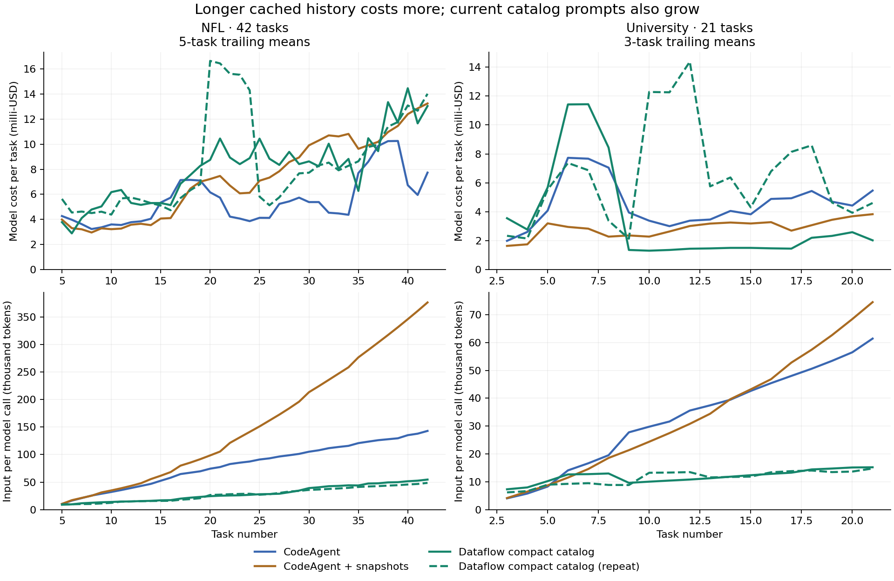
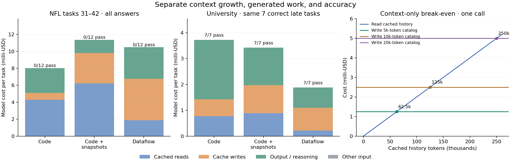

<!--
  Licensed to the Apache Software Foundation (ASF) under one
  or more contributor license agreements. See the NOTICE file
  distributed with this work for additional information
  regarding copyright ownership. The ASF licenses this file
  to you under the Apache License, Version 2.0 (the
  "License"); you may not use this file except in compliance
  with the License. You may obtain a copy of the License at
  http://www.apache.org/licenses/LICENSE-2.0
  Unless required by applicable law or agreed to in writing,
  software distributed under the License is distributed on an
  "AS IS" BASIS, WITHOUT WARRANTIES OR CONDITIONS OF ANY
  KIND, either express or implied. See the License for the
  specific language governing permissions and limitations
  under the License.
-->

**Long conversations: does a catalog reduce the cost of the next task?**
Analysis dated 2026-09-21, runtime revision `e410903c5`. No new model runs.

**Yes, this is a promising next hypothesis.** It changes the main measurement
from whole-session cost to the cost of each additional task at a given history
length and comparable accuracy. The traces contain a useful signal that the
session totals obscure. They do not yet demonstrate flat late-task cost with
preserved accuracy. In particular, the current compact-catalog arm still sends
every earlier question, answer and task receipt, so it does not implement the
bounded-context hypothesis.

I recommend making this context experiment the next milestone, ahead of another
maintenance-operation build. Keep construction cost and cumulative break-even as
secondary measurements. The hypothesis is that a growing store of useful
artifacts permits a small, relevant prompt and less regenerated code. A catalog
that simply grows beside the transcript does not guarantee that benefit.

Reproduction:

```bash
.venv/bin/python agent-service/benchmark/multiturn/analyze-long-horizon.py
```

The [analysis script](analyze-long-horizon.py) checks saved costs against token
accounting and session totals for 1,575 task records in 144 executions. Outputs:
[per-task CSV](long-horizon-analysis/per-task.csv),
[aggregates and source hashes](long-horizon-analysis/results.json), and two
figures. It uses the existing deterministic success labels: exact requested
dictionary keys and list order, numeric tolerance `1e-4`. Historical studies are
kept separate because settings and cost accounting differ.

**A real positive case appears after the initial analysis is built.** On the
21-task university session in `dev-run2`, the `maint` arm uses the compact
catalog and reuses `times_2016_cleaned` for subsequent calculations:

| Tasks | CodeAgent mean cost/task | Compact Dataflow mean cost/task | Strict passes, Code / Dataflow |
| --- | ---: | ---: | ---: |
| 1–7 | $0.00476 | $0.00664 | 3/7 / 2/7 |
| 8–14 | $0.00359 | $0.00141 | 6/7 / 6/7 |
| 15–21 | $0.00527 | $0.00202 | 4/7 / 2/7 |

The middle block is 61% cheaper at equal aggregate accuracy. It is not the
same six passing tasks. The last block is cheaper with worse accuracy, so it
does not satisfy the research objective. In the repeated Dataflow run the
middle block costs $0.00817/task and passes 0/7: the useful representation does
not prevent an incorrect trajectory. Early and late tasks also differ in
analytical difficulty; these stage means are descriptive, not causal effects
of position.

To examine the successful mechanism, take the seven later tasks that **all
three** `dev-run2` systems solve: 8, 10, 11, 13, 14, 18 and 20.

| Same seven correct tasks | Total model cost | Model calls | Input tokens | Output tokens | Generated code characters |
| --- | ---: | ---: | ---: | ---: | ---: |
| Ordinary CodeAgent | $0.02609 | 7 | 289,520 | 13,432 | 29,071 |
| CodeAgent + snapshots/index | $0.02399 | 8 | 340,933 | 8,506 | 15,087 |
| Compact Dataflow | $0.01318 | 8 | 101,086 | 4,569 | 10,234 |

Dataflow is 49% cheaper than ordinary CodeAgent and 45% cheaper than the
snapshot control in this diagnostic subset. This is selection on success,
not an end-to-end accuracy result. It establishes a mechanism worth testing.

At task 10, ordinary CodeAgent emits loading, parsing, score filling and
cleaning again before doing the regression. Dataflow accepts the cleaned table
as its UDF input and emits the new calculation. The snapshot CodeAgent also
reuses its cleaned variables, so this is not an expressive limitation of Python.
Dataflow still re-estimates some regressions later rather than retaining their
fitted models; the catalog is useful without being maximally reusable.

Of the $0.01290 saving against ordinary CodeAgent on these seven tasks, about
82% comes from output/reasoning tokens and 18% from input cost. Dataflow actually
spends more on cache writes ($0.00617 versus $0.00454), but spends less on reads
and much less on generated output. With the recorded prices, avoiding 1,000
output tokens saves as much as avoiding 60,000 cached input tokens. The benefit
to seek is both less history processing and less repeated program generation.

**Long cached histories are visibly expensive even with excellent hit rates.**
On NFL, ordinary CodeAgent's mean input per call rises from 17k tokens in tasks
1–10 to 131k in tasks 31–42. Its mean task cost rises from $0.00393 to $0.00803.
In the last block, cache reads alone cost $0.00430/task, 53.5% of total cost.
At task 42 its cache-hit rate is 98.6%. Cache efficiency is not sufficient to
make a growing prompt cheap.

The compact Dataflow arm grows from 12k to 50k mean input tokens per call in
those same blocks. That is a much smaller prompt, but its late total cost is
$0.01049/task: extra calls, writes and generated work erase the advantage.
All three systems in the cost-component figure fail all twelve late NFL tasks
under strict scoring. These cost curves diagnose growth; they cannot establish
an accuracy-preserving win.



Solid lines use `dev-run2`; the dashed line is the Dataflow `dev-run3` repeat.
Curves show trailing means, not confidence intervals. Input size is aggregate
provider input divided by usage-bearing calls, not a tokenizer reconstruction.
The two Dataflow input-size curves are close despite their different success
and total-cost trajectories. Representation growth is easier to observe here
than its end-to-end consequence.

**There is a simple context-only break-even calculation.** The campaign's
recorded prices are $0.02/M tokens for cache reads and $0.25/M for cache writes.
These are repository accounting assumptions, not current provider prices.
Comparing a fully cached history of `H` tokens to a fully rewritten catalog of
`K` tokens, with common instructions/query, calls and output held equal:

```text
cached history cost = 0.02 × H / 1,000,000
fresh catalog cost  = 0.25 × K / 1,000,000
fresh catalog is cheaper when H > 12.5 × K
```

| Fresh catalog | Equal-cost cached history | Cost per call at equality |
| ---: | ---: | ---: |
| 2,000 tokens | 25,000 tokens | $0.00050 |
| 5,000 tokens | 62,500 tokens | $0.00125 |
| 10,000 tokens | 125,000 tokens | $0.00250 |
| 20,000 tokens | 250,000 tokens | $0.00500 |

This deliberately gives history a full cache hit and the catalog no reuse.
If fresh input is charged at $0.20/M without the write premium, the ratio is
10 instead of 12.5. If unchanged catalog pieces also cache, the threshold can
be lower. Ordinary CodeAgent is already processing prompts large enough for
these thresholds to matter.

This is not a universal task-number crossover: prompt growth per task, catalog
growth, extra retrieval calls, output length and task difficulty differ.
Separate three measurements: context-only break-even, lower total cost of a
new task, and recovery of initial construction cost. A result about the first
does not automatically establish either of the others. In the observed late
NFL block, paid input per call is already approximately equal: $0.00305 for
CodeAgent versus $0.00301 for compact Dataflow. Calls per task are 1.67 versus
2.25, so per-task input and total cost still favor CodeAgent.



**The current growing history is the immediate implementation target.** I
tokenized the saved first-call message text with `o200k_base` for attribution.
These component counts are estimates, exclude message framing/tool schemas,
and do not replace provider token usage:

| Compact Dataflow, NFL | Old questions/answers/receipts | Catalog block | Provider input total |
| --- | ---: | ---: | ---: |
| Task 10 | 6,559 | 1,459 | 12,875 |
| Task 20 | 14,528 | 3,699 | 23,238 |
| Task 30 | 31,161 | 4,256 | 40,567 |
| Task 42 | 38,555 | 4,915 | 48,823 |

At task 42, old task text is roughly 79% of provider input and the catalog is
roughly 10%. About 89% of first-call prompt growth from task 10 to task 42 is
explained by old task text. In university, the catalog grows from about 1,858
tokens at task 7 to 2,500 at task 21, while old task text grows from 2,512 to
8,245. This is close to the setting where a compact catalog could stabilize
the working context, provided inherited requirements remain available.

[task-context.ts](../../src/agent/native/task-context.ts) explicitly replays
completed questions and answers, plus receipts. It then emits every live
operator, historical availability, and selected dependency definitions.
Making cards shorter alone cannot make this context bounded. A new answer
operator for every task also makes an unfiltered catalog grow with the session.

Do not simply delete that history: it carries units, precision, population
definitions and changing defaults. The candidate should keep the active
analysis specification and applicable constraints, show a bounded set of useful
artifact cards, and retrieve old task details on demand. Archive complete
history outside the prompt. Preserve exact historical references in the
runtime. Charge retrieval, compression and verification calls to the requesting
task. Start with the existing graph and catalog interface; no new state-command
family is necessary for this experiment.

**CodeAgent needs a credible memory control.** Ordinary persistent Python can
also get cheaper after initialization. In the older 20-task repeated-correction
trace, CodeAgent passes 20/20 and costs about $0.00061/task in the first five,
then $0.00046/task in the last five. That older accounting omits cache-write
premiums, so it is a qualitative counterexample rather than a pooled price
comparison. In the current eight-task controlled suite, both CodeAgent and
Dataflow become cheaper after the initial tasks, and CodeAgent stays cheaper.

The snapshot control additionally has avoidable prompt duplication:
[run-task-code.py](run-task-code.py) prepends its entire growing index on each
task while replaying all previous task prompts. At NFL task 42 the current
index is about 13,803 text tokens, but accumulated copies total about 302,764
tokens. Reported mean input for that task is 407,995 tokens. Comparing only
against this baseline would overstate the advantage of our memory policy.
Keep ordinary CodeAgent primary and add a CodeAgent control with one current
index and compact history.

A bounded prompt is therefore not exclusive to Dataflow. The research question
is whether executable artifacts, schema and provenance let our system retain
the necessary information more reliably, or retrieve it more cheaply, than
equally compact Python memory. Existing full-history versus catalog Dataflow
experiments support the representation idea: on WiDS the two-repetition average
cost rises from about $0.0240 to $0.1622/task across the first and last blocks
with full history, compared with $0.0122 to $0.0497 for catalog context. Both
grow; catalog growth is slower. Different revisions and older accounting make
that supporting evidence, not a current CodeAgent comparison.

**The right target is bounded cost after learning, at matched task difficulty.**
For a roughly fixed set of relevant artifacts and a fixed number of calls,
replaying a transcript that grows with `t` gives a history-processing cost per
task that grows with `t`. A bounded working catalog and active specification
can keep that component roughly constant. Initial construction may produce a
drop during warm-up; indefinite decreases are neither necessary nor realistic.
If relevant artifacts and current requirements themselves grow, flat cost
requires selection and retrieval rather than printing the whole catalog.

Cases that should expose the opportunity include repeated analyses over a
shared cleaned/joined table, returning to a mature analysis after other useful
work, and revising related reports while preserving several historical states.
Include sessions where useful artifact count grows, as well as sessions where
the reusable core stabilizes. Independent fresh-dataset questions remain a
negative control. More task count alone does not guarantee more useful state.

The next experiment should compare ordinary CodeAgent, CodeAgent with bounded
memory, current catalog Dataflow, and Dataflow with a bounded catalog plus active
specification. Preserve normal provider caching for every arm; stop tuning its
boundaries during this experiment. Use matched queries at history depths such
as 10, 25, 50 and 100 tasks, extending to 200 if the development result holds.
Prefixes should contain meaningful work and comparable initial state, not
artificial padding. Match probe difficulty, answer size and reuse opportunity;
vary history depth and dependency distance separately. Randomize independent
work where semantics permit and include historical/current composition probes.

Start cheaply with paired continuations from a few saved, correct states:
assemble full and bounded context for the same next task, then measure whether
the bounded variant can select the right artifact and preserve inherited
requirements. Count any summary construction or retrieval cost. This isolates
the context change before a long end-to-end campaign; it cannot establish that
the agent reliably builds those states itself. If it works, run the four-arm
session experiment above with failures and repair costs included.

The primary outcome is all-attempt marginal cost and strict/analytical accuracy
at each depth. Report the slope of cost versus history size, relevant prompt
tokens, calls, generated code/output, fraction of tasks consuming prior derived
artifacts, and retrieval/repair burden. Show success for all scheduled tasks,
including those inheriting failed foundations. Keep both-pass comparisons as
mechanism diagnostics. Report setup spending and cumulative break-even beside
the main result rather than discarding them.

Use repeated development sessions to estimate variation, then freeze the method
and sample size for confirmation. The current data do not locate a reliable
accuracy-preserving task-number crossover; they justify looking for one. If
bounded Python memory matches the gains, the result is about context management.
If Dataflow preserves the right state at smaller context or lower retrieval and
regeneration cost, that supports a contribution specific to its executable
catalog. This is now a sharper next test than another comparison of session
totals alone.
