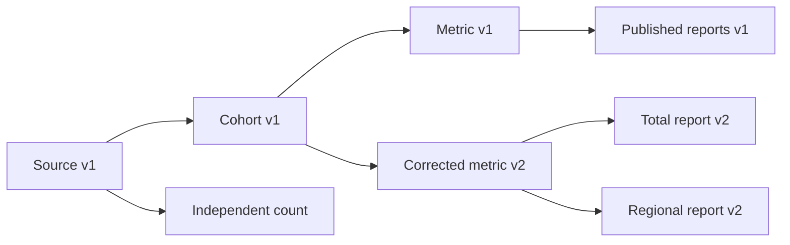

<!--
  Licensed to the Apache Software Foundation (ASF) under one
  or more contributor license agreements. See the NOTICE file
  distributed with this work for additional information
  regarding copyright ownership. The ASF licenses this file
  to you under the Apache License, Version 2.0 (the
  "License"); you may not use this file except in compliance
  with the License. You may obtain a copy of the License at

    http://www.apache.org/licenses/LICENSE-2.0

  Unless required by applicable law or agreed to in writing,
  software distributed under the License is distributed on an
  "AS IS" BASIS, WITHOUT WARRANTIES OR CONDITIONS OF ANY
  KIND, either express or implied. See the License for the
  specific language governing permissions and limitations
  under the License.
-->

# Multi-turn state milestone: implementation and smoke report

Date: 2026-09-15. Branch: `feat/multiturn-dataflow-research`.

## Outcome

The versioned-state mechanism works in real engine executions. **This MVP does
not beat ordinary Code Agent.** Across six paired sessions / 42 requests per
system, first-pass strict correctness was **39/42 for Dataflow versus 42/42 for
Code Agent**. Estimated model cost was **$0.08056126 versus $0.04127826**
(**1.95×** for Dataflow). These are diagnostic smoke results, not a representative
benchmark or an official LongDS score.

Two Dataflow failures had correct underlying numbers but invalid final answer
format. One used the wrong cohort after a valid graph revision. Those are separate
failure mechanisms; the graph did not make a semantic error impossible.

## What changed

1. Merged native Python work through `8ef6b6201` in merge `8ba6ef594`: the V2
   operator catalog (19 operators), batching, data profiles, flow evidence,
   result-version bindings, revision-specific diagnostics, and execution telemetry.
2. Removed the extra Python reusable-function arm and its prompt from the current
   Code Agent runner. The baseline is the existing persistent LongDS smolagents
   wrapper. It can define functions normally; it receives no extra function or
   artifact-registry instructions.
3. Added opt-in `nativeState: true`, with `dataflow.publish`, `dataflow.revise`,
   and `dataflow.state_catalog`. The existing native recipe option stays off in
   all new treatment runs. Details and API examples are in [README.md](README.md).
4. Added a fully isolated launcher profile, including a configurable engine
   cluster port. Isolation changes are committed as `f16e6b574`.
5. Added three five-turn mechanism fixtures and deterministic scoring, plus a
   real-engine state smoke. Kept the previous customer diagnostic as a regression
   family, with seeds 41/42/43 rather than counting them as distinct task families.
6. Encoded the embedded native Python runtime compactly, reducing the small-operator
   payload from about 79.8 KB to 26 KB. This reduces graph serialization overhead;
   it does not establish unbounded workflow persistence.

The other effort continued moving: at the final read its head was `791c53511`,
including newer repair guidance and bounded evidence ranking in `87f644e10`.
The measurement base above is pinned explicitly; these later changes are a
candidate for the next experiment, not part of these scores.

## How the state mechanism works

The model declares an analysis's named inputs and outputs once. The service stores
immutable operator definitions, their physical dependencies, and hashes of local
Scan inputs. On a revision it resolves a chosen historical/active version, applies
bindings or parameter changes, traverses the dependencies, shares unchanged nodes,
and creates changed downstream nodes. The normal batch scheduler executes them.
Only successful, complete results bound to the requested operator revisions can
advance the active reference. Failed attempts leave it unchanged.

In the acceptance fixture a single metric override created exactly three nodes:
metric, total, and regional report. The baseline and independent count kept their
result versions and values. Temporary revisions did not replace the active
analysis. A failed update did not publish. A membership binding compiled to
**project keys → distinct keys → join to new values**, avoiding duplicate
membership multiplication and old value columns leaking into the calculation.

This is the Dataflow contribution being tested: the runtime performs mechanical
maintenance from explicit dependencies. Code can implement equivalent machinery;
there is no claim of exclusive expressive power or automatic semantic correctness.

## Isolation and qualification

The stack has its own Docker project `texera-multiturn-mvp`, network, volumes,
metadata/result databases, and workflow-result directory in this worktree.

| Component | Research port |
| --- | ---: |
| Agent service | 3031 |
| Engine HTTP / cluster | 18085 / 12552 |
| Texera web | 18080 |
| Compiling / file / access-control / config | 19090 / 19092 / 19096 / 19094 |
| CU manager API / admin | 18888 / 18082 |
| PostgreSQL / MinIO / LakeFS / LiteLLM | 15432 / 19000 / 18000 / 14000 |

All 12 required backend/agent services passed health checks; the frontend is
skipped. The shared agent ports 3001/3007, engine 8085/2552, and web 8080 retained
their original PIDs in the isolation check. Python packages and provider credentials
are shared read-only; service processes and mutable stores are separate.

Validation:

- Bun: **1,143 passed**, 0 failed; TypeScript checking passed.
- Engine configurable-port regression: **1 passed**, including default, private
  override, and invalid values. `sbt dist` also completed for the isolated engine.
- Python structured-profile/transport tests: **23 passed**.
- Isolation profile tests: **3 passed**; benchmark scoring tests: **2 passed**.
- Live native profile smoke: DELTA/LATEST with collection on/off passed.
- Live native shape and evidence smokes passed, including cached observations,
  pinned history, failed edits and repair, and empty/dynamic schemas.
- Live state smoke passed version publication, correction across two reports,
  independent/baseline preservation, temporary isolation, failed promotion,
  duplicate-key membership with new values, cached reads, and source drift rejection.
  The final ten-request smoke also passed UDF input rebinding with preserved
  callable arguments and an explicit opaque-operator receipt.

Raw validation and stack identity are under `/tmp/texera-multiturn-mvp/`:
`bun-test-final.log`, `typecheck-final.log`, `port-test-final.log`,
`python-evidence-tests.log`, `native-*-smoke.log`, `state-smoke-complete/`,
`stack-status.txt`, `listening-ports.txt`, and `isolation.json`.

## Real Luna runs

Both systems used GPT-5.6 Luna through the private proxy, medium reasoning, 25 steps
per request, and a 2,000-character print/result budget. Both retain a single
session across turns. No evaluator answers, dependency labels, or prepared
solutions are supplied. Dataflow used V2, profile collection, data level 1,
flow level 1, chronological full history, and no recipe guidance.

Native rows and Code stdout are different interfaces. Code can execute
`final_answer(value)` in its Python action; Dataflow ordinarily requires another
model response to report an executed result. Costs count all model calls and
cache discounts. Rates are the repository's accounting assumptions per million
tokens: input $0.20, cached input $0.02, output $1.20. These are estimates, not
provider invoices. Execution infrastructure cost is not included.

Every requested field must match; numeric tolerance is 0.0001. The new fixtures
also require the specified JSON structure. Final format failures remain failures
in the primary score, with semantic diagnosis recorded separately.

| First-pass suite | Code correct | Dataflow correct | Code cost | Dataflow cost | Model calls: Code / DF |
| --- | ---: | ---: | ---: | ---: | ---: |
| Corrections across reports, 5 turns | 5/5 | 4/5 | $0.00343010 | $0.01504186 | 6 / 20 |
| Temporary scope, 5 turns | 5/5 | 5/5 | $0.00265464 | $0.00636874 | 7 / 13 |
| Membership versus values, 5 turns | 5/5 | 5/5 | $0.00375214 | $0.00759622 | 9 / 15 |
| Customer regression, 3 × 9 turns | 27/27 | 25/27 | $0.03144138 | $0.05155444 | 36 / 74 |
| **Total** | **42/42** | **39/42** | **$0.04127826** | **$0.08056126** | **58 / 122** |

These are six session attempts per system across four small diagnostic families.
Turns within a session are dependent. No confidence interval or general superiority
claim is justified by this pilot.

### What the traces show

- **Wrong boundary, customer seed 42 turn 8:** the membership join correctly
  produced 28 original customers with new values. Binding at the raw source then
  caused the downstream `orders >= 5` filter to reduce them to 20. The graph
  executed the selected composition faithfully, but the requested fixed-membership
  semantics were lost. Code constructed the original ID set, looked up new values,
  and did not filter eligibility again. Evidence:
  `state-primary-42/t08/{react_steps,workflow,operator_results}.json` and
  `code-primary-42/t08/react_steps.json`.
- **Correct correction, wrong return format:** in the new correction fixture,
  Dataflow rejected a revision with an uncast `returned` column, preserved the
  active reference, and eventually produced the correct total 740, regional
  totals 295/445, and units 56. Its final answer was prose instead of JSON.
  See `state-mechanism-fanout_correction/t03/`.
- **Answer copying:** customer seed 43 turn 9 returned a malformed numeric literal
  (`43. -?`) inside JSON despite correct computed results. See
  `state-primary-43/t09/`. This is not an invalidation or dependency failure.
- **Cost:** Dataflow made 122 model calls versus 58 and processed about 1.98 million
  input tokens versus 0.34 million. On the customer regression it generated fewer
  output tokens (11,918 versus 17,994) while still costing more. Shorter revision
  requests alone did not overcome the larger context and extra response calls.
- **Visible mechanical benefit:** a later correction in the new report fixture
  used no manually authored downstream operators. One override produced the new
  total and regional report. This proves the mechanism is exercised, not that it
  beats Code Agent on aggregate.

### Recovery protocol

Every failed primary session receives two additional full-session attempts with
fresh agents. Recovery outcomes and costs are reported separately below; primary
scores are never replaced with the best retry. Code had no failed primary sessions.
The compact runtime encoding is used for all recoveries and the new mechanism
primary runs; customer primary runs used the earlier uncompressed transport.
Decoded operator semantics and model-visible typed definitions are unchanged.

| Recovery session | First retry | Second retry | Combined retry cost |
| --- | ---: | ---: | ---: |
| Customer seed 42 | 9/9 | 9/9 | $0.02652062 |
| Customer seed 43 | 9/9 | 9/9 | $0.02698406 |
| Corrections across reports | 5/5 | 5/5 | $0.01477300 |

All 46 recovery requests passed. Their additional estimated cost was $0.06827768 across 114 model calls. Total measured model cost, including both primary arms and every recovery, was $0.19011720 across 130 scored requests. Recovery removes the first-pass errors in these attempts; it does not erase their original cost or establish a first-pass advantage.

## Limitations and recommended next milestone

This is in-memory session state. It does not archive source bytes, restore its
registry after restart, or support ordinary workflow checkout after publication.
It detects changed local Scan files rather than freezing them. Arbitrary Python
callbacks and UDFs can read external state or be nondeterministic; the declared
graph is not proof that all such dependencies are captured. Reused-node receipts
identify shared definitions, not certified backend cache hits.

Large forked graphs also hit an existing PostgreSQL/MeCab indexing limit during
workflow persistence. Runtime compression lowers the payload substantially, but
large regression graphs still generated persistence errors. Live execution and
in-session snapshots remained available; durable large-session support is not
qualified. Failed staged nodes also remain in the DAG and add context/storage
cost. This deserves repair before a larger campaign.

The next experiment should address the observed gaps in this order:

1. **Make fixed membership a checked input contract.** Let the model select a
   historical cohort, a value version, and a definition version. Bind at the
   declared cohort boundary; distinguish fixed membership from re-evaluated
   eligibility and validate the resulting dependency path. Support declaring or
   selecting an existing boundary when a new task introduces a new composition.
   A valid join alone is insufficient, as the 28 → 20 failure demonstrates.
2. **Return answers from result pointers.** Add a bounded, version-checked JSON
   return facility so the tool can finish with computed values directly. Compare
   this separately: it targets the two observed format failures and the extra
   model response, rather than proving a graph-maintenance advantage by itself.
3. **Select context through those dependencies.** Keep active references,
   governing instructions, and current failures available; retrieve selected
   definitions/results and their ancestors. Measure the catalog and retrieval
   overhead against full history and the ordinary Code Agent. Do not add an
   unconditional extra planning call.
4. **Clean up failed staged work and remove repeated runtime payloads from durable
   workflow storage.** Then extend the diagnostic with more maintained outputs,
   longer unrelated task intervals, and held-out LongDS sessions.

The decision gate is a matched comparison that reduces state-selection/repair
errors or total model cost. Batching, fewer generated operator definitions, and
successful runtime invariants are useful foundations, but the current measurements
do not establish that win.
