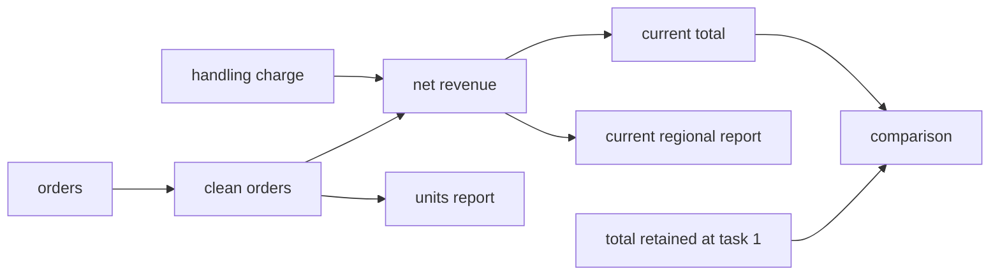

<!--
  Licensed to the Apache Software Foundation (ASF) under one
  or more contributor license agreements. See the NOTICE file
  distributed with this work for additional information
  regarding copyright ownership. The ASF licenses this file
  to you under the Apache License, Version 2.0 (the
  "License"); you may not use this file except in compliance
  with the License. You may obtain a copy of the License at

    http://www.apache.org/licenses/LICENSE-2.0

  Unless required by applicable law or agreed to in writing,
  software distributed under the License is distributed on an
  "AS IS" BASIS, WITHOUT WARRANTIES OR CONDITIONS OF ANY
  KIND, either express or implied. See the License for the
  specific language governing permissions and limitations
  under the License.
-->

# Can Dataflow improve multi-task analytical sessions?

Research review, 2026-09-18. Implementation inspected at `06398f299` on
`feat/task-history-dataflow`. This is an investigation and proposed experiment,
not a new implementation or a new paid-model campaign.

## 1. Recommendation

**Continue, with a narrower claim and a smaller method. The opportunity is
real; superiority over ordinary CodeAgent is not established.**

The strongest idea is to move **maintenance of an established analysis** from
the model into the runtime. After a user changes a source or assumption, the
model expresses that change. The graph determines which calculations become
invalid, which requested results need execution, and which historical results
must stay fixed. The same dependencies should limit the state shown to the model.

The research claim I recommend is:

> Can executable dependencies reduce the work and errors involved in updating
> and composing an existing analysis, at comparable memory and answer quality?

There are three reasons to pursue it:

1. **The mechanism already appears in real traces.** A one-operator source
   edit updates existing reports, while the paired CodeAgent regenerates the
   calculation. Our context overhead currently consumes the generation saving.
2. **Historical preservation has a repeatable signal.** The candidate handles
   old publications more reliably on the controlled membership cases. However,
   snapshots alone might explain this; a graph-specific benefit needs isolation.
3. **The benchmark opportunity is much larger than three examples.** LongDS
   contains many full sessions with revisions and historical composition.
   Our recent GitHub adaptation was an unusually weak test of those properties.

I would not pursue a large collection of special state commands, a mandatory
LLM call to select context, or more ancestry text on every operator. Keep named
operators, normal inputs, and optional `atTask` references. Implement a focused
context policy first; qualify demand-driven execution separately.

**Confidence:** high that dependency propagation is useful functionality;
moderate that it can support a convincing research section; currently low that
the present interface will beat CodeAgent in total model cost without a
substantial context reduction. A universal cost guarantee is not defensible.

## 2. What was investigated

I read the supplied [Claude conversation](/home/bob/Desktop/dataflow-agent/tmp_claude),
the research reports across the relevant worktrees, the current implementation,
the local inventory of all 68 LongDS sessions, representative public requests
and reference programs, and selected paired raw traces. Three parallel audits
covered recent traces, external benchmarks, and related research.

The two recent complete campaigns were reaggregated using the existing
[summarizer](summarize-state-milestone.py). Every one of the latest campaign's
567 per-task usage records reconciles with its session summary. Fixture hashes
match the original campaign after its documented whole-family tie clarification.
The [evidence ledger](RESEARCH_REVIEW_EVIDENCE.json) contains totals, per-family
results, paired comparisons, source hashes, and provenance qualifications.

This is **comprehensive across the relevant experiment families**, with a
bounded manual trace audit. It is not a claim to have manually read every step
of approximately 20,000 saved answer files. Those files include development
attempts, repeated sessions, and older incompatible configurations. They are
not independent benchmark examples.

### Evidence across the research lineages

| Evidence | What it establishes | Important limit |
| --- | --- | --- |
| Older LongDS context campaigns: catalog versus full Dataflow history | Smaller state representations can reduce cost and avoid context overflow | Many older references to “code mode” mean Python UDFs inside Dataflow, not ordinary smolagents CodeAgent |
| Native two-repeat study, five real sessions | Reported paired accuracy 138/284 versus 139/284; catalog cost $8.90 versus full history $24.18 | Different completion coverage; one catalog NFL run stopped at task 38. This is not a win over CodeAgent |
| Early chronological batching/recipe study | Native batching: 26/27 versus ordinary CodeAgent 27/27; recorded cost $0.02653 versus $0.03366 | Three numeric variants of one family; earlier accounting omitted cache-write premiums. Recipe reuse did not improve the result |
| State-registry MVP | Propagation, branch isolation and historical membership can work | Dataflow 39/42 versus CodeAgent 42/42; $0.08056 versus $0.04128; cumbersome state API |
| Task-history milestone | Simpler operator-plus-task references; direct return and input-coverage checks | Diagnostics 46/50 versus 49/50; still more expensive |
| Live cache study | Completed-history cache boundaries reduced real-session Dataflow cost by 19.7% with unchanged aggregate 38/45 correctness | CodeAgent achieved 43/45 and remained cheaper |
| State milestone and interface fixes | Best matched current comparison; examined below | Seven development families, not a held-out benchmark |
| Latest single-task evidence-compaction campaign | Useful evidence rendering and interface lessons | No CodeAgent arm; no matched full V2 no-evidence control. Cannot establish multi-task or causal compaction gains |

Sources: [native study](../../../../multi-turn-optimization/benchmark/longds/NATIVE_2REP_REPORT.md),
[early research](../../../../multiturn-dataflow-research/agent-service/benchmark/multiturn/REPORT.md),
[state MVP](../../../../multiturn-dataflow-research/agent-service/benchmark/multiturn/MVP_REPORT.md),
[task history](TASK_HISTORY_REPORT.md), [cache study](TASK_CACHE_LIVE_REPORT.md),
[state milestone](STATE_MILESTONE_REPORT.md), and
[evidence compaction](../../../../evidence-only-context/benchmark/Kramabench/judgment_runs/evidence_compaction_20260916/REPORT.md).

The historical guided smolagents run on five full LongDS sessions also matters:
its judged scores were GitHub 15/15, university 18/21, Acea 16/38, WiDS 31/40,
and NFL 6/42. It shows both that ordinary Python is competitive and that hard
session problems remain. Its custom prompt, Chat transport and judge protocol
differ from the current controlled comparison; do not pool its dollars or
accuracy with the new runs. Paths and totals are in the evidence ledger.

The evidence-compaction study's three matched V2 arms scored 76.19% data-only,
72.35% flow-only and 73.32% combined on KramaBench's partial-credit metric.
These are one-pass measurements, not proof that additional flow evidence
helps accuracy. A mechanically shorter observation is also not automatically
a cheaper trajectory.

## 3. What the strongest current results say

Both complete campaigns contain seven families, three arms and three fresh
trials: 63 sessions and 567 answer instances each. Each arm has 189 answers.
The same 63 distinct requests are repeated. These are **not 1,134 independent
questions**. The `tasks` arm already includes task retention, `atTask`, batching
and direct return. `reuse` additionally supplies ancestry facts, row counts
and reuse/parameter guidance.

| Campaign | System | Correct tasks | Entire sessions correct | Recorded model cost |
| --- | --- | ---: | ---: | ---: |
| Original state milestone | CodeAgent | 181/189 | 16/21 | $0.18474 |
| Original state milestone | Dataflow | 176/189 | 15/21 | $0.27125+ |
| Original state milestone | Dataflow + reuse guidance | 175/189 | 17/21 | $0.32605+ |
| Interface fixes | CodeAgent | **183/189** | **17/21** | **$0.17117** |
| Interface fixes | Dataflow | 179/189 | 14/21 | $0.24412 |
| Interface fixes | Dataflow + reuse guidance | 177/189 | 14/21 | $0.26827+ |

`+` denotes missing usage after a failed request, so the recorded cost is a
lower bound under the accounting model. Estimates use the campaign rates:
$0.20/M ordinary input, $0.02/M cache reads, $0.25/M cache writes, $1.20/M output.
They are not invoices and exclude engine/storage costs. Reasoning is already
included in output tokens.

The interface fixes are useful: candidate calls fell 296 → 259 and recorded
cost fell 17.7%. They removed parameter-name restrictions on positional UDFs,
duplicate error messages and some return-column repairs, and clarified final
rounding. Several changes were bundled; their individual effects are not
causally isolated. The unchanged CodeAgent moved by two correct tasks and
7.3% cost between campaigns. That is observed variation, not an estimated
statistical “noise floor.”

### The candidate still loses on both headline axes

- Latest cost premium: **56.7%** over CodeAgent.
- Of 189 paired task instances: 171 both pass, 12 only CodeAgent passes,
  six only the candidate passes.
- Among the 171 both-pass pairs, CodeAgent is cheaper in 151. Their combined
  costs are $0.15524 for CodeAgent and $0.23746 for the candidate: **53% more**.
- The candidate costs more in every family aggregate. The cost loss is not
  explained by timeouts or by comparing successful runs with failed ones.

### Preservation is the encouraging result, with qualifications

| Requested state checks | Original CodeAgent | Original candidate | Latest CodeAgent | Latest candidate |
| --- | ---: | ---: | ---: | ---: |
| Preserve original/unrelated outputs | 85/93 | **93/93** | 85/93 | **91/93** |
| Update requested outputs | 81/81 | 81/81 | **81/81** | 79/81 |
| Select requested population | 69/69 | 69/69 | **69/69** | 67/69 |

These count requested root fields, not rows or independent trials. The
preservation difference is concentrated in repeated membership/publication
cases. The latest candidate also loses update and selection checks after
failed earlier tasks. The original result does not justify “the analysis is
already always right.”

## 4. Trace evidence: both successes and counterexamples

### A. Historical output prevents an incorrect recalculation

In latest `code-membership_values/t05`, CodeAgent recomputes the original
publication with the current `risk >= 5` rule and reports **4 / 1400**. The
requested original publication was **3 / 800**. Candidate
`reuse-membership_values/t05`, step 1, reads `task1_result atTask:1` and gets
the original values correctly.

However, original `recovery1-code-membership_values/t01`, action step 2,
saves `initial_patient_membership` and copies the old records into
`original_publication`. Its task 5 succeeds in one call for $0.0004998.
CodeAgent is capable of the same preservation; automatic retention makes it
less dependent on anticipating every future need.

**Interpretation:** promising benefit from retained analytical state;
insufficient evidence that dependency structure caused it.

### B. One edit updates an established analysis

Latest `reuse-repair_descendants/t07`, step 1, changes only the `orders_raw`
scan to the corrected export and returns existing `task6_report`. Existing
deduplication, net-revenue and regional calculations produce total **842**,
units **60**, East **450**, West **392**.

The paired CodeAgent regenerates loading, latest-record selection, revenue
calculation and aggregation. Both succeed in one model call:

| | Dataflow | CodeAgent |
| --- | ---: | ---: |
| Output tokens, including reasoning | **229** | 338 |
| Recorded model cost | $0.00083465 | **$0.00069918** |

**Interpretation:** the graph removes generated program work. The larger
prompt currently outweighs it. This is the strongest concrete starting point
for the optimization claim. We have not yet measured which physical operators
or rows the engine avoided executing.

### C. Correct retention does not guarantee correct selection

Original `recovery2-tasks-membership_values/t05`, step 1, chooses
`default_cohort_risk5_summary atTask:2` when the user wanted task 1. The engine
faithfully returns the wrong historical choice. Another run,
`tasks-membership_values/t05`, selects the correct task-1 aggregate but counts
its one row, producing baseline count **1** rather than **3**.

**Interpretation:** the model must still choose the right state and operation.
A valid reference guarantees identity, not scientific meaning.

### D. A graph can preserve an incorrect active default

Latest `recovery1-reuse-temporary_scope/t02` ends with no recorded usage and
does not apply the tariff update. Task 5 reports **288** instead of **432**.
After another failed update, task 8 still reports **288** instead of **576**.
Old publications are preserved, while current state is wrong.

A different run, `recovery2-reuse-temporary_scope/t03`, contains **12 model
calls and 12 tool calls** repeatedly placing JSON delimiters inside Python
callbacks. It ends with a timeout on step 13. Classifying that entire failure
as an infrastructure hang would hide a real generation/repair problem.

### E. More evidence cannot repair every wrong foundation

In the older native university trace, task 5 uses
`female_to_male_ratio_numeric > 5`, empties the table, and later tasks reuse
that empty result. The raw trace confirms the predicate and final zero count.
The public wording and numeric representation need careful interpretation;
the graph cannot establish that intended interpretation. An empty-result
observation can prompt scrutiny, but emptiness is not itself proof of a bug.

This is why “correct upstream graph” and “correct analytical assumptions” must
be evaluated separately. Dependency propagation efficiently carries either.

Raw paths are listed in §12. These examples were chosen to include a
preservation win, a compact-update win, successful CodeAgent preservation,
wrong Dataflow selection, a failed-update cascade and an earlier semantic error.

## 5. Corrections to the Claude proposals

Several suggestions are worthwhile, but their claimed exclusivity and some
diagnoses are too strong.

| Proposal or claim | Assessment |
| --- | --- |
| CodeAgent only has strings, so cannot validate final results | Incorrect. Its Python environment contains DataFrames and objects; a wrapper can validate objects or parsed JSON |
| Flat typed returns make sorting/top-k/field errors impossible | They make checking easier. The model can still choose the wrong columns, sort, limit or population |
| JSON inside a UDF means the computation is no longer a dataflow | Too strong. The UDF still has graph inputs and invalidation. Its nested output is opaque to table-level validation |
| Turn on current `enableAnswerGrounding` | It will not address these direct-return failures as implemented; see below |
| Zero recorded calls means a timeout occurred before the model | Unsupported. The runner counts usage-bearing completed steps. Failed provider requests can lack usage |
| No operator edits means a task failed | Insufficient. A successful read-only task may edit nothing; an incorrect edit may change much |
| A parameter operator prevents copied literals | It simplifies the intended representation. Arbitrary Python can still contain duplicated constants |
| Provenance receipts are useful | Yes, when derived from execution, but they document the selected computation rather than prove user intent |

The current grounding check requires a literal `Final Answer:` marker, which
native direct-return JSON lacks. It looks for at least two substantive numbers
and only nudges when **none** appear anywhere in visible results or recalled
text. Numeric strings, including the answer blob itself, enter that corpus.
It does not check field names, top-k, order, population or historical identity.
Turning it on without changing the contract is not the proposed accuracy fix.
See [answer-grounding.ts](../../src/agent/answer-grounding.ts) and the call site
in [texera-agent.ts](../../src/agent/texera-agent.ts).

Across the two candidate campaigns, 314/378 answers (83.1%) use JSON-string
cells; 286 of these are UDF-produced. Forty answers use typed row/records
returns, and 24 finish as model text. Among 26 failed answers, 17 are JSON-UDF
returns, five are typed returns, and four end with timeout text. Therefore
changing the return representation alone cannot remove all observed errors.

The “20 presentation defects” classification includes omitted required fields
and nine returned rows instead of five. Those are genuine answer-contract
failures, even when the underlying quantities are correct. Preserve strict
scores and report analytical-content diagnosis separately. The existing
`content_passed` metric only relaxes extra fields; it is not a comprehensive
semantic score.

One factual correction: GitHub task 15 does **not** fail in every run. In the
latest campaign it passes all three CodeAgent runs, all three `tasks` runs,
and one of three candidate runs.

## 6. The current context, and the actual cost bottleneck

The task-context layout is:

```text
fixed instructions + tool schema
completed task 1: request, answer
completed task 2: request, answer
...
current catalog: every live operator
saved task ranges
full definitions of operators selected during this task and their ancestors
current request
current-task actions and observations
```

There is no separate mandatory context-selection call. At the first model
call of a task, selection is empty. Normal edits and observations subsequently
select operators. The renderer follows their ancestors, stopping at retained
historical sources. Its full-definition selection is **within-task**, while
the global catalog is still supplied on every call.

Each card clips the operator definition to 280 characters; it does not always
include the complete Python body. Schema, status, optional row count and up to
250 characters of ancestry add more text. Once selected, full ancestor
definitions can add substantial further context. These are exact properties
of [task-context.ts](../../src/agent/native/task-context.ts) and
[task-reuse.ts](../../src/agent/native/task-reuse.ts).

Actual first-call message content in latest `reuse-temporary_scope`:

| Task | Completed-history characters | Catalog characters | Current-request characters | Provider input tokens |
| --- | ---: | ---: | ---: | ---: |
| 1 | 0 | 153 | 415 | 4,632 |
| 4 | 815 | 3,331 | 202 | 5,793 |
| 8 | 1,591 | 5,786 | 246 | 6,757 |

The message dump omits the system/tool-schema contribution. “568 characters
on task 1” is not the total provider prompt. At task 8 the graph message is
76% of the displayed message content. Mean candidate graph-message size across
the latest 259 calls is about 4,931 characters, with a maximum of 15,556.

### Why stabilizing cards did not solve caching

The catalog follows completed-task history. Each new completed task inserts
messages **before** the catalog. Even unchanged catalog bytes therefore follow
a different prefix. Within a task, graph changes can also replace the block
before the actions. Moving saved-task ranges out of individual cards helps
representation, but does not by itself make those prefixes reusable.

| Latest recorded usage | CodeAgent | Candidate |
| --- | ---: | ---: |
| Usage-bearing model calls | 230 | 259 |
| Output tokens | 87,443 | **85,985** |
| Cache-write input tokens | **173,729** | 560,358 |
| Cached input tokens | **1,133,580** | 1,242,220 |
| Cache-write cost | $0.04343 | $0.14009 |
| Output cost | $0.10493 | $0.10318 |

Extra writes account for **99.5% of the recorded $0.09710 gap**. This is a
cost decomposition, not proof that every extra write came from catalog text.
Additional calls and their changing messages contribute too.

Removing cache-write tokens from the prompt while holding other priced token
classes fixed, matching CodeAgent would require removing about **388,391
cache-write tokens**, 69.3% of the candidate's writes.
Converting writes into reads instead would require about 422,164 tokens,
75.3%. These are accounting sensitivities, not predicted savings. A small
formatting tweak is unlikely to be enough.

## 7. The fundamental technique: dependency-driven maintenance

### One example, with no additional state vocabulary

Suppose task 1 builds the following analysis and publishes the total:



Later the user says: “Change the handling charge from 2 to 3. Update the
regional and total reports, and compare the total with the original publication.”

The model changes the existing charge input and asks for the existing reports.
The comparison consumes current `total` and `{operator:"total", atTask:1}`.
The runtime updates net revenue and its live consumers. Units are unaffected;
the original total remains fixed. The model does not need to rewrite every
formula or enumerate every downstream invalidation.

If the user asks only for the total, the regional report can remain invalid
until it is requested. It must never be served as current while invalid.
If the user asks to refresh all reports, all those outputs are demanded and
must be refreshed. Lazy execution does not change the meaning of the request.

### Algorithm

Let `M` contain changed definitions or inputs, and `Q` contain demanded outputs.
Use the graph to invalidate live descendants, then traverse backward from the
requested outputs, stopping at valid materializations:

```text
invalidate M and its live descendants

ensure(output):
    if output is a fixed task input: return its retained table
    if output has a valid complete materialization: return it
    inputs = [ensure(parent) for parent in output.inputs]
    execute output using inputs
    store its result and exact input/definition identities

for output in Q: ensure(output)
```

Mark affected results invalid even if they are not requested; account for old
and new edges when rewiring. Newly created nodes and missing materializations
need execution only when this traversal reaches them. Evicting an upstream
cache entry does not by itself invalidate an already valid downstream result.
Retain explicit failures for requested paths. Validity must include the actual
source identity, operator definition and input identities, not only the output's
shape or filename.

Lazy execution also affects history. Keep the existing meaning of `atTask`:
an actually retained complete output. If a changed report was never demanded
or materialized during a task, that task's output is unavailable; never relabel
its old cache entry as a new historical output. The index must show accurate
availability. Test two consecutive updates followed by a request for an
undemanded report from the intermediate task. Exact lazy reconstruction of
historical computations would require retained definitions and source inputs;
that is additional work, not something this first mechanism promises. Evaluate
whether reduced historical availability harms later tasks, and account for
any additional retention needed to preserve the benchmark's requested artifacts.

For pure, fully declared computations, the correctness condition is simple:
the demanded results must equal a clean recomputation under the same inputs
and definitions. That is a testable systems property. It says nothing about
whether the model chose the user's intended formula.

**Current gap:** the native post-step path explicitly targets every edited
operator and all its live descendants. `observe` controls exposure, not this
execution set. Historical references already stop live propagation, but demand
pruning is not implemented by the current task-context feature. Inspect
`executePostStepChanges` in [texera-agent.ts](../../src/agent/texera-agent.ts).
The backend may reuse cached work; exact physical savings still need measurement.

Call this dependency-aware re-execution. Do not call it tuple-level incremental
computation: a whole-table aggregate rerun is not an incremental row update.

### Use the same graph to reduce context

The engine needs the full dependency graph. The model usually does not need
every ancestor's full source code to use a valid table.

Proposed task context:

```text
unchanged instructions and completed task records
small table index: name, inputs, schema, available task references
current request
selected input tables and relevant population/definition facts
changes or failures on the selected dependency path
current observations
```

For the charge update, a runtime receipt could say:

```text
Changed: handling_charge = 3
Updated: current_total, current_regional_report
Preserved: units_report; total atTask 1
Requested result: current total versus task-1 total
```

These are computed execution facts, not model-authored declarations. Full code
and samples remain available through normal observation. Record accepted changes
and completed-task receipts immutably; avoid reconstructing all full definitions
before every active exchange. A compact current index may still grow with the
number of tables. Cached history still costs tokens. Do not promise constant
context size or free retrieval.

Selection remains a real tradeoff: before the model chooses inputs, reachability
cannot determine which analysis the user meant. The first-call index must be
sufficient to discover relevant tables; removing useful definitions can cause
extra observation calls. Compare total calls and cost, not just prompt length.
Preserve governing instructions such as units and precision outside any slice
that could accidentally discard them.

### Historical values and historical definitions are different

| User request | Required operation |
| --- | --- |
| Repeat the original publication | Read the old summary with `atTask` |
| Measure the original cohort using today's values | Project/distinct old membership keys, join them to current measurements, then calculate |
| Apply the original selection rule to today's data | Reuse the old predicate/parameter on current data; an old output table is insufficient |

The third case is a current limitation of treating `atTask` as the only reuse
mechanism. Historical definitions are stored, but referencing old **data** does
not automatically instantiate old **computation** with new inputs. Initially
expose the needed recorded definition and let normal edits express the new
branch. Do not revive a complicated publish/revise/checkout system before a
trace shows that explicit rebuilding is the remaining bottleneck.

### Native operators and UDFs

- Use native operators where their contracts are useful: source identity,
  projection, distinct membership, joins with cardinality checks, grouping,
  sorting and limiting. Batch known chains.
- Use UDFs for substantial statistical or domain computations. Give them
  explicit table inputs so dependency tracking works at the boundary. An
  opaque UDF can be reused and invalidated without understanding its internals.
- Put boundaries around independently reusable or changeable stages, rather
  than making every arithmetic expression a new node. One enormous UDF loses
  fine-grained reuse; excessive tiny nodes increase planning and context costs.
- A shared changing assumption can remain an ordinary one-row table. A generic
  literal-table operator could remove boilerplate later; a new `param` concept
  is not necessary for the research claim.
- Prefer existing `row`/`records` returns when they fit the requested answer.
  Nested JSON and prose remain legitimate. Output validation is a separate,
  general agent improvement and should be available equally to the code control.

Undeclared file reads, mutable globals, randomness and library changes weaken
freshness guarantees. Initially test declared deterministic inputs in a pinned
environment. Treat opaque external dependencies conservatively; do not infer
semantic guarantees from a UDF's presence in the graph.

### A small correctness improvement worth adding

Record whether a requested task completed successfully and which changes were
accepted. If an update fails, retain that fact in subsequent task history and
on affected demand paths. Do not present the prior default as if the requested
update had succeeded. “No edits” alone cannot detect failure or infer intended
state. This needs ordinary success/failure receipts, not a global list of
operators that “need attention.” It is useful reliability engineering, not
exclusive to Dataflow.

## 8. Why Dataflow, if Python can also do this?

Python can save values, validate JSON, define functions and build a dependency
system. There is no expressive-power separation. The practical distinction is
**who maintains dependency consequences**:

- Ordinary CodeAgent usually has to remember which derived objects depend on
  a changed variable, rerun the appropriate computation, and preserve the right
  earlier copies.
- An executable graph provides that machinery as a runtime operation once
  inputs and computations are declared.
- A Python agent with a reactive notebook or DAG runtime can obtain the same
  property. A paper should acknowledge that and identify the abstraction being
  measured, rather than claim that Python cannot do it.

Nor does a dependency edge establish real-world causation. It states that one
calculation consumes another's output. “Causal dependency” should mean
computational dependence here, not a causal inference about the data.

The systems foundations are established: [Adapton](https://mhicks.me/papers/hammer13adapton.html)
studies demanded incremental recomputation;
[Dataflow Notebooks](https://www.usenix.org/conference/tapp17/workshop-program/presentation/koop)
provides explicit notebook dependencies;
[nbsafety](https://mail.vldb.org/pvldb/vol14/p1093-macke.pdf) and
[ipyflow](https://ipyflow.readthedocs.io/en/latest/index.html) track Python
lineage/staleness; [Kishu](https://arxiv.org/html/2406.13856v2) separates notebook
state preservation from adopting a native operator interface.

Agent research also narrows the novelty. [ContextWeaver](https://arxiv.org/html/2604.23069v1)
already selects context through an inferred dependency graph of interaction
history. Our potential distinction is using the **actual executable data
dependencies** for context, validity and updates, without a second LLM-built
memory graph. [MAGE](https://www.microsoft.com/en-us/research/publication/beyond-semantic-organization-memory-as-execution-state-management-for-long-horizon-agents/)
and [Tree-Notebook](https://aclanthology.org/2026.findings-acl.783/) also make
structured execution state and provenance relevant prior work.

[DataFlow-Harness](https://arxiv.org/html/2607.16617v1) is a particularly close
adjacent system. It reports 93.3% success and $0.261 mean cost versus ordinary
Claude Code's 91.7%/$0.950 on 12 pipeline-construction tasks, with ten trials.
Its codebase-aware control scores 94.2%/$0.456. That supports the possibility
of useful structured tools, not a multi-task state result: historical
composition and long-session repair are not directly evaluated. Its
[repository](https://github.com/OpenDCAI/DataFlow-WebUI#what-dataflow-harness-is)
says the benchmark tasks/configuration/raw results are not included. It is
related work, not a reproducible replacement for our benchmark.

The prospective contribution is therefore **a measured reduction in analytical
state-maintenance work using an executable graph**, with a clear account of
which benefit comes from retention, propagation, context selection or execution.

## 9. Benchmark choice: expand the right part of LongDS

The local inventory still contains 68 sessions and 2,225 requests. Recounting
metadata gives 574 Update, 394 Rollback and 447 Counterfactual annotations;
labels overlap. Sixty-six sessions contain an Update, and 56 each contain
Rollback and Counterfactual. These are candidate workloads, not certified
correct dependency graphs.

By contrast, the GitHub session has 15 requests, 12 Initial labels and no
Update/Rollback/Counterfactual labels. It tests cumulative analysis and final
reporting, but scarcely tests maintaining a changing analytical default.

The [LongDS paper](https://arxiv.org/html/2605.30434v3) explicitly studies
evolving scopes, assumptions, historical states and compositions. Its analysis
separates context, state-management and cascade errors. That is a good match
for our question; its findings do not themselves establish a graph advantage.
Official evaluation judges analytical meaning and numbers rather than requiring
our added JSON contract. Keep that distinction visible.

### New external starting point: v1.1 Lite

The [official release documentation](https://github.com/zjunlp/DataMind/blob/a814927159470ad1624602d233f57b7c0be5882e/longds/README.md)
now recommends 24 complete sessions / 777 requests across six domains.
The authors describe audited scope, tie-breaking and inherited-state wording;
raw datasets are shared with earlier releases. Full sessions are retained.
Do not assume this fixes our particular gold failures until reference execution
and diffs establish it. Do not combine v1 and v1.1 scores.

Our web audit counted the 24 pinned released metadata files:

| Annotation | Requests | Sessions containing it |
| --- | ---: | ---: |
| Update | 198 | 23/24 |
| Rollback | 138 | 20/24 |
| Counterfactual | 123 | 17/24 |
| Two or more state labels | 192 | 22/24 |

These are calculated from the [Lite index and corresponding metadata](https://huggingface.co/datasets/zjunlp/LongDS/blob/a640b309884ff036fe6fa15fe7b330a5692f2932/task/longds_v1.1/task_list_lite.json),
not from the old local inventory. The inspected dataset revision is
`a640b309884ff036fe6fa15fe7b330a5692f2932`, runner revision
`a814927159470ad1624602d233f57b7c0be5882e`.

Netflix's sessions combine an older title-matching rule with newer scores;
survey tasks combine changing thresholds and category definitions; NFL ends
by comparing several saved leader sets to the final consensus. These are
substantial analytical compositions, not repeated “remember this number” tests.
The local Netflix task 14 also explicitly requires the entire candidate pool,
not just the displayed top five—an important reusable-table boundary.

### Alternatives

| Benchmark | Role in our investigation |
| --- | --- |
| LongDS v1.1 Lite | Best primary external evaluation for state evolution and long dependencies |
| [DSAEval](https://arxiv.org/html/2601.13591v3) | Secondary breadth check: shared-kernel analysis, but public groups contain only 1–5 requests |
| [IDA-Bench](https://github.com/lhydave/IDA-Bench) | Useful interactive analysis; weaker direct isolation of retained-state repair |
| [Tapilot-Crossing](https://arxiv.org/abs/2403.05307) | Useful local correction cases; supplied clean history does not test self-generated cascades well |
| [BIRD-INTERACT](https://github.com/bird-bench/BIRD-Interact), [Spider2](https://spider2-sql.github.io/) | Interesting database/repository workloads, but substantial scope change from analytical sessions |
| [DA-Code](https://github.com/yiyihum/da-code), [DSBench](https://github.com/LiqiangJing/DSBench), [DABstep](https://huggingface.co/datasets/adyen/DABstep) | General analytical capability controls, not substitutes for historical-state experiments |

The DSAEval release has 641 requests grouped over 285 datasets. Our file audit
finds 103/74/60/30/18 datasets with 1/2/3/4/5 requests respectively. Its broader
reasoning/code/result judge score is not equivalent to final-answer accuracy.
Use complete tabular groups later, with result checks and a documented adapter;
the released flat data and grouped runner inputs also need alignment.
Sources: [dataset](https://github.com/AMA-CMFAI/DSAEval/blob/160f3d577e8a1b6a7e4b6ae8c5db168ba9d188f1/dsaeval.json),
[runner](https://github.com/AMA-CMFAI/DSAEval/blob/160f3d577e8a1b6a7e4b6ae8c5db168ba9d188f1/runner.py).

**Recommendation:** do not invent an entirely new benchmark to obtain a win.
Use existing complete sessions for external validity and a small explicitly
controlled extension to measure scaling and identify the mechanism.

## 10. Concrete next plan, with decision gates

### Milestone A — qualify the comparison and remove known confounds

1. Freeze code, gateway settings, fixtures, environments and writable workspaces.
   Give every session private output paths. Record a dirty-tree patch/hash if
   a campaign does not run from a clean commit.
2. Align Python/numerical libraries. Existing reference checks reproduce
   university 21/21, NFL 42/42 and policing 36/36 in both environments. Water
   reproduces 36/36 in the engine but 26/36 in the code environment. Netflix
   and survey have outstanding reference discrepancies. Audit v1.1 instead of
   silently modifying published answers.
3. Add request-stage timestamps around model dispatch/response, tool execution
   and task retention. Reproduce the temporary-scope failures in a bounded
   smoke. Distinguish failed model requests, schema-repair loops and engine
   stalls. Do not infer the root cause from absent usage.
4. Keep the shipped interface fixes. For flat output contracts, measure a
   minimal common serializer/validator or equally scoped prompting. Do not
   bundle an output-format improvement into the graph experiment.

**Exit condition:** clean reference answers for selected sessions, observable
failure stages, identical comparison budgets, and no shared writable artifacts.

### Milestone B — implement one graph-based context ablation

Start on the current branch's small interface. Change only context assembly:
retain immutable task/change receipts, compact the all-operator index, and show
full definitions only when the selected dependency boundary requires them.
Keep graph execution, history retention and answer behavior fixed.

First replay saved traces offline to verify that references, governing user
instructions, errors and requested values remain discoverable. Measure message
bytes and prefix stability, labeling them as representation results. Then run
the frozen seven-family suite, all three trials, against ordinary CodeAgent
and the current Dataflow control: **63 complete sessions / 567 answers**.

**Exit condition:** a large measured reduction in cache writes without extra
lookup/repair calls erasing it, and no regression in update/preservation checks.
A 20% saving against current Dataflow alone still would not beat CodeAgent.
Use the actual paired cost and correctness comparison to decide promotion.

### Milestone C — isolate propagation and execution benefits

Add demand-driven materialization behind one experimental setting. Reuse
existing normal input references and `observe`/`return` demand declarations.
An observation of an invalid result must cause the required execution rather
than read an old cache entry. Test this state transition directly.

Use three existing dependency structures: shared correction, repaired source
and temporary branch. Construct controlled workloads with one knob varied at a
time: 1/4/16 affected reports, 0/8/32 unrelated branches, or 2/8/24 intervening
requests. Avoid a full cross-product. For example, two structures × three
fan-out settings × three repeats × three main arms is **54 sessions**; add
controls only after the mechanism appears. Publish them as synthetic stress
instances, not 54 independent task families.

Ask both systems to maintain the same requested report artifacts. Do not force
CodeAgent to use our operators or prevent natural function/dataframe reuse.
Do not assume its effort must grow linearly with report count: it may reuse
code or write one loop. The measured curve must establish any difference.
Measure source reads, actual executed work, CPU time, cache hits and storage,
alongside model costs. A graph receipt saying “reused” is not sufficient evidence
that backend computation was avoided.

**Exit condition:** a curve showing that work depends on the changed, demanded
subgraph, while freshness and preserved outputs remain correct. Compare lazy
and eager Dataflow separately from the external CodeAgent comparison.

### Milestone D — evaluate complete real sessions

Audit exposure to all older experiments before designating holdouts. A new
task on an already tuned dataset is not a strong independent holdout.
Use up to six development sessions selected by domain/state pattern, then freeze
the method and evaluate the untouched eligible remainder of v1.1 Lite. If
18 sessions remain eligible, three arms × three fresh trials gives 162
complete sessions. Run this only after the development gate; report the
selected split rather than calling it a full Lite score. A full 24-session
score requires all 24, with development exposure disclosed.

Use Luna initially to preserve continuity with current measurements. If there
is a clear mechanism, repeat a prespecified representative subset with Terra
to test whether the result depends on model capability. Different models' raw
costs must not be conflated. No model can be promised to yield a win.

### Minimum controls needed for a credible claim

| Comparison | What it isolates |
| --- | --- |
| Ordinary persistent CodeAgent vs candidate | Practical competitiveness |
| CodeAgent with comparable automatic artifact retention vs candidate | Whether saved memory alone explains the historical advantage; no special reusable-function prompt |
| Same Dataflow, catalog vs dependency-local context | Graph-based context policy |
| Same Dataflow, eager vs demanded execution | Physical execution savings |

The retention control should expose the same kind of task-addressable tables
and charge its serialization/storage overhead; it should not supply gold
dependencies or a prewritten analytical function library. Define and validate
that equivalence on a few cases before treating it as a fair ablation.

An optional manual-refresh ablation can isolate propagation further, but it
must retain explicit recomputation capability and accurate freshness feedback.
Simply disabling invalidation and returning stale caches would manufacture
failures. The four comparisons above are sufficient for the first milestone.

Run these targeted ablations on the development subset, rather than multiplying
every variant across every real session.

## 11. Metrics and the prospective paper section

Keep three headline outcomes: **analytical accuracy, total model cost, and
execution work**. Preserve strict answer-contract success as a separate
reported result. Do not use an invented weighted score to conceal a loss.

| Metric | Definition and purpose |
| --- | --- |
| Session-macro analytical accuracy | Average request correctness within each session, then across sessions; primary external outcome |
| Strict contract success | Requested fields, precision, ordering and cardinality; retain our current scores |
| Update/preservation correctness | Observable requested outputs match the correct current/historical reference, regardless of internal representation |
| Entire-session success | Reliability when one failure can affect later answers |
| Model effort | Calls, generated code/edit tokens, input/cache-read/cache-write/output tokens and all-attempt model dollars |
| Execution work | Source bytes read, executed operators/UDFs, CPU and wall time, reused materializations, storage/retention cost |
| Repair burden | Calls, work and money after a supplied correction until demanded outputs are correct; unresolved cases remain failures |
| Amortization | Cumulative session cost including graph construction; report where, if anywhere, a break-even point appears |

Count failures and timeouts in end-to-end outcomes, and report missing usage as
unknown. Report evaluator/judge spending separately. Predefine numerical
tolerances and entity/order rules before runs. Where a semantic judge is used
for upstream compatibility, keep its score separate and audit disagreements;
do not use it to invent reasons for a cost difference.

Executed-operator counts compare Dataflow policies internally. Across systems,
compare CPU time, bytes read and requested output completion: one Python action
can contain many transformations, so tool/operator counts are not equivalent
units of computational work.

Use dataset/session clusters for uncertainty. Field checks, adjacent tasks and
numeric seeds are correlated. “Failure follows a wrong upstream” is an
association unless a trace or intervention establishes the dependence. Do not
interpret the older 93–94% cascade figures as proof that a graph fixes 93–94%
of mistakes.

Three figures would make the section clear:

1. Accuracy–cost points for complete held-out sessions, including failed runs.
2. Update work versus affected reports/unrelated branches, with output
   correctness and a CodeAgent curve beside the two Dataflow policies.
3. Cumulative cost across the session, plus state-error rates by update,
   historical composition and temporary-branch requests.

Possible claim **only if measured**:

> On revision-heavy analytical sessions, executable dependency maintenance
> reduces state-repair effort and stale-result errors, and reduces model or
> execution cost after accounting for initial graph construction.

If retention alone explains the benefit, describe it as artifact-memory
management. If the graph saves compute but not model dollars, claim compute
savings. If improvements disappear against a strong persistent code agent,
do not claim an algorithmic advantage. Those are useful outcomes for deciding
what to build, even when they are not the hoped-for result.

**My recommendation is to fund one focused milestone, not another broad prompt
search.** The best chance is repeated revision of shared analyses with mixed
current and fixed inputs. Short independent pandas questions are an unfavorable
regime: CodeAgent often already answers in one compact call. Our method should
earn its overhead by removing recurring maintenance work.

## 12. Reproduction, trace paths and remaining limitations

Reaggregate the two complete campaigns without new model calls:

```bash
python agent-service/benchmark/multiturn/summarize-state-milestone.py \
  /tmp/texera-task-history/state-milestone/pilot \
  --replacement /tmp/texera-task-history/state-milestone/clarified
python agent-service/benchmark/multiturn/summarize-state-milestone.py \
  /tmp/texera-task-history/fixes-campaign
```

Selected trace roots; each cited task contains `react_steps.json`, `stats.json`
and `answer.json`, with workflow snapshots in the native arms:

- Current paired preservation: `/tmp/texera-task-history/fixes-campaign/{code,reuse}-membership_values/t05/`.
- Current paired update: `/tmp/texera-task-history/fixes-campaign/{code,reuse}-repair_descendants/t07/`.
- CodeAgent preservation counterexample: `/tmp/texera-task-history/state-milestone/pilot/recovery1-code-membership_values/{t01,t05}/`.
- Wrong historical choice: `/tmp/texera-task-history/state-milestone/pilot/recovery2-tasks-membership_values/t05/`.
- Correct history, wrong aggregation: `/tmp/texera-task-history/state-milestone/pilot/tasks-membership_values/t05/`.
- Failed update cascade: `/tmp/texera-task-history/fixes-campaign/recovery1-reuse-temporary_scope/{t02,t05,t06,t08}/`.
- Generation/repair loop before timeout: `/tmp/texera-task-history/fixes-campaign/recovery2-reuse-temporary_scope/t03/`.
- Actual context examples: `/tmp/texera-task-history/fixes-campaign/reuse-temporary_scope/{t01,t04,t08}/`.
- Older empty-cohort trace: `/home/bob/Desktop/dataflow-agent/.claude/worktrees/multi-turn-optimization/benchmark/longds/system_scratch/LongDS_LongDSLunaNativeCatalog/education__world_university_rankings__task2/t05/`.

Important qualifications:

- The fixes manifest records pre-fix HEAD `e7466bcb9`; implementation changes
  were committed afterward as `06398f299`. The manifest alone does not prove
  an exact clean runtime revision. The ledger preserves that limitation.
- `fixes2-campaign` is incomplete exploratory work and is excluded from the
  full-campaign comparison.
- Some CodeAgent trials write identical shared output paths. No contamination
  is established by this audit, but fresh interpreters/cache keys do not isolate
  files. Future trials need private writable directories.
- Current history bindings live in agent memory. Retained Arrow files do not
  make a session recoverable after a service restart. Durability/cleanup and
  full storage costs remain unqualified.
- `atTask` preserves selected outputs, not hidden Python state or every external
  dependency. Source fingerprints and UDF boundaries require continued scrutiny.
- No runtime changes, stack restarts or new paid-model evaluations were made
  for this review. External benchmark research was read-only. The existing
  results remain intact.

## 13. Addendum: independent check and reconciliation (2026-09-18)

Written by the other reviewer after reading §§1–12, checking every claim that
could be checked against the raw artifacts, and reconciling with its own
assessment (which this addendum replaces). Nothing below was produced by a
new paid campaign.

### 13.1 Verified

| Claim in this review | Check | Result |
| --- | --- | --- |
| Paired latest campaign: 171 both pass, 12 CodeAgent-only, 6 candidate-only; both-pass cost $0.15524 vs $0.23746; CodeAgent cheaper in 151 | Recomputed from `fixes-campaign/*/tNN/{evaluation,stats}.json` | Exact |
| Cache writes are 99.5% of the latest $0.09710 gap | (560,358 − 173,729) × $0.25/M = $0.09666 | Exact |
| `recovery2-reuse-temporary_scope/t03` was a repair loop, not a hang | 13 agent steps, 12 with usage, 14 operator errors (`INVALID_ARGUMENTS` then repeated `PYTHON_SYNTAX: unmatched '}'`), 324 s | Confirmed; the other reviewer had labelled it an infrastructure timeout |
| Zero recorded calls does not mean the model was never reached | `run-task-native.ts:90` counts only steps with `inputTokens > 0` | Confirmed |
| GitHub task 15 does not fail everywhere | Baseline: code 1/3, tasks 1/3, reuse 0/3 pass. Latest: code **3/3**, tasks **3/3**, reuse 1/3 | Confirmed; the other reviewer's "every arm, every run" was wrong. The ordering failure is concentrated in the reuse arm (1/6) |
| Native post-step execution is eager | `texera-agent.ts:2747` materializes every downstream operator of every edit | Confirmed; no demand pruning exists |
| LongDS v1.1 Lite: 24 sessions / 777 turns, full sessions, same raw data | Pinned README at `a814927159470ad1624602d233f57b7c0be5882e` | Confirmed |

The other reviewer's own document also over-stated several points this review
corrects in §5 (a `final_answer` wrapper can validate objects; typed returns
make errors checkable, not impossible; the current grounding check cannot fire
under direct return; a `param` operator does not prevent literals in UDF
bodies). Those corrections are accepted without reservation.

### 13.2 Evidence this review does not carry

**Single-turn.** The evidence table in §2 has no dataflow-vs-CodeAgent row
without session state. The bobflow corpus has one, at gpt-5-mini (the only model
with both arms): best dataflow arm 71.3 ± 1.9 (3 reps) / 69.0 ± 3.4 (5 reps)
vs CodeAgent 5k Guided 59.9 ± 3.7 (5 reps), at $0.01728 vs $0.01527 per task
and 0.95× cost per correct answer, with equal steps per task (5.9–6.4 vs
5.4–6.2). An independent cruder scorer over only the 74 tasks that carry a
binary `success` metric gives 45.8 ± 1.9 vs 42.7 ± 2.3 — direction confirmed,
magnitude not independently reproduced. The traced mechanisms are materialized
intermediates catching what a monolithic block hides, engine statistics
delivering decisive facts in fixed bytes, and fewer no-answer runs; the losses
are discovery without oracle files, engine latency per hop on large tables, and
the script agent's value-level inspect-and-refine loop. This does not change
the multi-turn verdict. It does show that checkpointing is real where session
state cannot confound it, which matters for §7's claim that the graph should
"earn its overhead by removing recurring maintenance work": the overhead is
close to zero when there is no history to carry.

**A correction to the project's memory.** The 16.2× cost gap (516 steps /
$2.27 vs 101 steps / $0.17) is the LongDS NFL session in native catalog mode.
It has been repeated as a single-turn result; it is not one.

**Native-mode multi-turn** (memory record, not re-read): catalog 48.6% vs full
history 48.9% on 284 paired tasks at $8.90 vs $24.18; full history overflowed
context at NFL tasks 27 and 33; dependencies-all-correct 79.8% vs any-wrong
24.2%; 0 judge flips in 114 re-scores. **Code-mode multi-turn**: question-only
context (no carried history) scores as well as full history on average (19.3
vs 18.8; 53.0 vs 49.0 on short tasks) and is immune to inherited errors
(university t2: 67% vs 13%); history helps only for extension lookups. Both
lineages are dataflow-vs-dataflow; neither has a script baseline.

### 13.3 Framing: property and behaviour

§7 names the behaviour to measure — dependency-driven maintenance — and its
correctness condition. The property that makes it possible is that every
intermediate result is a typed, materialized, addressable, versioned table with
known lineage; a REPL has variables and a transcript has strings. The two
framings are complementary: the property explains why single-turn checkpointing
works and why the answer boundary (§5: 83% JSON-string cells) is where the
property is currently thrown away; the behaviour is what a paper can measure.

### 13.4 One disagreement on order

§10 evaluates complete real sessions last (Milestone D), after a context
ablation (B) and a demand-driven execution build (C). The other reviewer would
run a *development* pass on the three reference-clean sessions first — NFL
task 1 (36 state-labelled turns), university task 2 (15), policing task 1
(34) — under the state-milestone protocol with the retention-control arm from
§10, three fresh trials, strict evaluator plus `checks.json` field kinds
derived from `state_type`/`depends_tasks`. Those sessions are already exposed
from earlier lineages, so this costs no holdout; prepared manifests exist for
NFL and university; the spend is roughly $5–10 plus ~63 answer contracts. If
the mechanism shows nothing on 36 real rollback and counterfactual turns, B
and C would be building toward a claim already dead, and that would be known
for a small fraction of their cost. §10 permits up to six development sessions;
the proposal is only to run them before B.

### 13.5 Everything else

The other reviewer adopts §§9–11 as written: v1.1 Lite as the external
evaluation; the four minimum controls, in particular CodeAgent with comparable
automatic artifact retention; success/failure receipts rather than a "no edits"
heuristic; request-stage timestamps before any hang is diagnosed; the output
validator offered to both arms so it is never bundled into the graph
experiment; strict contract success kept as a headline with analytical-content
diagnosis reported separately.
