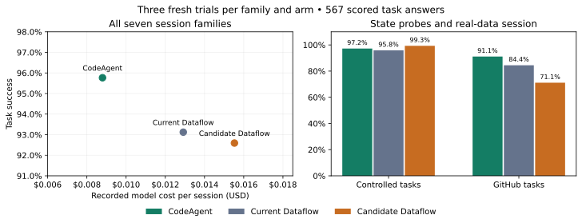

# Multi-task state milestone: completed pilot

## Decision

**Keep the new candidate experimental. It does not beat ordinary CodeAgent.**
The candidate improved preservation of historical results in the controlled
cases, but lost that gain through answer-contract failures in the real-data
session. Its recorded model cost was 76.5% higher than CodeAgent's.

The next algorithm should use the graph to reduce the **changing context sent
to the model**, rather than adding more ancestry text to every operator card.
The new benchmark now makes state errors and this context cost measurable.

## Experiment

- Runtime revision: `0be4241f839a8371dcc8c307901f0f3a177a97fc`, branch
  `feat/task-history-dataflow`, based on the evidence-only context work.
- Private agent service **3041**, engine **28085**, web **28080**, compiler
  **29090**, gateway **29096**, model proxy **24000**. Separate PostgreSQL,
  MinIO and lakeFS; Docker project `texera-task-history`. Other stacks were
  untouched. The frontend was not needed and remains stopped.
- GPT-5.6 Luna, maximum 25 model steps per task, Responses transport for both
  systems, fresh agents/interpreters and cache keys for each session.
- Six controlled eight-task sessions and the existing 15-task GitHub LongDS
  research adaptation. **Three complete fresh trials per family and arm**:
  63 sessions and 567 task answers in the final comparison.
- Ordinary smolagents CodeAgent, persistent session memory, no special reusable
  Python function arm or custom benchmark hints.
- All primary and repeat costs are included; no best-retry substitution.
  These are development cases, not an untouched held-out evaluation or an
  official LongDS leaderboard score.

One generated ranking request initially omitted a tie-break. Its prompt was
clarified to specify name ascending at tied values. All nine runs of that
family were replaced together with nine fresh runs, regardless of outcomes.
The original runs are preserved. Thus 72 full sessions / 639 answers were
actually generated, plus a separate three-task smoke. This is documented in
`tie-clarification.json` in the archive.

## What changed

The opt-in `nativeTaskReuse` setting adds:

1. Bounded facts about actual ancestors: filters, limits, grouping, joins,
   preview scans, and opaque UDFs. Historical ancestry resolves at its recorded
   task; it never silently substitutes the current definition.
2. Observed row counts in operator cards.
3. Guidance to keep complete analytical tables available, apply report-specific
   restrictions downstream, and represent shared changing assumptions as
   ordinary one-row inputs.

Current Dataflow and candidate Dataflow differ only in this setting. Existing
graph invalidation, task-result retention, `atTask` references, direct returns,
and the previous cache fix are enabled in both. This milestone does not claim
to have newly implemented those engine capabilities. The new setting defaults
to **false**.

Evaluation additions include private state-check annotations, field-level
requirements, session success, three-trial consistency, correction-task effort,
and separate startup/follow-up costs. Reference answers for all 48 controlled
tasks were checked against a second implementation using pandas.

## Main results

Costs below sum the same 21 complete sessions per arm.

| System | Correct tasks | Entire sessions correct | Recorded model cost | Cost / correct task |
|---|---:|---:|---:|---:|
| CodeAgent | **181/189 (95.8%)** | 16/21 | **$0.18474** | **$0.001021** |
| Current Dataflow | 176/189 (93.1%) | 15/21 | $0.27125+ | $0.001541+ |
| Candidate Dataflow | 175/189 (92.6%) | **17/21** | $0.32605+ | $0.001863+ |

`+`: each Dataflow arm had one timed-out task without reported token usage.
Its recorded cost is a lower bound under the accounting model, not proof that
the timed-out request was free. Prices are the repository's accounting
assumptions: $0.20/M ordinary input, $0.02/M cached input, $0.25/M cache writes,
$1.20/M output. These are estimates, not provider invoices; engine and storage
costs are excluded. Total recorded research spending, including superseded runs
and smoke, was approximately **$0.87031**, with the same missing-usage caveat.

Strict scoring checks requested keys, values and ordering, with the existing
absolute numeric tolerance of `1e-4`. It accepts parsed JSON/Python-literal
wrappers and numeric strings; it is not byte-for-byte JSON equality. Final
rounding and required field names still count. No LLM judge assigns success.



Native cost points share the missing-usage caveat above. The plot reports
descriptive results from the development pilot, without inferential error bars.

### By session family, all three trials

| Family | CodeAgent | Current Dataflow | Candidate Dataflow |
|---|---:|---:|---:|
| Shared correction across reports | 24/24 | 24/24 | 24/24 |
| Independent-task control | 24/24 | 24/24 | 24/24 |
| Historical membership / current values | 20/24 | 21/24 | **24/24** |
| Repair dependent reports | 24/24 | 24/24 | 24/24 |
| Restricted report → full population | 24/24 | 24/24 | 24/24 |
| Temporary scenarios / active default | 24/24 | 21/24 | 23/24 |
| GitHub real-data adaptation | **41/45** | 38/45 | 32/45 |

Controlled-task totals are 140/144, 138/144, and 143/144 respectively. The
candidate's one controlled-task failure was the timeout on an unrelated energy
sum; its subsequent default/scenario comparison succeeded.

### State checks, rather than only whole-answer success

These are prespecified requested fields in the controlled sessions. Preservation
is checked against the correct original reference, not merely whether a system
repeats its own previous answer. A nested regional report counts as one requested
field, so large tables do not dominate the metric.

| Check | CodeAgent | Current Dataflow | Candidate Dataflow |
|---|---:|---:|---:|
| Updated outputs correct | 81/81 | 80/81 | **81/81** |
| Original / unrelated outputs preserved correctly | 85/93 | 88/93 | **93/93** |
| Requested population selected correctly | 69/69 | 68/69 | **69/69** |

This is a useful state-preservation signal, not a general accuracy win. There
are only six controlled families; their tasks and repeated errors are correlated.
The candidate bundles prompt guidance and ancestry display, so this experiment
does not isolate the contribution of either component.

## What the traces demonstrate

**Historical results can prevent the wrong recalculation.** In the membership
case, CodeAgent recomputed the original publication with the current `risk >= 5`
rule and reported a baseline of 4 patients / 1400. The original publication was
3 / 800. The candidate joined the current summary to
`{operator: "default_summary", atTask: 1}` and read its saved values correctly.

**Retention alone is insufficient.** Current Dataflow retrieved the correct
historical one-row summary, then counted its rows and returned a patient count
of 1. The engine preserved the result correctly; the model selected the wrong
calculation over it.

**Dependency-driven updates are real.** In a repair task, changing only the
`orders_raw` source propagated through the existing deduplication and revenue
operators to the total and regional reports. The answer was correct in one
model call. CodeAgent also solved that request in one call and was cheaper.
This demonstrates functional propagation, not a measured reduction in executed
engine operators or a property unavailable to Python implementations.

**Shared parameters also worked.** In the temporary-scenario session, a one-row
`default_tariff` input changed from 0.20 to 0.30 and then 0.40. The existing
portfolio calculation updated while references to task 1 and the separate
scenario tasks preserved their earlier outputs. The model did not need a new
checkout command or a new user-facing result-ID system.

**Answer contracts remain a separate problem.** Manual review of the candidate's
13 GitHub failures found required-name, rounding, and ordering failures. They
remain failures in every headline score. Keeping upstream calculations unrounded
must not cause final answers to ignore requested precision. These results do not
establish that the new prompt caused the regression; that requires an ablation.

Concrete artifact references and counterfactuals are in
[state-milestone-audit.json](state-milestone-audit.json).

## Why it still costs more

| Recorded quantity | CodeAgent | Current Dataflow | Candidate Dataflow |
|---|---:|---:|---:|
| Model calls with usage | 233 | 304 | 296 |
| Generated output tokens | 95,746 | 91,631 | 95,402 |
| Cache-write input tokens | 184,183 | 533,613 | 734,368 |
| Cached input tokens | 1,182,882 | 1,385,339 | 1,389,772 |

The candidate generated approximately the same number of output tokens as
CodeAgent. **97.3% of its recorded dollar gap comes from additional cache-write
tokens** under the accounting rates above. It used fewer calls than current
Dataflow, yet cost more.

The task context rebuilds a current catalog as the graph and saved-task ranges
grow. An inspected task-8 catalog/context message was 9,738 characters. In that
session the candidate wrote 33,542 cache tokens versus CodeAgent's 8,584, despite
generating fewer output tokens. This is direct evidence of a changing-context
cost; it is not evidence that all additional writes came from ancestry facts
alone.

There are also avoidable interface retries. A tariff update computed the right
result, but `return: {operator: "original_report_json", format: "json"}` omitted
the required column. The runtime reported `value/json require an existing
column`, and another model call supplied the answer. This is independent of
historical-state correctness.

Supplied corrections were not cheaper either: across nine correction requests,
CodeAgent used 10 calls / $0.00711, current Dataflow 9 / $0.00742, and candidate
Dataflow 12 / $0.01068. Reusing a graph does not automatically remove model work.

## Broader benchmark readiness

Reference scripts were executed locally before spending on agents. Missing
notebook imports were restored explicitly; calculations and published answers
were not rewritten. The additions and library versions are recorded by
[research-gold-gate.py](research-gold-gate.py).

| Additional LongDS session | Engine Python | CodeAgent Python | Status |
|---|---:|---:|---|
| University rankings | 21/21 | 21/21 | Reference parity in both environments |
| NFL | 42/42 | 42/42 | Reference parity in both environments |
| Policing equity | 36/36 | 36/36 | Reference parity in both environments |
| Water potability | 36/36 | 26/36 | Align numerical/ML libraries first |
| Netflix | 35/36 | Not run | One published answer contains notebook-error text |
| Kaggle Survey | 36/37 | Not run | Final dominant-country answer differs: France vs UK |

Engine environment: Python 3.12.12, pandas 2.2.3, NumPy 2.1.0, scikit-learn 1.5.0.
CodeAgent: Python 3.10.9, pandas 2.2.3, NumPy 2.2.4, scikit-learn 1.7.2.
Reference parity is a prerequisite, not full certification of every prompt or
answer contract. These additional agent sessions have not been run yet.

## Next milestone

Do not launch the planned full 324-session matrix with this candidate. The small
pilot identified a specific cost bottleneck and an answer-contract regression.

1. **Implement dependency-local context changes.** Keep an immutable completed
   task record and stable operator index. After an input change, use the actual
   graph to emit changed definitions/results and affected dependencies. Avoid
   rebuilding every operator's definition, ancestry and saved-task range in
   each request. This uses the graph to determine what changed; it requires no
   model-authored checkout phase. Measure cache writes as the primary cost
   mechanism, with unchanged state checks as a correctness requirement.
2. **Fix return-interface friction separately.** Test safe inference of the
   JSON column only for an unambiguous single-column result, retaining strict
   row/completeness/JSON validation. Treat required names, precision and order
   as final-output contracts. Do not credit these engineering fixes as proof
   of a dataflow-specific reasoning advantage.
3. **Ablate the candidate.** Separate ancestry display, shared-parameter guidance
   and report-format guidance. Run the frozen seven-family development suite
   before promoting a combined setting.
4. **Then broaden.** Align Python libraries and resolve reference defects. Use
   the reference-clean university/NFL/policing sessions for the next real-data
   expansion, with a separate held-out set and a prespecified model comparison.

## Validation and artifacts

- `bun test`: **1089 passed**, zero failed; `bun run typecheck`: passed.
- Five evaluator regression tests passed, including missing answers, incorrect
  preserved values, shape-only errors, non-finite numbers and a timeout with no
  reported usage. The final summarizer also detects this missing usage in the
  original campaign summaries; no success labels or token totals were changed.
- Independent pandas validation checked all 48 controlled reference answers.
- Live smoke: **3/3** requested tasks passed.
- Every final cell has three fresh trials; all 72 complete sessions finished and
  recorded every requested answer. Two answers were provider-timeout errors.
- Source-data hashes remained unchanged. Model-call traces were checked for
  references to private gold/check files or the generator; none were found.
  Gold is kept out of model prompts; this pilot is not an adversarial filesystem
  isolation test.
- Shared hardware and concurrent runs limit latency interpretation. Engine
  compute billing, exact recomputation counts and long-run retention cleanup
  were not measured.

Machine-readable results:
[STATE_MILESTONE_RESULTS.json](STATE_MILESTONE_RESULTS.json).
Archive location/checksum and retained-table measurements:
[STATE_MILESTONE_ARTIFACTS.json](STATE_MILESTONE_ARTIFACTS.json).

Reproduce from this worktree using the private profile:

```bash
source /tmp/texera-task-history/profile.sh
.venv/bin/python agent-service/benchmark/multiturn/state-milestone.py /tmp/new-state-fixtures
# Prepare the GitHub research adaptation using prepare-task-longds.py.
.venv/bin/python agent-service/benchmark/multiturn/run-task-study.py \
  --fixtures /tmp/new-state-fixtures --out /tmp/new-state-runs \
  --kb-root /home/bob/Desktop/dataflow-agent/benchmark/Kramabench \
  --env-file /home/bob/Desktop/dataflow-agent/.env \
  --arms code,tasks,reuse --workers 6 --native-workers 3 \
  --repeat-all --recovery-rounds 2
```

The generator now includes the explicit ranking tie-break, so new runs do not
need the historical replacement procedure. The archive retains both original
and clarified manifests, prompts, answers, traces, workflows, scores and costs.
