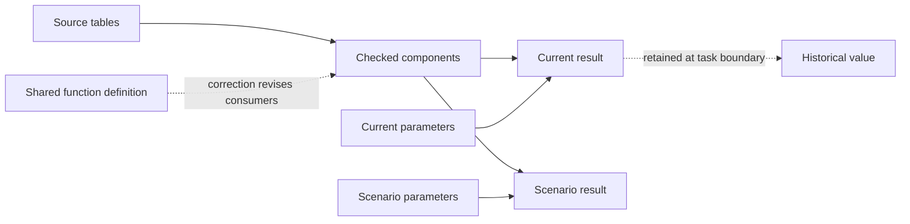

<!--
Licensed to the Apache Software Foundation (ASF) under one
or more contributor license agreements. See the NOTICE file
distributed with this work for additional information
regarding copyright ownership. The ASF licenses this file
to you under the Apache License, Version 2.0 (the
"License"); you may not use this file except in compliance
with the License. You may obtain a copy of the License at

  http://www.apache.org/licenses/LICENSE-2.0

Unless required by applicable law or agreed to in writing,
software distributed under the License is distributed on an
"AS IS" BASIS, WITHOUT WARRANTIES OR CONDITIONS OF ANY
KIND, either express or implied. See the License for the
specific language governing permissions and limitations
under the License.
-->

**Analysis-state experiment, 2026-09-24.** Implements the direction in
[the trace review](longds-state-repair-review.md). The candidate is opt-in;
existing arm meanings remain unchanged. No dataset name, reference answer,
future request, or benchmark dependency annotation enters its runtime policy.

**First-pass decision: keep the candidate opt-in.** On the six frozen sessions,
it reaches 37.55% task-macro accuracy and $1.83719 model cost, against existing
dataflow entries' 40.15% and $1.36132. Plain persistent Python reaches 30.12%
and $0.76901. The candidate is 2.59 percentage points worse and 34.96% more
expensive than the matched native control; it also exceeds the user-confirmed
1.25-times-Python cost ceiling. The [results](analysis-state-isolated-results.md),
[figure](analysis-state-results.svg) and [trace audit](analysis-state-isolated-trace-audit.md)
retain failures and explain the differences. Recovery trials are reported
separately and do not replace the first pass.

The campaign stopped at the user's request on 2026-09-24. The first pass and
first recovery trial are complete: four arms, six domains, 209 questions per
arm per trial. Of 72 planned sessions, 69 are fully scored (2,418 scored turns,
including unreached questions from intentional budget stops). One third-trial
Survey candidate session was stopped after three completed turns; its partial
fourth-turn trace and usage are preserved and excluded from accuracy. Two
third-trial control sessions were not started. The dedicated service and
evaluation/judge controllers are stopped. Missing sessions are not scored as
failures or used to compute a partial macro. The
[campaign status](analysis-state-campaign-status.json) records the final counts.

All 69 reported sessions use **GPT-5.2** with the same upstream judge prompt
and reference answers. The paper uses **DeepSeek-V4-Pro**; the initial attempt
with that judge encountered exhausted endpoint credit, and its artifacts remain
separate. These are controlled internal comparisons, not a reproduction of the
paper's judge configuration or published absolute scores.

The useful implementation result is executable state with tested correction,
branching and historical-value semantics. The current autonomous policy does
not reliably turn those capabilities into better answers: it creates no
parameter tables or cross-turn shared-function corrections in the first pass,
and uses three forks in one NFL turn. Repeated inspection, new cache writes,
source interpretation errors and incomplete foundations remain costly. Shorter
context alone is not a sufficient optimization.
The [retrieval audit](analysis-state-retrieval-audit.json) finds that 149 of 163
inspections returning previously available functions include a declaration
absent from selected task-start memory. Its method distinguishes these from
newly created functions and does not claim absence from the entire active prompt.

The task set was frozen before implementation in
[analysis-state-selection.json](../benchmark/longds/analysis-state-selection.json),
after surveying all 68 tasks' public questions and state metadata. It covers all
six domains and 209 turns. University and Netflix remain development diagnostics.
NFL was previously inspected and is explicitly not an unseen holdout.

This is a custom six-task subset of **LongDS v1**, not the official Lite split.
The local download is Hugging Face revision `da28ee1fbe515cb298580fa06c02ac2d5b8dc274`;
all six task JSON files match the currently published v1 files exactly. The
[version check](analysis-state-dataset-provenance.json) records hashes and the
upstream revision checked. The authors now recommend
[v1.1-Lite](https://huggingface.co/datasets/zjunlp/LongDS), with clarified scopes,
output rules and state semantics. That is a subsequent evaluation target;
this experiment keeps its frozen v1 questions and references throughout.
LongDS is the multi-turn benchmark discussed in
[the paper](https://arxiv.org/html/2605.30434v3), distinct from the older
[DSBench](https://arxiv.org/abs/2409.07703).

The implementation provides shared callable definitions backed by the
workflow, automatic consumer revision when one changes, parameter tables, and
forking an affected dependency slice with explicit input replacements. Historical
materialized values remain immutable. Inspection retrieves exact definitions;
bounded task memory keeps source history available through explicit recall.
Assertions inside reusable validation functions provide checked boundaries using
the existing engine failure/invalidation path. This does not infer arbitrary
semantic equivalence or promise atomic execution of opaque Python.



The graph supplies dependency tracking and invalidation; retained outputs supply
historical values; reusable definitions and explicit bindings supply alternative
computations. The agent still has to choose correct components, conventions and
bindings. Those choices are the principal unresolved accuracy issue in the traces.

Regression coverage includes corrections with several consumers, unrelated
and historical outputs, temporary branches, mixed membership/value versions,
same-call parameter edits plus forks, rejected bindings and invalid functions,
read-only explanation, and retrieval of archived context. Tests precede runtime
changes; real-engine smoke precedes paid evaluation.

Compare candidate, current entries, persistent DSGym, and a separately labeled
DSGym control with reusable-function guidance under the same model, public task
questions and 40-step limit. The runtimes retain their existing observation
rendering and system prompts; these are system comparisons, not an isolated
causal estimate of dataflow execution. Preserve first-pass results;
use two additional complete-session recovery runs for failed first-pass sessions
(any score-0 turn) consistently across arms, even if the first recovery succeeds.
Report all spending and separate repeat results. The acceptance criterion is
higher macro task accuracy and at most 1.25 times persistent Python's model
cost. The user confirmed this 25% ceiling after the comparison, matching the
original provisional target; the frozen selection manifest is preserved. On
this first pass the ceiling is $0.96126, versus the candidate's $1.83719. This
is a model-cost comparison, not a total research-spending budget. Start with
a bounded development pilot,
then freeze code before the six-domain comparison. If a revision follows that
comparison, retain its results and label subsequent measurements as development.

Report official scores separately from deterministic artifact invariants,
usage of the proposed mechanisms, generated code, cached input and writes,
physical execution and retained storage where available. Tests of increasing
history distance must hold request difficulty constant. A representative set
does not prove performance on every task in the benchmark.

| Domain and session | Turns | Longest annotated dependency | Coverage |
| --- | ---: | ---: | --- |
| Business: Goodbooks 1 | 35 | 29 | Identity joins, recommendation changes, old membership/current values |
| Community: Kaggle survey 2 | 30 | 25 | Denominator changes, adoption definitions, mixed components |
| Education: BI 2 | 30 | 27 | Weights, binning, sample restrictions, rollback |
| Geoscience: Water potability 3 | 36 | 33 | Imputation, features, fitted models, population variants |
| Social good: Los Angeles jobs 1 | 36 | 33 | Text parsing, deduplication, hierarchy, component changes |
| Sports: NFL 1 | 42 | 40 | Player/team aggregation, weak links, formula/cohort versions |

The selected annotations cover all four state patterns in every domain. Labels
can overlap on a turn and some turns are unlabeled, so these are not disjoint
denominators. File sizes range from a small two-file BI table to 839 Los Angeles
files; the Goodbooks sources total 42.9 MiB but expand into several million
materialized rows. Representativeness includes execution shape as well as
history length.

| Session | Initial | Update | Counterfactual | Rollback |
| --- | ---: | ---: | ---: | ---: |
| Goodbooks | 19 | 10 | 14 | 10 |
| Survey | 19 | 8 | 7 | 3 |
| BI | 8 | 3 | 3 | 1 |
| Water | 10 | 11 | 7 | 8 |
| Los Angeles | 29 | 14 | 14 | 10 |
| NFL | 14 | 11 | 12 | 13 |

Enable the experiment on a new native agent with:

```json
{
  "nativeTaskHistory": true,
  "nativeTaskContext": true,
  "nativeTaskRestore": false,
  "nativeAnalysisState": true,
  "nativeTaskMemoryChars": 24000
}
```

The memory limit counts characters of the completed-task projection, including
selected table cards and whole exact function definitions. Definitions are
selected by request-word overlap and recent use; this is deterministic retrieval,
not a semantic guarantee. It does not cap the system prompt, current request,
active ReAct trace or explicitly recalled material. The complete source request
and answer remain in task history. Archived change entries retain their existing
code-summary limits; `inspect` returns exact current definitions. No LLM writes
a summary on the agent's behalf.

For a normal update, redefine a shared function or reassign its parameter table.
For a scenario, submit `edits="scenario = parameters(weight=0.3)"` together with
`fork=[{"operator":"ranking","as":"trial_ranking","bindings":{"policy":"scenario"}}]`.
An optional `task` uses historical definitions and pins unchanged input values.
Current forks share unchanged live inputs, so they are not immutable snapshots;
`at(table, task=N)` reads an immutable historical result. Assertions in Python
check user-specified invariants through the normal execution error path.

Definitions persist with their consumers and survive workflow checkout. There
is no second global function registry. An unused standalone definition is
rejected rather than silently forgotten. Conflicting imported helper bodies
must be resolved explicitly. Fork bindings must name real ancestors and must
all be used; a binding hidden behind another replacement is rejected.

The existing task-number index and request/answer archive remain agent-session
state; creating a new agent from a saved workflow does not reconstruct them.
Historical table references depend on retained result files in the configured
storage. Exporting workflow JSON does not bundle those files. The history
smokes verify references within a continuing session, while the persistence
check verifies saved function, parameter and branch definitions.

Final source validation on this worktree: 1,145 Bun tests and 19 Python tests
pass, and TypeScript passes. These include post-evaluation correctness and
storage fixes described below; benchmark scores belong to the frozen R3 runtime.
The real-engine smoke's seven calls verify shared correction, scalar types,
scenario isolation, historical formula/current parameter composition, exact
inspection, request recall, retained values, assertion failure propagation and
saved-workflow round trips.
The smoke is `agent-service/benchmark/multiturn/analysis-state-smoke.ts`; artifacts
are in `/tmp/texera-analysis-state/final-state-smoke/`. It also exercises a zero-input
reusable loader. A separate real WebSocket check rejects an overlapping request
while preserving the first request's callbacks. These checks establish implementation
behavior, not benchmark accuracy. The [final validation record](analysis-state-validation.json)
includes source identity, log hashes, the nine engine calls and both large-graph
save checks.

A separate [distance check](analysis-state-distance-check.json) holds the query,
formula and data fixed while inserting unrelated tasks. At distances 2, 8, 32
and 128, the real engine returns the original saved value, reruns the original
formula with the current parameter, and preserves the current value. It uses
no LLM calls. The source is `analysis-distance-smoke.ts`; this verifies state
semantics, not the model's retrieval decisions or standalone latency.

The reproducible representative run uses the selection manifest, for example:

```bash
python benchmark/longds/run_official_matrix.py \
  --selection benchmark/longds/analysis-state-selection.json \
  --arms react-analysis,react-entries,dsgym,dsgym-functions \
  --models gpt-5.6-luna --sut-prefix LongDS_Isolated_20260924 \
  --trial 1 --workers 4 --dataflow-workers 2
```

Use a new run prefix for a changed implementation. Each run records the source
hash (including untracked runtime files), base commit and public manifest hash.
Model prices are the repository's cache-aware accounting assumptions, not
provider invoices. Judge response usage is recorded separately when provided;
unreported judge charges must not be represented as zero.

The first development pilot is revision R1; its University and Netflix sessions
are excluded from the six-domain aggregate. Before that comparison, revision R2
adds whole function definitions to bounded memory, allows inspection with omitted
`edits`, and resolves helper dependencies through Python scope analysis. Reads of
column names, strings and local variables cannot accidentally enlist an unrelated
shared function. Dynamic `eval`/`globals()` dependencies cannot be inferred.
The first representative R2 attempt was interrupted after its Goodbooks sessions
hit the client's 20-minute ceiling. The runner had ignored `completed=false` and
submitted later turns concurrently; the WebSocket server had no busy guard. Three
sessions were archived under `LongDS_AnalysisInterrupted_20260924_*`, excluded
from accuracy, with $0.09472513 in captured model usage (in-flight usage may be
unreported). Their artifacts are retained, not overwritten.

R3 reserves an agent before asynchronous setup, rejects overlapping normal and
debug requests, and makes the benchmark stop and drain an incomplete turn before
continuing. Six regression tests cover concurrency and timeout sequencing.
It also teaches a general ingestion alternative: a zero-input reusable pandas
loader can return a cleaned or aggregated table at the analysis grain rather
than materializing every large raw fact table. Existing analysis dependencies
remain explicit inputs. File I/O inside such a loader is opaque to the graph;
the function's doc names its files, and input coverage remains a model-generated
check. The seven-call engine smoke checks the loader and persistence as well.

R3 was frozen before restarting the complete dataflow comparison. Its ingestion
guidance was informed by the interrupted Goodbooks execution, and eight survey
turns had been observed, so these tasks must not be called untouched holdouts.
The same six-domain selection is retained. Python prompts and execution policy
are unchanged throughout; native controls use the same concurrency fixes.

**The initial unisolated comparison is invalid as accuracy evidence.** Manual
trace inspection subsequently found the guided Python control reading prepared
`gold.json` from Los Angeles turn 23 onward, and the plain Python second trial
reading other runs from turn 9, including their reference answers and judgments.
The [access audit](analysis-state-reference-access-audit.json) identifies the
submitted code and trace hashes. The runner did not put answers into the model's
prompt, but unrestricted execution could reach them on disk. All runs from that
campaign are marked ineligible for the primary comparison; their raw judgments,
traces and spending remain intact. The running dataflow sessions were stopped
and saved with another $0.08414561 in captured usage. Interrupted Python/judge
requests may have incurred charges that were not captured.

The `LongDS_Isolated_20260924` comparison restarts every arm with R3's unchanged
agent policy and a restricted execution filesystem. Python kernels use
bubblewrap with an empty filesystem root, read-only task data, private persistent
scratch, IPC channels and no network. Native workers mount interpreter/runtime
files, raw data, private workflow scratch, their own retained historical results,
and the engine result warehouse. They retain networking required by the local
engine and storage services. This is benchmark artifact isolation, not a claim
of complete protection against hostile code. Reference tasks, prepared gold,
judgments, prior trace directories, repository reports and provider credentials
are absent from both execution filesystems. There is no unrestricted fallback.

Seven Python checks verify read-only data, hidden host answers and other session
files, removed credentials, state persistence through a real Jupyter kernel,
long output paths, failed allocation, and request-thread/restart lifecycles.
`analysis-isolation-smoke.ts` verifies the same critical boundaries through the
engine, including private files surviving separate worker executions. The
seven-call state smoke also passes with retained-history mounts enabled.
`calls.jsonl` checkpoints each Python response's usage so later interrupted runs
do not lose all completed-call accounting.

Two Python setup attempts were archived under `LongDS_IsolationSetup_20260924`
and `LongDS_IsolationIPC_20260924`, with accuracy marked ineligible and usage
retained. The first exposed the Unix socket path limit; the second exposed
bubblewrap's parent-thread lifetime. IPC sockets now use short private temporary
paths; kernels and their clients are owned by a persistent thread, including
restarts. Failed allocation stops before model calls. A real HTTP smoke verifies
allocation, CSV execution, state persistence and cleanup. These harness-only fixes
change the source provenance hash; the native R3 policy and isolation wrapper
remain unchanged throughout their comparison.

DSGym kernel isolation is enabled by `run_official.py` and requires `bwrap`. For native
runs, configure a **dedicated evaluation engine** with `UDF_PYTHON_PATH` pointing
to `benchmark/longds/native_isolated_python.py`, `LONGDS_NATIVE_PYTHON` pointing to
the real venv interpreter, `LONGDS_SOURCE_DATA` pointing to the raw `data/longds`
directory, and `LONGDS_NATIVE_WORKSPACE` pointing to a private scratch parent.
`TEXERA_TASK_RESULT_DIR` must match the agent/engine's retained-result directory.
Pass the wrapper only to the engine; agent-service must use the real interpreter
for AST parsing and validation. Restart only that engine through `bin/local-dev.sh` and run both real-engine
smokes before evaluating. Set `LONGDS_NATIVE_ISOLATION` in the runner environment
to record the deployment policy in every protocol artifact. The primary run uses
six concurrent native sessions and three concurrent Python sessions; latency
measurements therefore include shared-machine contention.

During the isolated first pass, native Goodbooks ingestion again exhausted the
20-minute turn deadline. The campaign therefore adds a **one-hour wall limit per
session**, including setup and all turns, uniformly for all four arms and both
recovery rounds. This is an exploratory resource-policy change chosen after
observing the stalls, not a preregistered result. Completed answers and all
captured spending are preserved; interrupted and unreached questions are empty
answers and score zero. Sessions are never silently dropped from the task macro.
The supervisor stops only the matching runner tree and native agent, then drains
the execution; the drain can extend elapsed time beyond the limit. Per-run
`session-budget.json` records the limit, start time, five-second polling grace,
attempted/answered/planned counts on expiry, and this policy note.
Run it alongside the matrix and leave it active through recovery trials:

```bash
python benchmark/longds/session_budget.py \
  --prefix LongDS_Isolated_20260924 --seconds 3600 \
  --agent-base http://localhost:3051 \
  --stop-file /tmp/texera-analysis-state/stop-session-budget \
  --policy-note 'Exploratory wall budget selected during the first pass; uniform across arms and recoveries'
```

Five supervisor regression tests cover answer preservation, partial-call cost,
unreached questions, exact process matching, and termination of only the selected
process tree. Seven reporting tests verify interrupted usage, avoid counting checkpoints and
completed-turn records twice, and distinguish attempted turns from synthetic
unreached failures included in the scoring denominator. They also keep the full
planned denominator when sessions are missing, without inventing judgments.

The initial DeepSeek judge endpoint exhausted its account credit during scoring.
Those verdicts and usages are archived as `results_eval.deepseek-v4-pro.json`.
All comparative scores are recomputed with `gpt-5.2` and the upstream judge prompt;
`judge_protocol.json` records prompt hash, endpoint and token prices per run.
These scores support comparisons within this experiment, not claims against the
paper's absolute scores. Missing judgments stay unscored, never accuracy zero.
The reporting script includes archived judge spending separately from agent cost.

The pilot also reproduced an existing persistence failure in both dataflow
arms: PGroonga's unchunked MeCab tokenizer rejected multi-megabyte workflow
JSON. Migration 32 enables `TokenMecab("chunked_tokenize", true)` on the workflow
index and rebuilds it; the other indexes and workflow content are unchanged.
This option is supported in [Groonga's tokenizer implementation](https://github.com/groonga/groonga/blob/main/plugins/tokenizers/mecab.c).
`sql/tests/workflow-fulltext-long-content.sql` fails on the original index and
verifies exact content preservation and search after saving 9.8 MB with the
new index. The local pilot database received this migration while the Netflix
pilot was running; the representative dataflow comparison uses the fixed index
throughout. The event is recorded in `/tmp/texera-analysis-state/runtime-events.json`.


A coordinated unexpected SIGTERM interrupted both unfinished native NFL first
passes and 18 Python recovery attempts (including an earlier isolated SIGTERM).
Those attempts are preserved under `LongDS_IsolationInterrupted_20260924`,
ineligible for accuracy; recorded calls and judge charges remain in the ledger.
The signal sender was initially unknown. Completed sessions remain valid and the
deliberate uniform deadline stops remain scored failures. The evaluation's own
agent/engine were restored through `bin/local-dev.sh`; the seven critical frozen
runtime files still match their recorded hashes. The real-engine isolation smoke
passes after restoration. The engine alone uses the isolated UDF wrapper; the
agent service's AST validator uses the ordinary Python interpreter.

A second coordinated SIGTERM near 16:00 UTC interrupted six native recovery
sessions before their budgets expired. These are archived under the same
ineligible prefix, bringing unexpected-interruption archives to 26 sessions;
the 56 fully scored sessions were retained. No matching user cron job or kernel
OOM event was initially found. The campaign was relaunched through the same
supported launcher inside transient user service
`texera-analysis-evaluation-20260924`, with a four-hour outer lifetime and the
unchanged one-hour session budgets. A fresh engine isolation smoke passes, and
all 254 files in the frozen runtime archive match before this restart. This
changes process supervision, not the evaluated model or runtime policy.

Near 16:43 UTC the campaign controller received SIGTERM again. The transient
service itself had not reached its lifetime; its wrapper observed the controller's
signal exit and shut down its own engine and agent. Five unfinished sessions
were archived under `LongDS_IsolationInterrupted3_20260924`, for 31 unexpectedly
interrupted attempts across the three events. The NFL control's third trial had
already recorded all 42 answers and traces; its final score is 16/42 and it is
retained. Rollouts were paused to identify the sender. All recorded spending, including invalid and
interrupted attempts, is retained in the [ledger](analysis-state-research-spend.md).

The system journal subsequently identified **`earlyoom.service`** as the sender
in all three coordinated events. It issued SIGTERM when available RAM fell to
8% and free swap to 15%; its Python preference selected even small controllers.
At 16:43:27.799 UTC it explicitly targeted PID 1669323, the supervised campaign
controller. Earlier events also targeted Bun processes retaining 9,321 and 11,509 MiB
RSS. This was a userspace memory watchdog, explaining the absence of a kernel
OOM event. There is no evidence that another tenant stopped the campaign.
The [resource audit](analysis-state-resource-audit.json) retains the sanitized
journal events, service settings, archived idle agents and new resource policy.

With the user's authorization to manage the dedicated machine, the unused
`texera-evcomp` stack and idle agent services on ports 3071 and 3072 were stopped
through the supported launcher after their agent state was archived. Docker
volumes were retained. The required main backend services remain available.
The remaining fourteen native sessions resumed at 17:48 UTC from a separate
checkout verified against all 254 archived files and the frozen R3 digest.
Both isolation and seven-call real-engine state preflights passed. The final
worktree fixes below are not part of that runtime.

The new system service `texera-analysis-dedicated` enforces a 20 GiB memory
limit on the experiment engine, agent, controllers and their children. It
admits three sessions per wave only with at least 10 GiB available RAM and
8 GiB free swap. The agent restarts between drained, completed waves to release
retained traces. Memory is sampled every 15 seconds. The host watchdog remains
enabled. These controls reduce memory pressure; they do not reserve physical
RAM or make arbitrary runs immune to resource exhaustion.

The earlier resumed scheduler allowed six native and three Python sessions.
Each failed first-pass **session** gets the same two additional attempts. It can
run recovery of an already completed session while an interrupted first-pass
session is replaced; task execution order is not included in the model prompt.
This changes scheduling from the initial arm-wide barrier and is recorded as an
exploratory protocol change. It does not change questions, scoring, models,
context policy, step limits or the wall budget. Both recovery trials remain
separate, including failed ones; no favorable-attempt selection is used.
The later three-session waves are a further resource-policy change, so recovery
latency and cost are not measurements under identical contention. Excluding
resource-interrupted attempts makes the accuracy comparison conditional on
completion; all 31 interruptions and their captured spending remain reported.

The first idle-agent restart exposed a separate controller configuration error:
reloading the isolation environment replaced the agent parser's normal Python
interpreter with the engine-only worker wrapper. All three sessions in that wave
had zero operators and no tool results from their first turn. The completed
Los Angeles control's apparent 0/36 was therefore a setup failure, not a usable
accuracy result. That session and both unfinished water sessions are archived
under `LongDS_IsolationDispatch_20260924`, with all captured spending retained.
The restart controller now explicitly sets the normal interpreter for the agent
and runs the engine isolation smoke after every idle restart. All 25 previously
completed native sessions had real results in their first tool-bearing turn; the primary
comparison and the three valid sessions from the first dedicated wave are
unchanged. The replacement runs use the same frozen R3 source.

The SDK driver also discarded thrown tool exceptions because it recorded only
`toolResults`, while the SDK stores these failures as `tool-error` content.
The context renderer then showed a misleading generic `ok`. A post-evaluation
driver fix preserves those errors with the corresponding tool-call IDs. Two
regressions reproduce the omission, including a mixed success/failure step.
This fix belongs to the final worktree and is not credited to frozen R3 scores.

Saved NFL graphs also expose a remaining persistence limit: at the interrupted
checkpoints they are approximately 20 MB (candidate, 206 operators) and 40 MB
(entries, 414 operators). Backend saves return HTTP 400 despite full per-turn
workflow snapshots being retained locally. Runtime source is repeated in each
physical operator. This is a separate limitation from model history handling and
from the earlier fixed PGroonga tokenization failure; the cause of the HTTP
parser rejection is isolated by a [synthetic save probe](analysis-state-persistence-size-check.json):
19,000,056 content characters save and round-trip exactly, while 21,000,056
receive the same HTTP 400. The temporary workflow is deleted and never executed.
This establishes a size boundary independently of benchmark calculations.

After freezing the evaluation results, the compiler was changed to compress
the embedded Python runtime once and decompress its exact bytes in each
physical operator. Operators remain independently executable. The
[backend round-trip check](analysis-state-compact-runtime-check.json) reduces
these graphs to 6.76 MB and 12.70 MB and saves them exactly. A regression test
checks 400 operators against the API limit and executes a generated operator
in a separate Python interpreter. The 20-million-character API limit remains,
and previously saved operators are not automatically recompiled. This fixes
the demonstrated storage failure, without claiming unmeasured accuracy gains.

Two further post-evaluation fixes restrict fork substitution to positional table
inputs, preserving function and dtype identifiers with the same spelling, and
make an unsupported `async def` correction block its old consumers and newly
requested descendants. Regression tests cover both; the additional real-engine
fork check verifies keyword functions, positional functions, dtypes and unchanged
original values. The frozen and final source hashes are recorded separately in
[runtime provenance](analysis-state-runtime-provenance.json).
