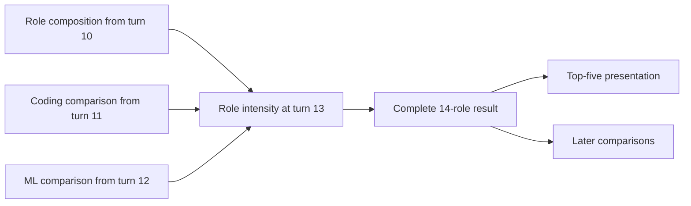

<!--
Licensed to the Apache Software Foundation (ASF) under one
or more contributor license agreements. See the NOTICE file
distributed with this work for additional information
regarding copyright ownership. The ASF licenses this file
to you under the Apache License, Version 2.0 (the
"License"); you may not use this file except in compliance
with the License. You may obtain a copy of the License at

  http://www.apache.org/licenses/LICENSE-2.0

Unless required by applicable law or agreed to in writing,
software distributed under the License is distributed on an
"AS IS" BASIS, WITHOUT WARRANTIES OR CONDITIONS OF ANY
KIND, either express or implied. See the License for the
specific language governing permissions and limitations
under the License.
-->

**Dataflow versus persistent DSGym: accuracy mechanisms, 2026-09-24.**
The strongest observed benefit is the composition of named, retained analytical
components. In successful turns, the agent selects existing tables with specific
meanings and connects them to a new calculation. This preserves component
definitions, population identity and full-precision values. The task history
also presents these objects and their provenance to the model. Persistent Python
can represent the same computations; it already retains variables. These traces
show a difference in how the agents use their state, not an impossibility in Python.

This is a manual audit of saved traces, using the existing GPT-5.2 binary labels
(pass = 1), without reruns or rejudging. First-pass results remain primary.
Available repeats check whether examples recur and are never selected best-of.
The [structured audit](analysis-state-vs-dsgym-audit.json) contains all first-pass
Dataflow-only turns, twelve paired cases, costs, repeat labels and evidence hashes.
The complete [score report](analysis-state-isolated-results.md) is unchanged in meaning.

**Where the gain comes from.** Counts below are correct answers within each task,
not macro-averaged percentages.

| Task | DSGym | Existing Dataflow | New analysis-state Dataflow |
| --- | ---: | ---: | ---: |
| Goodbooks | 0/35 | 0/35 | 0/35 |
| Survey | 18/30 | 27/30 | 19/30 |
| Education BI | 23/30 | 28/30 | 28/30 |
| Water | 15/36 | 9/36 | 13/36 |
| Los Angeles | 0/36 | 10/36 | 4/36 |
| NFL | 1/42 | 2/42 | 9/42 |

Existing Dataflow has 29 Dataflow-only wins, 10 Python-only wins, 47 shared
passes and 123 shared failures. The new candidate has 27 Dataflow-only wins,
11 Python-only wins, 46 shared passes and 125 shared failures. Thus the gains
are uneven across domains, and the newer implementation is not the stronger
Dataflow arm overall.

**Survey turns 13–14: preserve the meaning of intermediate components.**
Turn 13 asks for role intensity from three previously established quantities.
The existing Dataflow agent builds this actual dependency structure:

The engine provenance confirms reuse: input execution IDs are 5603, 5610 and
5612; the new consumer executes as 5621. This is evidence of consuming earlier
results, beyond the model merely saying that it reused them. The coding and ML
anchors remain the global maxima, 4.2502446184 and 6.3519243314. Data Architect
therefore scores 3.4375 and ranks first.

DSGym instead reloads the CSV and recomputes both anchors separately inside
each role. That changes the requested statistic: Developer Advocate receives
coding/ML anchors 30.3279 and 20.0820 and incorrectly ranks first at 6.3873.
At turn 14, Dataflow passes the earlier AutoML-only role and coding tables
together with the current strict ML table. It gets the partial rollback right
while retaining the strict ranking for comparison. DSGym carries forward its
incorrect role-specific anchors.

This success uses separately named tables and explicit process inputs. It does
not use the new fork API or an explicit historical-result read. Both completed
existing-Dataflow trials pass turns 13 and 14; both Python variants fail both
turns in all three trials. Several subsequent survey wins descend from this
same correct foundation, so they are not independent demonstrations of separate
features.

Evidence: [Dataflow turn 13](../benchmark/longds/system_scratch/LongDS_Isolated_20260924_react-entries_luna_t1/community__kaggle-survey-2022__task2/turns/t13/react_steps.json),
[recorded execution and values](../benchmark/longds/system_scratch/LongDS_Isolated_20260924_react-entries_luna_t1/community__kaggle-survey-2022__task2/turns/t13/operator_results.json),
[DSGym turn 13](../benchmark/longds/system_scratch/LongDS_Isolated_20260924_dsgym_luna_t1/community__kaggle-survey-2022__task2/agent/bak/turn_13_result.json),
[Dataflow turn 14](../benchmark/longds/system_scratch/LongDS_Isolated_20260924_react-entries_luna_t1/community__kaggle-survey-2022__task2/turns/t14/react_steps.json).

**Survey turns 17, 18 and 22: exact values, complete results and explicit inputs.**
At turn 17, Dataflow computes the industry-rate gap from retained values:
23.931623931623932 minus 13.409961685823754 equals 10.521662245800178, which
rounds to the reference 10.5217. DSGym executes no code and answers 10.5216,
the subtraction of the displayed four-decimal values. Persistence alone did
not make DSGym use its full-precision state.

At turn 18, Dataflow initially connects the top-five industry table where a
full-table normalization denominator is needed. Seeing a concentration of one,
it identifies the wrong input and reconnects the complete industry table. The
complete role table from turn 13 is also still available. It produces the
correct role concentration 1.2993. This is a concrete case of checking a result
and repairing a local graph input; the first graph was not automatically correct.

At turn 22, Dataflow sorts the named composition-lift table and selects Data
Architect. DSGym hardcodes Developer Advocate, confusing its intensity leader
with the requested composition-lift leader. Separate named analytical objects
helped distinguish two different rankings.

Evidence: [Dataflow turn 17](../benchmark/longds/system_scratch/LongDS_Isolated_20260924_react-entries_luna_t1/community__kaggle-survey-2022__task2/turns/t17/react_steps.json),
[DSGym turn 17](../benchmark/longds/system_scratch/LongDS_Isolated_20260924_dsgym_luna_t1/community__kaggle-survey-2022__task2/agent/bak/turn_17_result.json),
[Dataflow input repair](../benchmark/longds/system_scratch/LongDS_Isolated_20260924_react-entries_luna_t1/community__kaggle-survey-2022__task2/turns/t18/react_steps.json),
[Dataflow turn 22](../benchmark/longds/system_scratch/LongDS_Isolated_20260924_react-entries_luna_t1/community__kaggle-survey-2022__task2/turns/t22/react_steps.json),
[DSGym turn 22](../benchmark/longds/system_scratch/LongDS_Isolated_20260924_dsgym_luna_t1/community__kaggle-survey-2022__task2/agent/bak/turn_22_result.json).

**NFL turn 26: separate cohort membership from score components.**
The new candidate inspects definitions and recalls earlier requests before
combining `reliable_pool`, `high_leverage_pool`, the retained winsorized-speed
table, pressure components and tracking data. It explicitly selects earlier
eligible players excluded from the current pool, then obtains reference-matching
names and scores: Riley Reiff 1.1063, Billy Turner 0.9320, Jesse Davis 0.8365,
Rob Havenstein 0.8246 and Jonah Williams 0.7397.

DSGym's wider `combined` table has missing current scores and missing
winsorized-speed values for excluded players. A repair still produces NaNs,
and the agent declines to rank them. The Dataflow benefit here is inspectable,
separately retained components and membership. The candidate does recompute
composite formulas: this is not proof that scoring was entirely reused or that
the fork machinery solved the turn. Candidate trials 1 and 2 pass; trial 3 fails.

Evidence: [candidate trace](../benchmark/longds/system_scratch/LongDS_Isolated_20260924_react-analysis_luna_t1/sports__nfl_big_data_bowl_2023__task1/turns/t26/react_steps.json),
[executed result](../benchmark/longds/system_scratch/LongDS_Isolated_20260924_react-analysis_luna_t1/sports__nfl_big_data_bowl_2023__task1/turns/t26/operator_results.json),
[DSGym trace](../benchmark/longds/system_scratch/LongDS_Isolated_20260924_dsgym_luna_t1/sports__nfl_big_data_bowl_2023__task1/agent/bak/turn_26_result.json).

**What the accuracy advantage does not establish.**
Fourteen of the existing arm's 29 exclusive wins, and eleven of the new arm's
27 exclusive wins, face a DSGym inability answer with no Python submitted in
that turn. Six existing-arm BI wins are in this category. At BI turn 7, DSGym
successfully discovers and loads the same data after earlier claiming it was
inaccessible. These are tool-use behavior differences. The native structured
tool interface, stronger execution instructions and visible workflow may help,
but this comparison cannot isolate which of them causes that behavior.

The graph also permits incorrect analytical scopes. At Water turn 8, existing
Dataflow computes the severity top decile over the wider population, although
the narrowed population is separately available. DSGym uses the correct
population: 41.1371% overlap versus Dataflow's 39.6825%. Explicit dependencies
do not by themselves select the right cohort.

Judge passes need a similar boundary. Los Angeles turn 18 passes for Dataflow,
and the role order and score drops match, but its absolute before/after scores
do not all match the references. Such cases cannot establish full correctness
of the underlying state. All existing labels are preserved.

Neither first-pass Dataflow arm calls `at(table, task=...)`. Existing-arm
restoration is used at NFL turns 5 and 10; both fail. The new candidate's three
forks occur in NFL turn 30, which also fails. The first pass contains no shared
function corrections across turns or parameter-table usage by the candidate,
as recorded in the earlier mechanism audit. Those new capabilities therefore
cannot explain the observed first-pass passing turns.

**Why model cost rises.** Repository cache-aware accounting across the same six
first-pass tasks gives the following decomposition; judging and infrastructure
are excluded. These are recorded estimates, not invoices.

| Arm | Calls | Mean input tokens/call | Cache reads | Cache writes | Output | Total |
| --- | ---: | ---: | ---: | ---: | ---: | ---: |
| Persistent DSGym | 424 | 35,177 | $0.2902 | $0.0995 | $0.3783 | $0.7690 |
| Existing Dataflow | 534 | 52,366 | $0.5286 | $0.3828 | $0.4496 | $1.3613 |
| New analysis-state Dataflow | 875 | 25,258 | $0.3742 | $0.8472 | $0.6153 | $1.8372 |

Totals also include less than $0.001 of uncached input per arm. Existing
Dataflow uses 26% more calls and 49% more input per call than DSGym. The new
candidate reduces average input but more than doubles the number of calls and
creates much more new cached context. Its first pass includes 180 dataflow
calls with inspection and 126 with recall; these categories overlap and are
not all avoidable or additional calls.

Some additional computation produces valid answers where DSGym declines to
execute, so the aggregate premium is not entirely wasted overhead. Other costs
are avoidable. At Survey turn 16, both pass, but Dataflow needs four model calls
($0.00862235) versus Python's two ($0.00366807): one extra call repairs loader
arity, another fetches a row omitted from the sampled display. At Survey turn
13, Dataflow is both correct and cheaper than the failing Python attempt:
two calls/$0.00367655 versus three/$0.00604049. At Water turn 10 both pass,
and reuse of existing severity/panel tables avoids Python's reconstruction
error: two calls/$0.00378577 versus three/$0.00668219.

The evidence supports keeping complete reusable components, explicit scope and
version bindings, exact arithmetic and useful verification. Cost work should
target repeated definition discovery, syntax repairs and incomplete result
displays while preserving those successful behaviors. A future causal test
would match Python's structured execution interface and result presentation
before varying graph-backed state and retrieval. No such experiment was run
for this audit.
