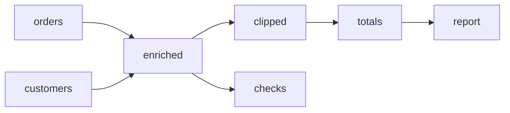

<!--
  Licensed to the Apache Software Foundation (ASF) under one
  or more contributor license agreements. See the NOTICE file
  distributed with this work for additional information
  regarding copyright ownership. The ASF licenses this file
  to you under the Apache License, Version 2.0 (the
  "License"); you may not use this file except in compliance
  with the License. You may obtain a copy of the License at

    http://www.apache.org/licenses/LICENSE-2.0

  Unless required by applicable law or agreed to in writing,
  software distributed under the License is distributed on an
  "AS IS" BASIS, WITHOUT WARRANTIES OR CONDITIONS OF ANY
  KIND, either express or implied. See the License for the
  specific language governing permissions and limitations
  under the License.
-->

# Native dataflow statements and shared Python operators

Design decision, updated 2026-10-08. Implementation and measured rollout remain pending.

Native mode keeps one `dataflow(reasoning, actions)` tool. An edit contains
`python` for ordinary Python definitions and `changes` for graph statements:

```text
set operator_id: operator_type(input1, input2, parameter=value, doc="Optional summary")
delete operator_id
```

The operator type is either a predefined constructor or a named Python function.
Table inputs are positional; settings are keywords. Custom operators have no
`process` wrapper or `fn=` selector. There is one session-wide Python namespace:
later definitions see earlier definitions and can replace them. A namespace
update automatically recomputes its existing custom users and their downstream
results, with a conservative refresh rule described below.

This contract supersedes the earlier `inputs=[...]`, `params={...}`, immutable
per-operator function bindings, and future-sets-only behavior in this design.
Historical runs and sessions retain their recorded protocol. No running service
or benchmark result is changed by this documentation update.

The [standalone proposed system prompt](native-registered-python-system-prompt.txt)
contains the exact default data-statistics variant and a complete batch example.
The implementation plan separates protocol qualification from prompt trimming.

## 1. Decisions to freeze

| Area | Contract |
| --- | --- |
| Tool | One static `dataflow` definition with brief `reasoning` and ordered `actions`; no provider schema per Python function. |
| Graph | `set id: operator_type(input1, input2, key=value, ...)` replaces a complete definition; `delete id` removes it. |
| Connections | Positional bare operator IDs define incoming edges and port order. No explicit edge commands. |
| Custom operator | The call head is a public, top-level synchronous Python function. Inputs are DataFrames; output is one DataFrame. |
| Settings | Direct `key=value` configuration; Python defaults apply. No generic parameter escape mapping or embedded Python bodies. |
| Namespace | One cumulative logical namespace per session; imports, constants, helpers, and definitions survive later cells. |
| Documentation | Optional universal `doc=` metadata overrides a custom function's docstring or a generated built-in description. Never forwarded as a function setting. |
| Atomic validation | Stage Python registration and the final DAG together. Syntax, initialization, binding, graph, or cancellation failure commits neither. |
| Ordinary execution | Initial construction and graph/settings-only edits require explicit `execute`. `retrieve` never executes. |
| Python refresh | A semantic namespace change with existing custom users commits the validated state, then automatically executes the refresh set and awaits its receipt. |
| History | Whole-session checkpoints retain ordered source cells, graph, settings, namespace identity, and version-bound captured results; the live session uses latest names. |
| Failure after commit | An automatic execution failure leaves the new definitions live; failed/blocked outputs are unavailable or stale. Earlier results remain historical. |
| Prompt | One syntax, a generated short catalog, one complete example, and feature guidance only for enabled views/evidence. |

Store a protocol identifier with sessions, snapshots, and traces. Do not present
legacy assignment, `del`, create/update, explicit-edge, indented-function,
callback-wrapper, or typed-JSON operator syntax in this protocol.

## 2. Tool and action contract

The provider envelope is JSON; `python` and `changes` are strings within it.
The graph language is parsed locally, not evaluated as Python. For an existing
operator `raw`, an edit can register a custom type and use it immediately:

```json
{
  "type": "edit",
  "python": "def plus(table, *, opt1=1, opt2=2):\n    \"\"\"Add two configured constants to the value column.\"\"\"\n    return table.assign(value=table['value'] + opt1 + opt2)\n",
  "changes": "set adjusted: plus(raw, opt1=10, doc='Add the requested fixed adjustment to each value.')"
}
```

Both strings are present in the static schema; unused strings are `""`. Reject
an edit with both empty. Python-only edits update the namespace. Graph-only edits
use existing definitions and built-ins. A Python-only replacement can therefore
run existing operators automatically; it is not merely passive registration.

No Vercel/provider tool is created for individual Python functions. The tool
schema describes the envelope; the local validator resolves constructors,
parameters, and actual Python binding. System text and the separate provider
tool payload both contribute to model input and are measured separately.

| Action | Behavior |
| --- | --- |
| `inspect`, `target="graph"` | Read current definitions, summaries, and result status. |
| `inspect`, `target="operator"` | Read a definition and its current function signature; `include_implementation` requests relevant current namespace source. |
| `inspect`, `target="reference"` | Read selected built-in/custom contracts or an enabled example. No computation. |
| `edit` | Stage namespace and graph, initialize definitions in isolation, validate, and atomically commit. When a namespace change affects existing custom users, await their automatic refresh. |
| `execute`, optional `operator_ids` | Compute selected nodes and ancestors, reusing valid cached results. Omitted IDs select the whole DAG. |
| `retrieve`, `operator_id`, `view`, optional `columns` | Read only a current materialized result in an enabled view. No execution. |
| `answer`, `content` | Finish with prose or a requested envelope; sole action in its call. |
| `answer`, `from` | Finish with the existing projection/precision syntax; final action in its call. |

First-time registration plus graph construction still uses `edit → execute →
retrieve`. An update that refreshes existing custom users can use `edit →
retrieve` because the edit waits for refresh completion. A later explicit
`execute` is permitted and reuses already current results; do not teach it as
necessary after every successful automatic refresh.

Actions are ordered. Each edit's state commit is atomic; the entire action list
is not one transaction. A later action failure does not undo earlier completed
edits. Observation-dependent decisions belong in the next model call.

Keep the expression executor's exception allowing inspection/retrieval of
independent completed branches after execution failure, including automatic
refresh failure. Report the failed target's cause rather than an old table.
Skip later writes, executions, and answers after failure. An automatic refresh
receipt explicitly distinguishes committed state from execution outcome.

Prefer one tool call containing a batch. Generalizing the ordered-call adapter
to accept multiple returned calls is a separate qualified runtime treatment:
preserve call/transaction boundaries, skipped receipts, and answer termination.
Do not deduplicate returned calls implicitly.

## 3. Graph statement grammar

```text
set <operator_id>: <operator_type>(<input_id>, ..., <key>=<value>, ...)
delete <operator_id>
```

Statements start at the margin. Parenthesized calls can span lines; comments
and blank lines are allowed. Operator IDs and custom type names use ASCII Python
identifier spelling and cannot be keywords.

All positional arguments are bare graph IDs. Configuration is keyword-only
in graph statements, even if a Python function would accept positional settings.
A source has no positional arguments: `scan(files="data/orders.csv")` or
`load_summary(filename="data/summary.xlsx")`. Join input 0 is left and input 1
is right; `union(january, february, march, schema="strict")` accepts repeated
table ports. A self-join can reference one source twice; a node cannot reference
itself as an input.

Resolve syntax roles directly: the call head is a type, positional names are
graph IDs, and keyword names are settings/metadata. A function and a graph node
may share a name, as in `set normalize: normalize(raw)`. Never classify an input
by whether the same name appears in the function registry.

### 3.1 Replacement, deletion, and final-graph validation

A `set` replaces the type, settings, incoming edges, and explicit documentation
override. Omitted settings reset to defaults; omitted `doc` resets to inherited/
generated documentation. Outgoing connections remain defined by consumers.
An identical resolved definition is a no-op.

Write each graph ID at most once per edit. Reject repeated sets/deletes or both
for one ID. Resolve forward references against the final draft; check input
existence/counts, constructor contracts, Python binding, and cycles before commit.

Deletion removes incident edges. Rewire or delete retained consumers in the
same edit; otherwise reject the final graph. There is no cascade deletion.
Historical editable-draft replay retains its older disconnected-consumer policy.

For an existing replacement source:

```text
set totals: aggregate(replacement, by=["region"], outputs={"total": sum("amount")})
delete obsolete
```

This is valid if `totals` was the only consumer of `obsolete`. Intermediate
statement order does not invalidate a valid final graph.

### 3.2 Settings and structured values

Every setting uses `key=value`. Custom settings are finite, faithfully
representable literals: strings, numbers, booleans, `None`, lists, and dictionaries
with string keys. Collections are configuration data, not nested Python code.
There is no graph-level constant evaluation, arbitrary function invocation,
Python `**` unpacking, lambda, or nested operator call.

Built-ins additionally accept closed catalog descriptors: dtype names and
documented dtype/reducer/window constructors. For example, `sum("amount")` is
parsed as an aggregation specification; it does not call Python's `sum` or a
function from the shared namespace. These descriptors are valid only in their
declared parameter positions.

Use fixed mapping parameters where column names are data:

```text
set typed: cast(raw, columns={"Unit Price": float64, "doc": str})
set counts: aggregate(typed, outputs={"inputs": count(), "doc": count("Unit Price")})
set previous: window(daily, order_by=["date"], outputs={"previous value": lag("value")})
```

`columns=` and `outputs=` are actual built-in settings, not generic parameter
wrappers. They support spaces, reserved metadata names, and catalog-option names
without treating column names as keyword identifiers. Use one spelling per
built-in: no parallel dynamic-column keyword form in the new protocol.

`doc` is the one universal metadata keyword and is removed before parameter
validation/invocation. A custom setting cannot be exposed under this reserved
name; use a domain name such as `description` instead. The names `inputs`,
`params`, and `fn` have no graph-control meaning in this protocol and may be
ordinary settings when a custom function explicitly accepts them.

Reject duplicate keywords and unsafe literal values. Never silently round
integers through JavaScript: preserve exact supported values or report the
representation limit. Built-in parameter defaults/validation come from one
catalog metadata source.

## 4. Shared Python namespace and custom operators

### 4.1 Definition cells and exports

`edit.python` is ordinary Python source appended as a definition cell to the
session. Later cells see earlier imports, constants, classes, helpers, and
functions, and may overwrite names. Functions resolve global helper/constant
names from the latest namespace at call time, following Python rules.

Public top-level synchronous `def` names are eligible custom operator types.
Names starting with `_` are helpers; imports/constants/classes remain usable
Python names but are not automatically graph constructors. Async entries and
selected non-callables are rejected. Helpers may contain lambdas, nested
functions, and normal Python constructs.

Predefined constructor names are reserved against Python redefinition, including
the retired `process`, `filter`, and `map` wrapper names. Reject collisions with
a clear error and allow a different custom name. Dispatch must never silently
switch a built-in into an authored function.

AST parsing and compile-only preflight execute no authored imports, decorators,
defaults, or bodies. Then an isolated, bounded registration worker reconstructs
the prior definition cells and applies the candidate cell before validating
resolved callables and bindings. Initialization failure, timeout, cancellation,
or a non-callable replacement used by the graph prevents the state commit. Compilation alone is not
sufficient when a decorator changes the actual callable.

The namespace is shared logically, not as a mutable heap across engine workers.
Persist ordered authored cells and rebuild a coherent namespace revision in each
worker; every operator in one execution sees that same definition revision.
Table inputs arrive as arguments, not globals. Use graph edges for durable data.
Mutation during an operator invocation is worker-local and does not publish a
new namespace definition.

Definition cells are for imports and deterministic definitions/constants.
Authored top-level reads of task data, clock/random-dependent initialization,
network writes, open handles, or mutable execution state are not durable
namespace state; put data-dependent computation inside functions with explicit
inputs/settings. Initialization is sandboxed so rejected transactions cannot
publish external writes. Pin packages/runtime and input artifacts for replay.
Source checkpoints preserve definitions and captured results, not arbitrary
initialized Python objects or external service state.

Preserve Python's distinction between defaults captured when a definition cell
runs and globals looked up when a function is called. Ordered deterministic
cell replay preserves the former; do not rewrite an earlier function's defaults
when a later constant changes. Prefer immutable literal settings defaults. Append every submitted definition
cell in order, including repeated source: re-running a definition can recapture
a changed default. Storage may deduplicate source bytes, not cell events.

### 4.2 Inputs and keyword settings

The runtime call is:

```python
selected_function(*ordered_input_dataframes, **configuration_overrides)
```

Strip `doc` before binding. Recommend required table inputs followed by
keyword-only settings:

```python
def plus(table, *, opt1=1, opt2=2):
    """Add configured constants to the value column."""
    return table.assign(value=table["value"] + opt1 + opt2)

def compare(left, right, *, threshold=0.05):
    ...

def load(*, filename, sheet="Summary"):
    ...
```

Accept normal Python signatures when the actual planned call binds: defaults,
positional-only inputs, varargs, and supplied required keyword-only settings.
For `def f(table, /, **options)`, `table="metadata"` can legally enter `options`;
do not reject settings merely because a positional input has the same name.
Unknown keywords are permitted by `**kwargs`; explicit named settings give
better typo diagnostics.

AST signature metadata uses a default-present sentinel without evaluating
expressions. The registration worker and invocation worker validate the actual
resolved callable after initialization/decorators. Do not evaluate annotations
to invent setting types or per-function provider schemas.

Validate all retained custom operators against the candidate namespace, not
just newly written nodes. A replacement that removes a function, changes it
to a non-callable, or makes an existing configured call unbindable rejects
the whole edit. Users can fix all affected node definitions in that same edit.

```text
CUSTOM_TYPE_NOT_FOUND: adjusted selects plus; available types: normalize, compare.
FUNCTION_BINDING: plus got unknown setting optl; accepted settings: opt1, opt2.
FUNCTION_BINDING: plus parameter table is already supplied by input 0.
FUNCTION_BINDING: compare requires another input; supplied inputs: [left].
GRAPH_INPUT: totals refers to missing operator parsed.
GRAPH_DELETE: orders is required by totals; rewire or delete totals in this edit.
```

Distinguish envelope, statement, graph, compile, initialization, binding,
invocation, table-output, and automatic-refresh failures.

### 4.3 Table output and row transformations

Every direct custom operator receives zero or more DataFrames and returns one
DataFrame with unique string column names, scalar cells, supported consistent
column types, and finite numeric values or missing values. Runtime input isolation
must preserve stored parent results even if custom code mutates a received table;
prefer copying before modification. Zero-input functions
can load specialized formats. Bool/dictionary-returning row helpers are not
implicit graph operators.

For custom filtering/mapping, write table-returning functions and call them
directly. Retire the model-facing `filter(..., fn=...)`, `map(..., fn=...)`,
and `process(..., fn=...)` forms in this protocol. The engine may reuse its
generic Python execution machinery internally. Function names/docstrings do
not grant measured row-preservation or filtering semantics.

Preserve the initial runtime's existing datetime policy. Return civil dates
without a justified timezone as explicit ISO text; timezone-aware timestamps
follow existing normalization. Automatic naive-date conversion is a separate
recorded treatment, not silently bundled into prompt trimming.

### 4.4 Operator summaries

Description precedence is explicit node `doc=` → current custom function
docstring → generated description from type/settings. Built-ins normally use
their generated description. Store the optional explicit override separately
from the effective rendered summary.

The prompt asks the model to write a concise custom-function docstring about
the transformation/output, and use `doc=` for task-specific population, units,
or statistical meaning. Do not require redundant prose for every scan/sort or
reject executable edits for missing documentation.

```text
set adjusted: plus(orders, opt1=10, doc="Add the fixed adjustment to each order value.")
set enriched: join(orders, customers, on="customer_id", how="left",
    validate="many_to_one", doc="Attach customer metadata, retaining unmatched orders.")
```

A new `set` resets an omitted override. Function replacement refreshes inherited
summaries; explicit node overrides remain attached and should be revised by the
model when the operation's meaning changes. A documentation-only change updates
summaries without invalidating numeric results; compare executable semantics
separately from descriptions. If semantic equivalence cannot be proved, use the
conservative execution rule.

Descriptions are authored intent, not evidence. Keep them distinct from measured
statistics. A custom operator's internals remain opaque even when its summary
says it preserves all rows or applies a specific eligibility rule.

### 4.5 Automatic refresh and receipts

Operators store the custom type name and settings, and resolve that name in the
current session namespace. There are no user-visible per-function versions or
older pinned live bindings.

Redefining `plus` refreshes every existing node using `plus` and its descendants.
It does not force fresh computation of unchanged ancestors. A shared helper or
constant can affect other functions without changing their source. Initially, if custom nodes existed before the edit,
every semantically changing Python definition cell conservatively refreshes
**all retained custom nodes in the final draft and their descendants**, including
newly set custom nodes. Adding an unused function is not an exemption because
existing code can inspect the namespace.
This avoids unsafe regex dependency extraction. Pure documentation changes are
exempt when proven; optimize other refresh selection later under equivalent
tests, without changing the public rule that affected users always refresh.

The refresh set is computed against the final draft, so deletions/rewiring in
the same edit are respected. Force fresh execution of invalidated nodes; reuse
unaffected current ancestors, or execute missing/stale ancestors as required.
New graph-only nodes outside the refresh set remain unexecuted. If the edit began without custom nodes, it performs no automatic refresh even
when it constructs the first custom nodes; explicit execute is required. An empty
graph has nothing to refresh.

Validation/initialization completes before graph+namespace commit. After commit,
the edit awaits automatic execution. A runtime failure does not roll back the
new definitions; mark failures and blocked outputs, and retain successful
independent branches. Old results and evidence remain historical, never current.

For a DAG `orders/customers → matched → adjusted → report` and a separate custom
node `other_adjustment` using `plus`, a `plus` replacement refreshes `adjusted`,
`report`, and `other_adjustment`. Current `orders`, `customers`, and `matched`
results are reused. Other custom functions may refresh under the initial
conservative policy, and the receipt names that reason.

An illustrative receipt is:

```json
{
  "action": "edit",
  "state_committed": true,
  "namespace_revision": "ns-7",
  "refresh_reason": "namespace_changed_conservative",
  "refresh_roots": ["adjusted", "other_adjustment"],
  "invalidated": ["adjusted", "report", "other_adjustment"],
  "completed": ["adjusted", "report", "other_adjustment"],
  "failed": [],
  "blocked": [],
  "reused_ancestors": ["orders", "customers", "matched"]
}
```

Field names are the proposed receipt contract; the identifiers are illustrative.
Record actual executions, cache reuse, timings, and diagnostics separately from
the planned refresh set. An error receipt retains `state_committed=true` when
execution failed after commit, plus causes for failed/blocked nodes. Flow
evidence can appear on these edit receipts because they performed execution.

### 4.6 Checkpoints and reproducibility

A saved version is a whole-session history checkpoint: ordered Python cells,
namespace/source identity, graph, settings, and captured version-bound results.
It does not select a function version for the live model. `plus` always means
the latest active definition.

Checkout restores the whole checkpoint together. Historical inspection reads
its definitions/results without changing the active namespace. A fork creates
an independent session/branch namespace from a checkpoint; it does not mix old
operators into today's namespace. Do not restore one old custom node with an
invisible older function binding.

Persist this state through workflow save/load, snapshots, import/export,
checkout, resume, and protocol-aware trace replay. Namespace-only updates are
checkpointed even when the graph is empty. Clearing conversation history while
retaining a graph retains its namespace. Rerunning a checkpoint requires its
recorded input artifacts, runtime, and packages; source history alone cannot
freeze mutable external data. Captured historical results remain available
according to the existing result-retention policy.

## 5. Built-in operators

The new catalog exposes twelve predefined table operators. The old
`filter`/`map` callback adapters and `process` wrapper are replaced by direct
named custom operators. The retained operators keep their data semantics;
`cast`, `aggregate`, and `window` normalize column/output specifications into
fixed keyword mappings.

| Operator | Positional inputs | Common settings and role |
| --- | --- | --- |
| `scan` | None | `files`, `format`, `sheet`, `header`, `names`, `skip_lines`, `all_text`, `preview`. Read a source. |
| `project` | `t` | `keep`, `drop`, `rename`. Select/rename columns. |
| `cast` | `t` | `columns={name: dtype}`, `errors`. Convert types. |
| `aggregate` | `t` | `by`, `outputs={name: reducer}`. Group and summarize. |
| `join` | `left, right` | `on`, `how`, `validate`, `nulls_equal`, `suffix`. Combine by keys. |
| `union` | Two or more | `schema="strict"` or `"align"`. Stack without deduplication. |
| `distinct` | `t` | `columns`, `keep`. Keep a whole row per key. |
| `sort` | `t` | `by`, `nulls`. Stable ordering. |
| `limit` | `t` | `n`, `offset`. Select a bounded ordered result. |
| `window` | `t` | `partition_by`, `order_by`, `outputs={name: window_spec}`. Ordered calculations. |
| `unpivot` | `t` | `columns`, `name`, `value`. Wide to long. |
| `pivot` | `t` | `index`, `columns`, `values`. Long to wide. |

All accept optional `doc=` metadata. Prefer built-ins for ordinary joins,
grouping, ordering, and column selection; custom operators cover parsing,
filtering, feature derivation, statistical tests, model fits, and specialized
loaders.

### 5.1 Join examples and checks

```text
set enriched: join(orders, customers, on="customer_id", how="left", validate="many_to_one")
set differently_named: join(orders, customers, on=[("customer_id", "id")], how="left", validate="many_to_one")
set eligible: join(people, membership, on=["community", "name"], how="semi")
set missing: join(people, membership, on=["community", "name"], how="anti")
```

The default is inner with `validate="many_to_many"`. Choose explicit population
and cardinality where relevant. Null keys do not match by default. Inspect
suffix renames for colliding right-side columns. Sort before top-k or ordered
output. Add a count/distinct-key/unmatched check when a material ambiguity
remains, not automatically for every join.

### 5.2 Other built-in statements

```text
set cleaned: project(raw, keep=["customer_id", "amount"], rename={"amount": "total"})
set numeric: cast(cleaned, columns={"total": float64})
set grouped: aggregate(numeric, by=["customer_id"], outputs={"total": sum("total"), "rows": count(), "measured": count("total")})
set ranked: sort(grouped, by=[("total", "desc"), "customer_id"])
set top: limit(ranked, n=10)
set stacked: union(january, february, schema="strict")
set previous: window(daily, partition_by=["station"], order_by=["date"], outputs={"previous": lag("value"), "position": row_number()})
```

`count()` counts rows, `count("column")` non-null measurements, and
`count_distinct("column")` distinct non-null values. Numeric reducers require
numeric inputs. Put conditional transformations inside a named custom table
function before aggregation, not inside a reducer specification.

Reconcile advertised defaults with normalizers before shipping the generated
index. In the current catalog, explicit `distinct(columns=None)` is rejected
although omission means all columns; make those forms consistent with a
regression test. Historical benchmark arms retain their recorded normalizers.


## 6. Complete batched DAG example

This fictional request supplies the schemas of two small files: orders have
`customer_id` and numeric `amount`; customers have unique `customer_id` and
`region`. It asks to clip order amounts at the fifth and ninety-fifth
percentiles across all orders, then return totals and order counts by region
in alphabetical order, with amounts rounded to two decimals.

The known schemas and requested rule allow the complete computation to be
submitted together. The example uses a custom operator for a global quantile
transformation and built-ins for the join, grouping, and ordering.



### 6.1 Register and construct the DAG in one edit

The first Python definition cell is:

```python
import pandas as pd

def winsorize(table, *, column="amount", q=0.05):
    """Clip a numeric column at the q and 1-q quantiles."""
    if not 0 <= q < 0.5:
        raise ValueError("q must be between 0 and 0.5")
    result = table.copy()
    values = pd.to_numeric(result[column], errors="raise")
    result[column] = values.clip(values.quantile(q), values.quantile(1 - q))
    return result
```

The statements are:

```text
set orders: scan(files='data/orders.csv')
set customers: scan(files='data/customers.csv')
set enriched: join(orders, customers, on='customer_id', how='left', validate='many_to_one')
set clipped: winsorize(enriched, column='amount', q=0.05)
set totals: aggregate(clipped, by=['region'], outputs={'total': sum('amount'), 'n': count()})
set report: sort(totals, by=['region'])
set checks: aggregate(enriched, outputs={'rows': count(), 'customers': count_distinct('customer_id'), 'measured': count('amount')})
```

The actual tool arguments, including execution and retrieval, are valid JSON:

```json
{
  "reasoning": "Clip the requested amounts, total them by region, and check the joined population.",
  "actions": [
    {
      "type": "edit",
      "python": "import pandas as pd\n\ndef winsorize(table, *, column='amount', q=0.05):\n    \"\"\"Clip a numeric column at the q and 1-q quantiles.\"\"\"\n    if not 0 <= q < 0.5:\n        raise ValueError('q must be between 0 and 0.5')\n    result = table.copy()\n    values = pd.to_numeric(result[column], errors='raise')\n    result[column] = values.clip(values.quantile(q), values.quantile(1 - q))\n    return result\n",
      "changes": "set orders: scan(files='data/orders.csv')\nset customers: scan(files='data/customers.csv')\nset enriched: join(orders, customers, on='customer_id', how='left', validate='many_to_one')\nset clipped: winsorize(enriched, column='amount', q=0.05)\nset totals: aggregate(clipped, by=['region'], outputs={'total': sum('amount'), 'n': count()})\nset report: sort(totals, by=['region'])\nset checks: aggregate(enriched, outputs={'rows': count(), 'customers': count_distinct('customer_id'), 'measured': count('amount')})"
    },
    {
      "type": "execute",
      "operator_ids": [
        "report",
        "checks"
      ]
    },
    {
      "type": "retrieve",
      "operator_id": "report",
      "view": "full"
    },
    {
      "type": "retrieve",
      "operator_id": "checks",
      "view": "full"
    }
  ]
}
```

The batch is seven graph operations in one atomic edit, followed by one scoped
execute and two result reads. It does not require seven model turns or seven
provider tool calls. Shared ancestors are eligible for reuse during execution.
This is an illustrative batch, not a replay result from a benchmark task.

### 6.2 Verify the returned evidence and answer

For illustrative amounts `[100, 200, 300, 400]` with alternating east/west
regions, the quantiles are 115 and 385. The expected report and check values are:

| region | total | n |
| --- | ---: | ---: |
| east | 415 | 2 |
| west | 585 | 2 |

| rows | customers | measured |
| ---: | ---: | ---: |
| 4 | 4 | 4 |

Check that execution succeeded, both retrieved tables are current and complete,
the left join retained four orders, grouping uses the intended region, and the
transformation matches the requested global quantiles. Completeness describes
what was computed; it does not prove the population or formula was correct.
The target schemas and row counts in real runs come from their actual receipts.

After checking the observations, finish in a separate call:

```json
{
  "reasoning": "The complete report and population check support the requested totals.",
  "actions": [
    {
      "type": "answer",
      "from": "report[region,total:2,n]"
    }
  ]
}
```

Preserve the existing answer serializer: several rows of a multi-column table
are wrapped under the table ID, so this form produces `{"report": [...]}`.
Use `answer.content` for a different required envelope or explanatory prose.
`:2` is appropriate because the request specifies two decimals; use `:full`
to retain computed precision when the request does not ask for rounding.

## 7. Additional representative examples

These examples belong in the design and on-demand reference. The default prompt
includes the single complete example in section 6, rather than all examples.

### 7.1 Imports, constants, helpers, and settings

This parser assumes the already verified source table contains a `Reading`
column. It demonstrates the layouts rejected in the historical DeepSeek traces.

```python
import re
import pandas as pd

KWH = re.compile(r"([0-9]+(?:\.[0-9]+)?)\s*kwh", re.I)

def _parse_kwh(value):
    match = KWH.search(str(value))
    return float(match.group(1)) if match else None

def parse_readings(table, *, column="Reading", scale=1.0):
    """Extract numeric kWh readings and apply the requested unit scale."""
    values = table[column].map(_parse_kwh)
    return pd.DataFrame({"energy": values * scale})
```

Submit that definition cell once and use its defaults or overrides:

```text
set parsed: parse_readings(raw)
set mwh: parse_readings(raw, column='Reading', scale=0.001)
set summary: aggregate(mwh, outputs={'mean_energy': mean('energy'), 'measured': count('energy'), 'rows': count()})
```

Execute `summary`, then retrieve it. If the source really uses `Usage text`
instead of `Reading`, an observed column error is repaired by inspecting the
actual schema and submitting a new edit with `python=""`:

```text
set mwh: parse_readings(raw, column='Usage text', scale=0.001)
```

Then execute `summary` and retrieve its new result. The unchanged function is
reused, the changed settings are recorded, and the prior summary is stale.
Since `set` replaces the whole definition, include every override to retain.
Changing only `column` while omitting `scale` resets scale to its default.


### 7.2 Custom filtering, feature derivation, and composite eligibility

```python
import pandas as pd

ELIGIBLE = frozenset({"adult", "senior"})

def keep_group(table, *, column="category"):
    """Keep records in the declared eligible categories."""
    return table.loc[table[column].isin(ELIGIBLE)].copy()

def add_unit_price(table, *, amount="amount", quantity="quantity"):
    """Add unit_price without dropping records or existing columns."""
    result = table.copy()
    amounts = pd.to_numeric(result[amount], errors="raise")
    quantities = pd.to_numeric(result[quantity], errors="raise")
    result["unit_price"] = amounts.div(quantities.where(quantities.ne(0)))
    return result
```

```text
set eligible: keep_group(orders, column="category",
    doc="Keep the request's adult and senior categories.")
set priced: add_unit_price(eligible)
set included: join(priced, membership, on=["community", "name"], how="semi")
set total: aggregate(included, outputs={"n": count(), "entities": count_distinct("entity_id")})
```

Both custom operations have the same table-input/table-output contract. The
eligibility constant belongs in Python, not a graph-level assignment. The semi
join uses the full membership key and selects left records once. The authored
description of `keep_group` is not measured eligibility provenance; return or
compute focused diagnostics when the requested population remains uncertain.

### 7.3 Redefinition, settings, and summaries

For an existing `adjusted: plus(orders, opt1=10)` and its downstream `report`,
a later Python-only edit can replace `plus`. It sees earlier imports/helpers,
and the existing graph continues to call `plus` by name. Successful validation
commits the replacement and automatically refreshes `adjusted` and `report`
(and other custom branches under the initial conservative rule). The receipt
names the actual work; current `orders` can be reused.

A graph-only edit changing `opt1` does not run automatically: issue `execute`
and then `retrieve`. A graph-only `doc` change updates the summary without a
numeric rerun when all executable settings are restated unchanged.

Inherited docstrings follow the current function; explicit overrides remain.
If a replacement drops `opt1` from its signature, either update every affected
configured node in the same edit or receive an atomic binding rejection.


### 7.4 Zero and multiple table inputs

A custom loader can extract a non-tabular spreadsheet layout:

```python
import pandas as pd
from openpyxl import load_workbook

def load_summary(*, filename, sheet="Summary"):
    """Extract the labeled value from cells A2 and B2 of a verified sheet."""
    book = load_workbook(filename, read_only=True, data_only=True)
    try:
        page = book[sheet]
        return pd.DataFrame({"metric": [str(page["A2"].value)], "value": [page["B2"].value]})
    finally:
        book.close()
```

```text
set summary: load_summary(filename='data/summary.xlsx', sheet='Summary')
```

Use the built-in scan for ordinary rectangular worksheets. Verify sheet names,
cell meanings, and cached formula values before relying on this loader.

Two independent populations can feed one statistical operator:

```python
import pandas as pd
from scipy.stats import ttest_ind

def compare(left, right, *, column="value", alternative="two-sided"):
    """Run Welch's t-test on two specified independent populations."""
    a = pd.to_numeric(left[column], errors="raise").dropna()
    b = pd.to_numeric(right[column], errors="raise").dropna()
    result = ttest_ind(a, b, equal_var=False, alternative=alternative)
    return pd.DataFrame({"t": [float(result.statistic)], "p": [float(result.pvalue)],
                         "n_left": [len(a)], "n_right": [len(b)]})
```

```text
set comparison: compare(treatment, control, column='response', alternative='greater')
```

Each example requires its imported package in the worker environment. The test
and direction must be justified by the request. Row alignment is irrelevant to
this independent-population test; use a keyed built-in join when correspondence
between observations matters. Execute and retrieve the result before answering.

### 7.5 Uncertain sources require an observation boundary

When a file's header or sheet layout is unknown, batch a preview execution and
retrieval first. Decide on parsing in the next call:

```json
{
  "reasoning": "Inspect the raw worksheet layout before choosing a reader configuration.",
  "actions": [
    {
      "type": "edit",
      "python": "",
      "changes": "set preview: scan(files='data/readings.xlsx', sheet='Usage', preview=8)"
    },
    {
      "type": "execute",
      "operator_ids": [
        "preview"
      ]
    },
    {
      "type": "retrieve",
      "operator_id": "preview",
      "view": "full"
    }
  ]
}
```

`sheet="Usage"` is justified only when supplied by the request or source metadata.
A complete preview contains all preview rows, not all source rows. After
observing the layout, set a full scan with justified `header`, `skip_lines`, and
column options, omitting `preview`. Do not guess a different worksheet merely
because the displayed first sheet does not contain the desired values.

## 8. Exact proposed default system prompt

The planned production renderer assembles the following core text, the example call
from section 6.1, and its separate verified-answer call from section 6.2.
The examples retain the request's short schema description so that direct
computation is justified. The common catalog index is generated from the same
operator metadata used by validation; the text below specifies its target form.

This concrete rendering assumes a single task, DELTA context, no optional
history tools or flow evidence, and enabled `sample_stats` and `full` views.
Render actual enabled views, context mode, and features from session settings.
Never advertise unavailable actions or views. No numeric retrieval caps are
hardcoded in this prompt. Append the data-statistics paragraph in section 8.3
for this rendering, and the flow paragraph only when flow exposure is enabled.

```text
You answer data-analysis requests by building, executing, and checking a directed graph of table-producing operators. Match the requested population, unit of analysis, eligibility, keys, formula, units, ordering, precision, and answer format. Use supplied schemas directly; resolve uncertain files, sheets, headers, or columns with a focused observation.

Use dataflow(reasoning, actions), with one brief objective and an ordered JSON action list. Batch operations whose arguments are known in one call. Observation-dependent decisions belong in the next call. Earlier observations belong to their recorded graph/namespace versions; edits can make them stale.

Actions:
inspect reads graph/operator state or selected reference documentation; it never executes.
edit takes python and changes strings; use "" when either is unused. It validates and commits namespace+graph atomically. Initial construction requires execute. A semantic Python update with existing custom nodes automatically refreshes all custom nodes and their descendants, awaiting completion and naming them in its receipt; valid ancestors are reused.
execute computes operator_ids and their ancestors, reusing valid results; omit IDs to run the whole graph.
retrieve reads one current result using an enabled view and optional columns; it never executes.
answer finishes the task after checking results. content is its call's sole action; from is the final action.

Graph statements in changes:
set id: operator_type(input1, input2, key=value, ...)
delete id
The type is a predefined constructor or registered Python function. Positional arguments are bare upstream IDs; all settings are keywords. Sources have no positional inputs. Join's first input is left and second is right. Calls may span lines. A set replaces the entire definition, incoming edges, and explicit doc override; omitted settings reset to defaults and consumers remain. Write each ID once per edit. References resolve in the final graph. No nested operator calls, self-inputs, or cycles. Rewire/delete consumers of a deleted node in the same edit. Invalid validation commits nothing.

Custom settings use Python literals, including lists/dictionaries. Built-ins additionally accept documented dtype/reducer/window descriptors, parsed locally rather than executed as Python. Column names are strings. columns= and outputs= specify named built-in columns.

Python belongs in python as ordinary definition cells: imports, deterministic constants, classes, helpers, and named functions. Later cells see earlier definitions and can replace them. Public top-level synchronous functions are custom operator types; _helpers remain Python helpers. Imported callables are not automatically operators. Built-in names are reserved. Resend source only to define/change it. Each custom call receives one DataFrame per positional input plus keyword settings and returns one DataFrame; zero inputs support loaders. Prefer keyword-only settings after *. Defaults follow Python binding; globals/helpers use the current namespace. Use table-returning functions for custom filtering/mapping. Keep durable data in graph inputs.

Give custom functions a concise docstring about their transformation/output. Optional doc= adds task-specific meaning to any node; it is metadata, never passed to the function. Description defaults to the current custom docstring or generated built-in summary. Documentation is optional. Descriptions state intent, not measured correctness.

Return unique string columns, scalar cells, consistent supported types, and finite numbers or missing values. Use justified timezones for timestamps and explicit ISO text for civil dates without one. Return needed diagnostics as columns. Prefer built-ins for ordinary joins, grouping, selection, and ordering.

Operator index; optional settings may be omitted; all accept doc=:
scan(files=..., format="auto", sheet=None, header=True, names=None, skip_lines=0, all_text=False, preview=None)
project(t, keep=None, drop=None, rename=None)
cast(t, columns={"column": dtype}, errors="raise")
aggregate(t, by=[], outputs={"output": reducer(...)})
join(left, right, on=None, how="inner", validate="many_to_many", nulls_equal=False, suffix="_right")
union(a, b, ..., schema="strict")
distinct(t, columns=None, keep="first")
sort(t, by=[...], nulls="last")
limit(t, n=..., offset=0)
window(t, partition_by=[], order_by=[...], outputs={"output": window_spec(...)})
unpivot(t, columns=[...], name="variable", value="value")
pivot(t, index=[...], columns="...", values="...")
Reducers: count(), count("col"), count_distinct, sum, mean, min, max, median, stddev, first. count() counts rows; count(col) counts non-null values. Other reducers take a column name. Window specs: lag, lead, row_number(), rank(), dense_rank(). Dtypes: str, int64, float64, bool, datetime.

Choose join keys/cardinality that preserve the intended population. Inner joins can drop rows; nonunique keys can multiply them. Composite keys may be necessary. semi/anti select matching/unmatched left rows once. Null keys do not match by default. Sort before top-k or ordered output. Resolve numeric text before numeric reductions.

Inspect target="reference", topic="operators", operator_names=[...] for needed contracts; reuse material already in context. Operator names belong in changes, not action types.

Read results with sample_stats or full. sample_stats includes a bounded sample and available data statistics; full is bounded too. Check coverage/clipping. A sample is not the full population or a random sample. A scan preview is only a source preview; reload without preview for computation. Compute searches, rankings, and summaries over the intended data in the graph, then retrieve the small result. Successful execution and complete display do not prove the population or formula.

After a successful automatic refresh, retrieve current results without another required execute. If refresh fails after commit, the new namespace remains live and affected failed/stale results are unavailable; independent completed branches remain readable. Repair the cause; retrieve after successful automatic refresh, or execute the affected target when needed. Preserve full calculation precision and round only final presentation as requested. Finish once focused checks settle material uncertainty. from="report[region,total:2,n]" projects columns and rounds total to two decimals; :full retains precision. Use content for other envelopes.
```

### 8.1 Feature paragraphs

Keep optional features as small generated additions rather than a second prompt:

| Feature | Addition |
| --- | --- |
| LATEST context | Replace the context-version sentence with a statement that current definitions/results are shown and older execution receipts may be collapsed. |
| `sample_stats` enabled | Add that this view includes available data statistics with their stated coverage; samples/statistics describe the computed selection. |
| Flow evidence enabled | Describe its scope/coverage and the distinction between measured metadata and the correctness of custom selection. |
| History enabled | Add enabled checkpoint inspection/fork rules; checkout restores the whole graph and ordered namespace cells together. |
| Alternative record layout | Explain the actual table/record notation briefly only when needed to interpret records. |

Do not copy implementation details, full telemetry definitions, optional-tool
documentation, or provider-specific strictness behavior into the common core.
The operator reference contains all reader enums and rare options. The core
shows common scan parameters without suggesting unsupported `format` strings.

### 8.2 Initial prompt budget and references

Target at most 9,000 UTF-8 bytes for the core plus the one worked example and
answer example, excluding the license comment. Allow up to 1,400 additional
bytes for both conditional evidence paragraphs together. This is a design
gate, not a measured token claim. Count the actual provider tool payload separately and
require combined setup tokens to be no higher than the recorded expression
control with matching evidence settings on each evaluated model. Record any
required exception before running. Serialize tool examples compactly from their
fixtures; the readable JSON formatting in this document is not a required
prompt cost.

The assembled core and examples use 8,325 UTF-8 bytes.
The review prompt uses 8,941 with data guidance and
9,555 with flow guidance also appended. These counts include the example prose
and compact JSON. They are not provider token counts and exclude the separate
tool payload. The combined setup-token gate remains an implementation/pilot
measurement.

Detailed examples use the existing reference action; extend its example names
only where needed. Use a closed selection such as `single`, `python`, `repair`,
and enabled `statistics`/`history`. Every reference example is generated from
structured fixture data and adapted to the enabled views. Do not return the
whole catalog for a one-operator lookup.

### 8.3 Using data statistics and flow statistics when available

Data evidence and flow evidence answer different questions. Data evidence
describes values in a profiled output table. Flow evidence describes the
operation and measured input/output relationships that produced it. Use either
when available; enable the two short paragraphs independently.

Derive data guidance from the actual view enum, not just the legacy
`dataEvidence` boolean. In the current implementation,
`availableRetrievalViews()` defaults to `sample_stats` and `full`, and choosing
`sample_stats` requests data evidence. Explicit `retrievalViews` can remove it.
Flow exposure independently follows `flowEvidence`, including operation lines
on explicit execute and automatic-refresh receipts and selected producing ancestors on retrieval. An enabled
view or channel does not guarantee a valid profile or every possible fact.

| Available exposure | Model behavior | Prompt addition |
| --- | --- | --- |
| Neither | Use schemas and records; compute a focused check only when needed. | Core only; advertise the actual non-statistics views. |
| Data only | Use `sample_stats` for relevant types, missingness, value sets, and ranges; inspect coverage before relying on a fact. | Data paragraph. |
| Flow only | Use operation counters to assess matching, retention, conversion, and denominators. Retrieve records in an enabled view. | Flow paragraph. |
| Both | Use data profiles for value quality and flow counters for transformation effects. Avoid recomputing facts those measurements already establish. | Both paragraphs. |

Flow-only can contain numerical statistics such as join matches or reducer
denominators. Data-only can use DAG-aware relevance to choose column profiles.
The two arms differ in exposed evidence families, not in whether all numerical
information or graph knowledge exists.

Append this exact paragraph when `sample_stats` is available:

```text
Data statistics: sample_stats adds available column profiles independently of displayed rows. Check full/partial row and column coverage. Use types, null counts, distinct values, and ranges to settle relevant questions; a prefix profile describes only its covered rows. all lists values within that profile; top is not exhaustive. Omitted facts are unknown. Column profiles do not establish row associations or order, and rounded summaries are not exact answers. Compute required exact quantities in the graph. Complete small records may suppress redundant profiles. Reuse evidence that already resolves the check.
```

Append this exact paragraph when flow evidence is enabled:

```text
Flow statistics: available counters describe built-in source parsing, conversions, selection, joins, grouping and window effects. Contract lines state enforced built-in behavior; measured counts describe this execution. Custom Python functions are opaque regardless of name or docstring: shapes and profiles do not prove filtering, row identity or formula. Follow edit refresh receipts and use only current-version evidence. Bounded examples are not exhaustive; absent or trimmed facts are unknown. Check unexpected loss, duplication or denominator changes against the requested population before changing logic.
```

Both together remain under the additional 1,400-byte budget. They replace the
longer data/flow fragments; do not append both old and new explanations.

The observation renderer keeps three separate budgets: records/schema, data
evidence, and flow evidence. Statistics do not displace rows. A complete small
table can suppress redundant data profiles. Raw-line previews have no meaningful
column profiles until parsed. Missing, invalid, budget-omitted, and redundant
facts have distinct reasons. Reuse version-bound evidence; a cached result
without proven producing inputs must not inherit today's flow relationship.

Collection policy remains separate from exposure. `nativeProfileCollection`
and `nativeProfileScope` are compiled into operators and must be fixed before
workflow construction. Prefix/full profile coverage, collection overhead, and
bounded distinct dictionaries are recorded, not guessed from the view name.
Changing views reads retained results and evidence without executing or making
another provider call.

#### A focused statistics example

Suppose the request asks for mean order amount by region, and the model needs
to verify measurement completeness and customer matching. After a successful
scoped execute or automatic refresh, when `sample_stats` is available:

```json
{
  "reasoning": "Check amount coverage and customer matching before calculating the regional means.",
  "actions": [
    {
      "type": "retrieve",
      "operator_id": "enriched",
      "view": "sample_stats",
      "columns": [
        "customer_id",
        "region",
        "amount"
      ]
    }
  ]
}
```

Consider these illustrative measured facts, rather than a literal runtime
receipt format:

| Available fact | Valid conclusion and next step |
| --- | --- |
| Full amount profile over 1,000 rows: 50 nulls and numeric non-null values. | There are 950 measured amounts in this table. Follow the request's missing-value policy; compute the mean exactly in the graph. |
| Partial amount profile over 200 of 1,000 rows: 10 nulls. | Ten profiled values are null. Full-table missingness remains unknown; compute a full count if it affects the answer. |
| Full single-column customer-key distinct count equals its non-null count. | That key is unique among the covered non-null rows; composite-key uniqueness still requires the composite relation. |
| Left join: 990 of 1,000 left rows matched, 10 unmatched, output 1,000. | Left rows were preserved but 10 have no lookup match. Decide how those rows belong in the requested region analysis. |
| Join multiplicity or output count exceeds the intended grain. | Inspect the key definitions or enforce the appropriate cardinality. Do not automatically deduplicate. |
| Flow aggregate denominator is 950 while input rows are 1,000. | The reducer used non-null measurements. A row count and a measurement count answer different questions. |

When full profiles and flow counters already settle the relevant checks, the
next call can compute and retrieve the answer without an extra diagnostic
branch:

```json
{
  "reasoning": "Compute the requested regional means over valid amounts, retaining denominator counts.",
  "actions": [
    {
      "type": "edit",
      "python": "",
      "changes": "set means: aggregate(enriched, by=['region'], outputs={'average': mean('amount'), 'rows': count(), 'measured': count('amount')})"
    },
    {
      "type": "execute",
      "operator_ids": [
        "means"
      ]
    },
    {
      "type": "retrieve",
      "operator_id": "means",
      "view": "full"
    }
  ]
}
```

This computation is appropriate after the request's handling of unmatched
regions and missing amounts has been established. A data-only arm can establish
value quality but still needs a focused computation if join provenance is
unresolved. A flow-only arm can establish operational matching/denominators
but may need records or a computation for unknown value quality. With neither,
use targeted aggregates, casts, or anti joins to resolve the needed checks.

The profiler does not supply exact quantiles, correlations, histograms, or
within-row associations. In the winsorization example, calculate the fifth and
ninety-fifth quantiles from the input DataFrame; a reported range is not a
substitute. An opaque custom-function boundary can report input/output shape, output
profiles, and the function description, but cannot prove what the custom code
selected or changed internally. If those internals need verification, return a
small diagnostic result in a separately justified custom operator or compare focused
before/after quantities; do not create one diagnostic row per input by default.

Add coverage/version tests for all four exposure combinations: enabled view
with unavailable profiles, partial profile plus full measured flow counters,
complete records suppressing data profiles, independent evidence budgets,
stale producing versions, omitted witnesses, and opaque custom stages. Hold
collection and exposure fixed in the primary syntax/prompt comparison. Evaluate
the four evidence policies separately after qualification so that statistics
benefits are not attributed to syntax changes.

## 9. What trace evidence says to keep and trim

Counts below retain their original units and cohorts. Categories overlap;
do not add them into a single failure total. The original campaign and fresh
36-attempt format pilot are separate experiments.

| Decision | Content | Evidence and consequence |
| --- | --- | --- |
| Replace | Indented functions, imports inside functions, repeated Python beneath every operator. | Original campaign: 18 of DeepSeek's 23 failed edit actions received the house-indentation error, across 30 native attempts. Seventeen attached imports before a function; one placed a function before its operator. All 18 extracted modules pass compile-only parsing when separated. This establishes layout coverage, not 18 recovered answers. |
| Replace | Exact positional-arity bans on defaults and variadic arguments. | Three original Sonnet tool receipts hit signature restrictions. Check actual call binding; do not forbid ordinary signatures through prompt prose. |
| Remove | Required extra `doc` prose and repeated implementation summaries. | Use optional universal metadata and function docstrings. In the recorded catalog, aggregate `doc="..."` was treated as an invalid reducer output; the new `outputs=` mapping separates output names from node metadata. |
| Keep compact | Legal actions and the distinction between constructors and actions. | Original Qwen traces contained 48 unsupported `scan` action entries concentrated in two biomedical attempts. A constructor belongs in `changes`. |
| Keep compact | Positional graph inputs, separate statements, and no nested operator calls. | DeepSeek's other failed edits included nested constructors, an unsupported reducer expression, a graph constant, and genuine syntax errors. Registration does not repair these graph statements automatically. |
| Keep with an example | Batch known operations; defer observation-dependent choices. | Batching was already instructed. A fresh Qwen task still used eight standalone set/read pairs. A complete batch demonstrates the boundary better than repeated slogans. |
| Keep | Repair execution before retrieving the failed target. | Of 26 original missing/unrun-result receipts, 24 followed failed execution in the same batch. These are usually consequences of upstream errors, not evidence that execute was forgotten. |
| Keep | Verify population, entity grain, composite keys, join cardinality, and formulas. | Selected original environment traces differed between name-only and community-plus-name eligibility, including 267 versus 268 counts. Successful execution did not resolve these semantic differences. |
| Keep | Source/header/sheet discovery and preview coverage. | Reader-option errors and worksheet guesses occurred in both campaigns. A complete preview cannot establish the full population or justify another worksheet's existence. |
| Keep compact | Valid table outputs, actual column names, and result completeness. | Callback, mixed-value, and duplicate/nonstring-column failures survive removal of parser restrictions. |
| Separate treatment | Automatic handling of naive datetimes. | Original DeepSeek had six affected execute failures; the candidate JSON runtime already uses a different calendar policy. Record date handling separately from syntax. |
| Move to references | Full catalog prose, rare reader modes, every join variant, and renderer internals. | Retain common signatures and critical defaults. Return detailed contracts only when requested. |
| Enforce in code | Precise schema/binding diagnostics and ordered response execution. | The fresh pilot had 19 schema-invalid calls among 243 captured returned calls and no captured JSON-syntax failures. Wrong union-branch diagnostics caused repair loops. |

The historical multiple-call evidence is also specific: Qwen had 49 responses
containing two calls each; DeepSeek had one response containing 35 calls.
These are not 133 separate multi-call model responses. The fresh format pilot
contained no multi-call response, so it does not qualify a new ordered-call path.

Registered Python targets repeated source and parser repair. It does not by
itself remove repeated system/tool setup, reduce model turns, or guarantee
better accuracy. Keep function source out of routine success receipts and avoid
expanding it once per operator in assembled context.

## 10. Refactor plan and implementation boundaries

Implement one graph planner, one cumulative logical Python namespace, and one
execution path. The new graph statement is
`set id: operator_type(input1, input2, key=value, doc=...)`; custom function
names are constructors directly. There are no `process`, `fn`, `inputs`, or
`params` controls in this protocol. Every positional argument is an operator
ID. Custom keyword values are literals, including literal collections. The
catalog's closed dtype, reducer, and window descriptors are declared graph DSL
values, parsed without evaluating Python.

The new catalog retains twelve built-ins. Reserve the retired `filter`, `map`,
and `process` names and return an obsolete-syntax error; custom table functions
replace their uses in new sessions. Direct custom calls receive pandas
DataFrames in input order and return one DataFrame. Do not infer row callbacks
from names, signatures, or return values. Historical sessions retain their
recorded catalog, callback behavior, protocol, and revision.

| Stage | Files and responsibility | Required gate |
| --- | --- | --- |
| 1. Protocol and catalog | `agent-service/src/types/agent.ts`, `agent-service/src/server.ts`, `agent-service/src/api/agent-service-api.ts`, protocol selection and `getNativeProtocol` in `texera-agent.ts`, `tools/dataflow-actions.ts`, `native/python/graph_parser.py`, `native/program.ts`, and `native/catalog.ts`. Wire a distinct protocol identity and static action schema; parse direct set/delete calls; normalize the twelve built-ins and universal `doc` metadata. | Grammar/envelope fixtures, reserved-name errors, fixed keyword-map examples, source/schema/prompt hashes, and unchanged legacy fixtures. No per-function provider tools. |
| 2. Python namespace and binding | Extend the local candidate `native/python/function_parser.py`; add a focused namespace-state helper and a bounded isolated namespace-initialization worker. Return exports, signature metadata, ordered source-cell provenance, and an immutable namespace revision. | Public synchronous definitions export; helpers/imports/classes/constants remain available; deterministic definition initialization succeeds; actual callable binding accepts the submitted tables and settings. Initialization failure does not publish state. |
| 3. Atomic edit and history | `tools/graph-edits.ts`, `agent-service/src/types/workflow.ts`, `workflow-state.ts`, `workflow-snapshot-storage.ts`, and checkout/import/resume/replay paths in `texera-agent.ts`. Stage Python cells, graph changes, existing-user rebinding, descriptions, and invalidation together. | All bindings and the final graph validate before commit. Cancellation, initialization failure, incompatible existing signatures, or a changed head rolls back the complete candidate. Whole-session checkpoints preserve source cells, graph, settings, and results. |
| 4. Refresh and cache identity | `native/python/runtime.py`, `native/codegen.ts`, `native/result-versions.ts`, and `tools/workflow-execution-tools.ts`. Invoke custom entries with table arguments and literal kwargs; hash the effective namespace and call settings into executable semantics; await required automatic refresh. | If custom nodes existed before the edit, a semantic Python revision refreshes all retained custom nodes in the final draft, including newly set ones, and their descendants. Unaffected ancestors remain cached. Runtime failure after commit leaves the new state live and affected outputs stale or failed, with explicit receipts. |
| 5. Context and observations | Native context/snapshot renderers, `native/action-observations.ts`, and `util/context-utils.ts`. Render source cells once when needed, plus concise exports, signatures, settings, descriptions, and result versions. | No per-operator repetition of the same Python source; history ordering and source locations remain recoverable; automatic execution is visible without replaying private runtime payloads. |
| 6. Prompt and references | `prompts.ts`, active prompt fragments, `agent-service/scripts/render-native-reference.ts`, generated root `native-mode/`, and active documentation. Generate common signatures and references from the same catalog metadata. | All advertised examples pass the actual parser/planner/runtime; generated references pass drift checks; examples and setup-size gates match enabled views and evidence. |
| 7. Metrics and harness | `benchmark/dsbench/native_integrity.ts`, `benchmark/dsbench/native_job.ts`, `benchmark/dsbench/metrics.py`, `benchmark/dsbench/run.py`, `benchmark/experiment_matrix.py`, and existing `benchmark/runtime` accounting/resource helpers. Record protocol, namespace revisions, commit outcomes, and refresh attribution. | Complete or explicitly unknown metrics; comparable full attempt boundaries; frozen source/config/runtime manifests; automatic refresh executions counted separately from requested execute actions. |

Unprefixed implementation paths in the table are relative to
`agent-service/src/agent/`; new namespace helpers are planned files, not
existing implementation. The local
function parser and candidate runtime changes are outside this documentation
commit. Reuse the current atomic graph planner and resource/transport ledgers
instead of creating independent state stores or measurement frameworks.

### 10.1 Namespace, binding, and transaction semantics

The current `functionSlot`/`functionClosure` machinery extracts definitions by
text references and can discard ordinary module state. Replace it for the new
protocol. Resolve the constructor in the callable namespace and every
positional argument in the graph; do not reuse the table-versus-function-name
heuristic. Export named public top-level synchronous definitions. Keep
`_helpers`, imports, classes, and constants in the cumulative Python namespace
without advertising them as graph constructors. Built-in and retired
constructor names remain reserved.

Keep ordered authored definition cells and their source history. New cells
extend the logical namespace; later definitions replace the named bindings.
Replay preserves ordinary Python definition-time default capture and call-time
global lookup. Every submitted definition cell is appended in order, including
repeated identical source: redefinition can recapture a changed default. Storage
may deduplicate content bytes, but cannot remove registration events or reorder
cells. Equal function text alone is not proof that registration is a no-op.
Prefer literal or deterministic immutable defaults. Authored nondeterministic,
import-time data loading, and I/O initialization cannot serve as durable state;
perform data operations inside functions. Ordinary imports and deterministic
definition cells remain supported. Source checkpoints do not clone arbitrary
initialized Python objects or provide a shared mutable worker heap.

Compile syntax first, then initialize the candidate namespace in a bounded
isolated worker before commit. This is authored initialization, not the current
compile-only preflight. Extend the isolation wrapper through an explicit owned
entry point; do not run initialization in the agent process or bypass the
sandbox. Confine initialization writes and resources, and enforce the
deterministic-source policy: sandboxing alone does not establish deterministic
replay. Reproducibility remains conditional on frozen dependencies and inputs.
Session-state rollback cannot undo arbitrary external side effects.

Bind each existing and new custom call to its actual exported callable using
the ordered table arguments plus literal settings. Required keyword-only
settings, defaults, positional-only parameters, and variadic signatures follow
normal Python binding. Reject missing settings, duplicate binding, unknown
keywords without `**kwargs`, and nonliteral custom settings. Module decorators
or definitions can change the resolved callable, so validate the initialized
callable as well as AST metadata. Never execute the table function during
binding validation.

`doc` is universal optional metadata, removed before catalog normalization or
custom argument binding. Resolve an explicit override, otherwise the current
function docstring, otherwise a generated description. A complete `set`
replaces all supplied settings and its description override; omitted overrides
reset to inheritance. Inherited descriptions refresh after redefinition.
Description overrides do not change computations. Changing Python docstrings
still belongs to namespace revision policy because Python can inspect them.
Fixed `columns` and `outputs` maps allow arbitrary column/output names,
including `doc`, without a generic parameter escape wrapper:

```text
set typed: cast(raw, columns={'Unit Price': float64}, errors='raise')
set totals: aggregate(typed, by=[], outputs={'total': sum('amount'), 'doc': count()})
set previous: window(typed, partition_by=[], order_by=['date'], outputs={'previous': lag('value')})
```

Initially, if custom nodes existed before the edit, any semantically changing
Python namespace revision conservatively rebinds and invalidates every retained
custom node in the final draft, including newly set nodes, and their descendants.
Adding an apparently unused function still triggers this rule: global lookup
or namespace reflection can make new names observable. There is no additive
exemption in the initial version. A docstring-only change may be excluded only
when a sound comparison proves it computation-neutral, including default
recapture effects; otherwise apply the conservative rule. This avoids stale
results from helper, constant, import, or dynamic global lookup changes; do not
claim precise dependencies from regex extraction. Precise dependency tracking
is a separate later optimization. Revalidate the retained existing call settings
before commit, so an incompatible signature rolls back the edit instead of
publishing a partially rebound graph.

After commit, await required automatic refresh and report its executions and
outcomes. Initial registration has no automatic refresh when there were no
custom nodes before the edit, even if that edit creates the first custom nodes;
those results require an explicit execute. Graph edits without a semantic Python
change also require explicit execute. New graph-only built-ins outside a refresh
cone are not executed implicitly. Refresh failure, cancellation, or timeout
after commit does not restore the old namespace: retain the new graph/source
state, mark affected outputs stale or failed, and return precise partial results.
Preserve unaffected cached ancestors and independent results where valid. Make
commit success and refresh success separate receipt fields.

Workflow serialization currently reconstructs known fields. Carry the whole
namespace checkpoint through get/set, snapshots, checkout, export/import,
resume, and trace replay, including registration-only snapshots with no graph.
Clearing conversation history while retaining a graph retains its namespace.
Full checkout restores the entire historical session namespace and graph;
there are no per-operator function-source pins or alias checkouts. A definition
restored into today's graph binds against today's namespace and must validate;
it cannot silently bring back a historical function version.

### 10.2 Prompt ownership and context cleanup

Keep one catalog metadata source for constructor names, arity, keyword maps,
closed descriptors, contracts, defaults, and generated descriptions. Generate
the index and on-demand references from it. Keep one static action envelope;
new function registrations never create provider tool definitions. Examples
are structured fixtures serialized with actual newlines, not separate escaped
Python copies maintained by hand.

Replace old syntax throughout the new protocol's single-task and history
examples, tool descriptions, and renderers. Regenerate `native-mode/` with the
existing script. Keep historical branches only for recorded sessions and
replay; do not advertise multiple syntax families to one model. Preserve the
declared closed dtype/reducer/window syntax instead of permitting arbitrary
Python evaluation in graph settings.

Ordinary success receipts show export names, signatures, namespace revisions,
resolved settings, descriptions, and refresh/result status. They do not echo
full authored source for every operator. When source is included, render each
needed cell once in its namespace/history context. Preserve complete source
and provenance privately. Cumulative cell history and default-capture ordering
may require older source; do not discard it merely because a function name was
redefined. Measure growth and any future compaction separately.

### 10.3 Meaningful regression and integration cases

Write failing tests before implementation for:

1. Unified built-in/custom calls, positional operator IDs, forward/repeated
   inputs, complete replacements, cycles, deletion validity, and rejection of
   nested operator calls or Python evaluation in custom settings.
2. The twelve built-in contracts and fixed keyword maps, including arbitrary
   column/output names and an output named `doc`; reserved retired names give
   explicit migration errors without changing legacy protocol fixtures.
3. The eighteen historical rejected Python layouts as separately authored
   source, imports/classes/constants/helpers, multiline strings, zero/multiple
   table inputs, and DataFrame output validation. Parser acceptance is not an
   assertion that historical tasks would now answer correctly.
4. Actual default/keyword/variadic binding; required settings; positional-only
   inputs; legal positional-only names inside `**kwargs`; duplicate and unknown
   settings; `doc` removed before binding with a clear error for a required
   custom setting named `doc`; explicit override removal on `set`.
5. Definition-time default capture versus changed globals/helper lookup,
   repeated definitions after a constant changes, ordinary imports, and
   rejection of forbidden nondeterministic/data-I/O initialization. Isolated
   initialization failure or timeout leaves the previous session untouched.
6. Registration-only then later reuse; invalid graph, incompatible existing
   signatures, cancellation, or head change rolls back namespace and graph.
   Registration and candidate initialization do not invoke table operators.
7. Redefining a function used by two operators refreshes all retained custom
   nodes and their descendants; unaffected ancestors remain cached. Helper,
   constant, or unused-function additions trigger the same conservative rule.
   Initial registration with no prior custom nodes does not refresh even when
   the edit creates the first ones. A later namespace edit refreshes newly set
   custom nodes too, while graph-only built-ins outside its cone stay unrun.
8. Automatic refresh execution failure after a successful commit retains the
   new state, stale/failed output markers, independent valid results, and
   separate commit/refresh receipts. A later explicit execute can recover.
9. Whole-session checkout/import/export/resume/replay preserves ordered source
   cells, graph, settings, and results; registration-only snapshots work;
   clearing history does not discard a retained graph's namespace.
10. Shared authored source appears once per assembled request; signatures and
    inherited descriptions refresh without per-operator source repetition.
11. One owned-stack integration with no LLM: register, set, explicitly execute,
    retrieve/cache-read, redefine and await automatic refresh, inspect its
    receipts, exercise a refresh failure, checkout, and clean up owned resources.
12. All four data/flow exposure combinations match prompt/view contracts;
    unavailable/partial profiles never become full-table claims; opaque custom
    stages do not manufacture column or population evidence.

Run focused tests, the full relevant Bun suite/typecheck, and generated-reference
drift checks after implementation. Exercise every advertised example through
the actual parser, planner, initialized namespace, and isolated engine worker.
A zero-provider owned-stack gate comes before any paid compatibility check or
model pilot. This documentation update authorizes no implementation or runs;
validate only its examples, references, and internal consistency now.

## 11. Experimental plan and complete metrics

Freeze the syntax and namespace/refresh policy during each evaluation. Keep
first attempts, record bundled changes honestly, and do not revise the grammar
after each task failure within a running cohort.

### 11.1 Staged comparisons

| Arm | Purpose |
| --- | --- |
| A. Frozen expression control | Fresh runs of its exact recorded grammar, prompt, runtime policies, and source revision. Historical archived results remain unchanged. |
| B. Unified constructors and cumulative Python with complete migrated guidance | Qualify the new protocol, twelve-built-in catalog, binding, descriptions, session state, conservative invalidation/automatic refresh, and context representation while retaining equivalent analysis guidance. |
| C. Same registered protocol with the section 8 compact prompt | Isolate prompt trimming against B with identical parser, runtime, namespace/refresh policy, schema, context visibility/budgets, and evidence. |
| D. Frozen JSON candidate, where useful | Contextual comparison with its recorded read/answer/calendar/strictness semantics; it is not a syntax-only ablation. |
| Script and custom smolagents controls | Matched models, data, budgets, deadlines, dependency versions, cache policy, and measured computation boundaries for the external accuracy/cost target. |

A versus B is a bundled migration, including removal of row adapters, function
reuse and redefinition, automatic refresh, metadata, and graph validity rules.
Do not attribute its outcome solely to syntax or Python source deduplication.
B versus C isolates prompt trimming. Hold the four data/flow exposure policies
fixed for both, then evaluate statistics policies separately after qualification.
Keep answer/calendar policy and ordered-multicall experiments separate from the
prompt comparison. A later invalidation optimization also needs a separately
frozen treatment; do not mix it with the initial conservative policy.

Replay parser/state fixtures offline first. Use no-LLM mechanism fixtures for
same-function multiple operators, helper/default changes, repeated edits,
automatic refresh, rollback, checkout, and cumulative namespace growth. Include
separate LongDS tasks for multi-turn qualification. Then preregister a small
paired KB/DS pilot, model routes, task selection, adjacent balanced pair order,
grading, pass thresholds, budgets, failure handling, and full denominators.
Include built-in DAGs, import/helper/custom functions, settings reuse, joins
with composite eligibility, uncertain parsing, and focused recovery; use a
fixed holdout for generalization instead of selecting tasks after outcomes.

Pair models/tasks/data, operator evidence, available views, response/output and
step budgets, model-call deadlines, retries, task watchdogs, concurrency, hardware,
required dependencies, and warm-service policy. Preserve the exact attested
routes and generation profiles for Sonnet, Qwen, DeepSeek, and any added model.
Record provider strictness and parallel-call declarations separately from
observed enforcement; equal step budgets are not proof of equal request caps.
Predeclare absolute deadline methods, not merely equal numeric SDK timeouts.

Register cache exposure before compatibility checks: setup can prime one format
or namespace prefix. Keep its requests and cost separate from cohort totals,
and record first-request cache classes. Balanced order does not remove setup
priming. Report observed warm/cache-discounted cost separately from any cold
cost claim; never infer cache causation from token counts alone.

Report per-model totals, all-attempt official scores/passes, completions,
accuracy flips, paired differences, and unknown coverage. Both-pass cost pairs
and matched complete-cost pairs are secondary subsets with named denominators.
Do not omit failed or timed-out attempts. Preregister recovery symmetrically;
full KB comparisons use the same two recovery rounds for each arm, retaining
first-attempt results and reporting total recovery cost separately. Six-task
pilots are exploratory, not proof of broad accuracy superiority. No provider
calls or recovery rounds are authorized by this document.

### 11.2 Token, execution, and cost ledgers

Reuse `benchmark/runtime/metrics.py` and `native_accounting.py`, the durable
model request journal, and captured transport receipts. Every actual attempted
provider request needs stable identity, route/model, timing, status, raw usage,
normalized usage, and applicable price provenance:

- Total input, cache-read input, cache-write input where reported, and uncached
  input under the provider's documented accounting convention.
- Total output and optional reasoning output, recording whether reasoning is
  already included rather than adding overlapping counts.
- Cached output only when a provider reports that class; otherwise `null` plus
  an unsupported/unreported reason. Input cache writes are not cached output.
- Provider-reported charge separately from the pricing-versioned estimate.
  Retain known subtotals. A full estimate needs complete billable classes and
  applicable prices; a full reported charge needs reported cost for every
  attempted request. Unknown failed-request billing leaves the full total null.

Keep input accounting cache-aware without subtracting write categories blindly
across providers. Cached input still contributes to total input. A timeout is
not a free request; incomplete token totals are observed subtotals, not complete
run usage. Judge and setup costs remain separate from agent-attempt costs.

Inventory system text, actual provider tool definitions, initial task,
observations, new Python cells, prior Python cells, and history per request.
Report exact Unicode characters and UTF-8 bytes separately. Provider usage is
the authoritative token count; component tokenizer attribution is an estimate
unless validated for that model/transport. Track cumulative source/history
growth, registration/redefinition events, namespace revisions, custom binding
reuse, inherited description refresh, and source echoes. Do not promise token
or cache savings from bytes or offline parser acceptance.

Keep requested actions, returned calls, syntax/schema validation, edit
statements, initialization/binding errors, commit outcomes, and execution
outcomes as separate units. Distinguish explicit execute requests from
automatic refresh. Record affected custom users, invalidated descendants,
preserved ancestors, refresh helper invocations, duration, cache reuse, and
success/failure. The existing `executeWorkflowAndPersist` count is a helper
invocation count; backend partition submissions and engine-history records are
separate where observed. One helper invocation can submit several independent
backend workflows. Do not double-count automatic execution as an additional
model-requested action or add tool errors to nested action failures.

### 11.3 Memory, CPU, wall time, and completeness

Reuse `benchmark/runtime/resources.py`, `components.py`, `_supervisor.py`, and
the existing native scope helpers. Preserve the same measurement algorithms
across arms. Primary local computation includes the dataflow agent/worker and
required execution services, or the corresponding script/smolagents worker and
sandbox. Name those components rather than asserting identical implementations.
Record task-driver and gateway resources separately when scopes allow it;
report broad system totals only for explicitly comparable component sets.
Remote provider CPU/memory is not observable local computation.

| Metric | Required meaning |
| --- | --- |
| CPU | User seconds, system seconds, and collected total independently, with counter source, scope, units, resolution, and completeness. Cgroup v1 scheduler-runtime total and tick-estimated user/system counters need not sum. |
| Memory | Absolute kernel/cgroup charged peak bytes, baseline bytes, cgroup version, reset/freshness proof, and sampling method. Charged memory is not RSS; report sampled peak RSS separately when available. Do not sum per-run peaks or label peak-minus-baseline an exact allocation increment. |
| Wall | Monotonic full-attempt measurement boundary plus setup, solve, artifact capture, and cleanup phases. Solve includes model waiting, isolated namespace initialization, automatic refresh, and explicit executions. Record local execution/refresh intervals separately. |
| Scope | Owned services/process trees, required warm services, worker freshness, concurrency, hardware, cache policy, and shared-component treatment. Parent/child scopes must not double-count CPU or race peak resets. |
| Completeness | Separate token/billing, measured resource-window, lifecycle, action/refresh, and provenance coverage. Preserve observed subtotals/windows; full totals and pair deltas remain null where the relevant coverage is incomplete. |

Namespace initialization and automatic refresh belong to the attempt's actual
wall/CPU/memory window even when hidden inside edit handling. Retain raw counters
and lifecycle/cleanup receipts for failed initialization, committed-but-failed
refresh, provider errors, timeouts, and stopped runs. Campaign elapsed wall time
and summed attempt wall time are different quantities, especially with parallel
execution. Use recorded UTC only for actual boundaries; never reconstruct dates
from receipt construction timestamps.

Full raw telemetry remains an artifact, not routine prompt content. Source-cell
reuse may reduce output repetition while increasing retained namespace/history
memory, initialization, and refresh work. Measure those tradeoffs rather than
treating reuse or conservative invalidation as free.

### 11.4 Acceptance gates

Qualify parser/catalog, actual binding, isolated initialization, transaction,
namespace/history, invalidation, and refresh behavior before paid experiments.
Require the preregistered paired accuracy criterion without task-specific syntax
changes. The compact prompt must satisfy its setup-size gate and reduce measured
cost or input exposure without sacrificing correctness; uncertainty in a small
pilot requires expanding the fixed evaluation, not claiming superiority.

The long-term target remains accuracy above script/custom smolagents at
comparable token cost. Publish denominators, unknown billing, provider charges
versus registry estimates, cache exposure, automatic refresh work, and full
resource boundaries. Keep the studied revision and historical raw evidence
separate from later implementation or documentation changes.

## 12. Evidence and current implementation references

Active sources reviewed for this design:

- [Current expression contract](native-expression-mode.md).
- Local single-task template `agent-service/src/agent/prompts/native-mode-single.md`
  and analysis principles `agent-service/src/agent/prompts/single-task-principles.md`.
  Their implementation commits are outside the documentation review branch.
- [Tool schema and action handling](../agent-service/src/agent/tools/dataflow-actions.ts).
- [Operator catalog](../agent-service/src/agent/native/catalog.ts),
  and [Python runtime](../agent-service/src/agent/native/python/runtime.py).
- [Reference renderer](../agent-service/scripts/render-native-reference.ts).
- [Active retrieval selection](../agent-service/src/agent/native/retrieval.ts),
  [evidence renderer](../agent-service/src/agent/native/evidence.ts), and
  [flow lineage](../agent-service/src/agent/native/evidence-lineage.ts).

Local, uncommitted candidate artifacts also reviewed are
`agent-service/src/agent/native/python/function_parser.py`,
`benchmark/retrieval/results/20261008-native-json-format-pilot-v3.json`, and
`benchmark/retrieval/results/20261008-native-json-format-pilot-v3-summary.csv`.
These are outside the documentation commit. Links to tracked implementation
files show their committed versions; the design also records relevant behavior
of the local candidate.

Original retained trace evidence is rooted at
`/var/tmp/texera-single-task-final/campaign-matrix-v1/attempts/`.
Supporting audits under `/var/tmp/texera-single-task-final/` are
`private-format-contract-claims-audit-v2.json`,
`private-native-format-pilot-trace-summary-v3.json`,
`private-ds-input-replay-audit-v3.json`, and `model-behavior-audit-v1.json`.
These local audits are supporting artifacts, not replacements for official
benchmark grading or portable repository references.

Representative trace anchors include DeepSeek DS00000032 question 1's repeated
`import re` rejection beneath process, DS00000006 question 25's module-level
pandas import rejection, wildfire-hard-16 BobFlow step 4's preceding `chi2test`
definition, and Sonnet astronomy-hard-10's zero-input `load(*args)` rejection.
Their layout/signature mechanisms motivate registration and actual binding;
their downstream answers still require execution and semantic verification.

Documentation validation on 2026-10-08 parsed seven JSON examples, compiled
seven Python blocks and two embedded edit modules, checked 16 illustrative graph
fixtures containing 47 operator statements by AST translation and contract checks,
and resolved all nine relative links against the documentation review branch.
Local pandas fixtures verified the example totals of 415 and 585, population
counts, parent immutability, custom parsing/filtering, and keyword binding.
Ordered-cell fixtures verified global updates, captured defaults, repeated-source
recapture, and independent historical reconstruction. The standalone prompt
matches the specified core, data paragraph, and example payloads and passes the
byte budgets. These checks validate documentation fixtures; the new service
parser, initialized namespace, and engine worker remain implementation gates.
No provider calls or engine runs were performed for this update.
