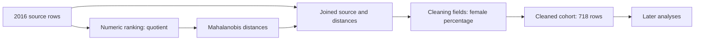

<!--
  Licensed to the Apache Software Foundation (ASF) under one
  or more contributor license agreements. See the NOTICE file
  distributed with this work for additional information
  regarding copyright ownership. The ASF licenses this file
  to you under the Apache License, Version 2.0 (the
  "License"); you may not use this file except in compliance
  with the License. You may obtain a copy of the License at
  http://www.apache.org/licenses/LICENSE-2.0
  Unless required by applicable law or agreed to in writing,
  software distributed under the License is distributed on an
  "AS IS" BASIS, WITHOUT WARRANTIES OR CONDITIONS OF ANY
  KIND, either express or implied. See the License for the
  specific language governing permissions and limitations
  under the License.
-->

This is the pre-implementation audit. The subsequent
[implementation and six-domain evaluation](analysis-state-implementation.md)
preserve this evidence and test the proposed mechanisms; their measured
accuracy/cost result takes precedence over the expectations below.

**LongDS state-maintenance review, September 24, 2026.** The recommendation is
to make a small experiment around repairing and modifying an executable
analysis. Catalogs remain useful for finding work, but the latest traces expose
failures that retaining more history cannot resolve: a correction applied to
only one copy of a definition, and a reporting request that accidentally changes
the calculation it is reporting.

This review inspected checkout `3a8a9b995` on `feat/task-history-dataflow`,
mechanically audited 24 saved sessions, and manually followed selected failure
and success chains through requests, programs, observations, graphs, answers,
and existing judgments. It also read the earlier research reports and selected
older traces. It did not manually classify every failed turn. The
[audit script](../agent-service/benchmark/multiturn/audit-longds-state.py) and
[evidence JSON](../agent-service/benchmark/multiturn/LONGDS_STATE_AUDIT_2026_09_24.json)
record the selection, artifact hashes, scores, attempted operations, usage, and
an offline numerical intervention. No agent or judge was run and no saved score
was changed. Runtime source is unchanged.

**What is actually being compared.** Trials 9–11 are the most recent repeated
`react-entries`/`dsgym` comparison on University task 2 and Netflix task 3. They
contain six sessions per arm and 171 paired turns. The recorded Dataflow settings
match across these trials; they enable task history, entries, cache boundaries,
restore, step explanations, and data/flow evidence. Run configurations do not
record the runtime commit, so these results must not be attributed to the latest
stable merge at HEAD. Earlier arms below are historical diagnostics, not pooled
treatments. The saved scores are binary official-protocol judgments; these two
development workloads are not the full LongDS benchmark.

| Latest recorded comparison | Dataflow entries | Persistent DSGym Python |
| --- | ---: | ---: |
| University, trials 9 / 10 / 11 | 2 / 2 / 2 of 21 | 7 / 1 / 16 of 21 |
| Netflix 3, trials 9 / 10 / 11 | 1 / 2 / 13 of 36 | 6 / 9 / 7 of 36 |
| Correct turns, pooled descriptive total | 22/171 (12.9%) | 46/171 (26.9%) |
| Recorded model cost | $0.9256 | $0.4558 |
| Model calls | 455 | 324 |
| Input tokens, including cached input | 16.34 million | 6.71 million |
| Output tokens, including reasoning | 284,119 | 226,099 |

The paired outcome counts are 10 both correct, 113 both incorrect, 12 Dataflow
only, and 36 DSGym only. All recorded spending, including failures, is included.
These are dependent turns within repeated sessions on two workloads; treating
171 turns as independent samples would exaggerate certainty.

**What the previous approaches established.** The branch has already explored
much of the natural design space. The
[September 20–21 direction review](multiturn-direction-review.md) corrects some
earlier baseline and mechanism descriptions and is the best starting point for
the older experiments.

| Approach | Capability it supplies | Limitation supported by the evidence |
| --- | --- | --- |
| Full ReAct history; DELTA/LATEST and evidence tuning | Preserves decisions and gives the model result evidence | Expensive replay; accurate recollection still permits incorrect computations. Historical cost wins against another Dataflow arm do not establish a Python-baseline win. |
| Compact catalog and completed task entries | Addresses prior operators, definitions, observations, and answers | The entries are not bounded memory. Names and explanations do not enforce a single definition of a metric. |
| Immutable historical outputs and `at(...)` | Exact old materialized values, separate from current descendants | Selecting the intended version remains necessary; an old result does not supply a reusable computation with different inputs. |
| Saved recipes, explicit registry, and restore | Retains or rebuilds definitions; can fork an analysis | Binding/cloning overhead, incorrect value-column selection, and weak natural uptake. Simple Python functions already support substantial reuse. |
| Dependency maintenance and demanded execution | Invalidates/recomputes along represented dependencies | Cannot repair a duplicated calculation in an unrelated UDF. Result callbacks are not measurements of physical execution. |
| Kept frames | Makes UDF-local DataFrames discoverable and replayable | Historical implementation re-executes the parent to expose a local; it does not capture every intermediate value. The successful controlled membership runs did not read frames. |
| Direct result return and answer guards | Avoids transcription and rounding mistakes | A previous guard rejected a correct cached answer merely because the new task did no work. Correct read-only reuse must remain valid. |

The sibling [recipe study](../../multiturn-dataflow-research/agent-service/benchmark/multiturn/REPORT.md)
already proposed explicit input roles and atomic fork/override/observe. Its
reusable-function Python control scored 27/27 at $0.0233, versus 26/27 at $0.0292
for guided recipes on one synthetic family. One recipe selected the right old
membership and new data but consumed old unsuffixed `gross`/`cost` columns after
the join. Graph connectivity alone did not establish the origin of the values.
I read that report, rather than re-auditing its complete raw campaign.

Thus reusable modules, dependency slices, and version roles are unfinished prior
work here. The new contribution of this review is a concrete explanation of
where to apply them and a numerical check of one repair mechanism. Some older
implementation documents describe retired settings; the historical arm's saved
configuration and revision take precedence over today's defaults.

**The University failure is a partial repair, with a reproducible cause.**
The key evidence is trial 11, turns 3–5:

1. Turn 3 makes `numeric_ranking`. It interprets a value such as `33:67` as
   `33 / 67`.
2. Turn 4 computes `mahalanobis_distances` from that table, using pairwise
   covariance and a pseudoinverse. Anadolu's squared distance is 281.8274.
3. Turn 5 implements the requested cleaning thresholds, including a cutoff of
   5 on the female-side value. It independently parses the field again inside
   `cleaning_numeric`. With quotient units, the resulting cohort is empty.
4. The agent recognizes the units problem and explicitly explains that the
   female-side percentage should be used. It changes `cleaning_numeric` and
   `cleaning_summary`, but does not change the older `numeric_ranking` or the
   distance calculation. The repaired local filter now retains 718 universities.
5. Later analyses consume this cohort. The requested calculation uses the
   female-side value in both places and retains 721 universities.

The graph after the attempted repair is conceptually:



This is not an engine cache-freshness failure. The engine follows the submitted
dependencies. The semantic definition exists twice, and the correction reaches
only the downstream copy. Saving that graph perfectly preserves the mistake.

I replayed the calculation locally with the same pairwise covariance procedure,
changing only the ratio encoding at the two locations:

| Encoding used for distances | Encoding used for screening | Retained rows | Mean total score | Sample SD |
| --- | --- | ---: | ---: | ---: |
| Quotient | Quotient | 0 | — | — |
| Quotient | Female-side percentage | 718 | 38.702725 | 17.243482 |
| Female-side percentage | Female-side percentage | 721 | 38.660466 | 17.232948 |

The last case also changes Anadolu's distance to 278.6702. Four universities
enter and one leaves relative to the mixed-definition cohort. This explains the
observed turn-5 difference without changing the covariance estimator. An older
README attributes similar numbers to covariance choice; that explanation should
not be carried forward to this trace. This replay establishes a numerical
mechanism, not a measured improvement in later agent accuracy.

The successful trajectories strengthen this diagnosis. Trial-11 DSGym encounters
the same empty cohort, then rebuilds the encoding, covariance, and cleaning
together; it ends at 16/21. Earlier Dataflow entries trial 8 similarly rebuilds
the distance calculation and reaches 18/21. Dataflow full-history trial 4 repairs
the older numeric definition at turn 6 and finishes at 17/21. These are observed
recoveries, not randomized evidence that one memory format caused recovery.

The early phrase “female-to-male ratio” permits understandable ambiguity. The
later threshold and balance criteria supply evidence for revisiting the earlier
interpretation. A general solution should retain units and derivation assumptions
and react to contradictions. It must not encode the hidden answer “721” as a
runtime check.

Evidence: trial-11
[turn 3](../benchmark/longds/system_scratch/LongDS_Official_react-entries_luna_t11/education__world_university_rankings__task2/turns/t03/react_steps.json),
[turn 4](../benchmark/longds/system_scratch/LongDS_Official_react-entries_luna_t11/education__world_university_rankings__task2/turns/t04/react_steps.json),
and [turn 5](../benchmark/longds/system_scratch/LongDS_Official_react-entries_luna_t11/education__world_university_rankings__task2/turns/t05/react_steps.json).
Turn-5 trace indices 1 and 2 contain the initial program and partial correction.
The numerical intervention and source hash are in `university_repair_replay` in
the evidence JSON.

**Netflix shows both an incorrect foundation and new drift during reporting.**
In trial 11, turn 1's search-data UDF explicitly excludes `multiTimeline.csv`.
That file's header identifies the United States; it is not a duplicate of the
other country files. The resulting analysis has 14 search markets instead of
15. DSGym also gets 14. This changes the population used for percentile ranks
and explains some later numeric differences. An inventory of included sources
and reasons for exclusions would expose the decision at its origin. Reading
files inside opaque Python also hides source dependencies from the graph.

There are additional local mistakes: turn 23 calculates rank loss as old rank
minus new rank, then sorts descending, selecting the wrong direction of change.
Neither that arithmetic error nor the omitted source should be relabeled as
forgetting because its answer occurs late in the session.

Turn 25 is the clearest maintenance opportunity. The user asks for the largest
positive and negative adjustments for the **current** top five. The agent writes
a new 3,994-character function that reconstructs the ranking from eight tables.
Its score base already contains `0.20 * structure_adult_fit`, but it also adds
`0.20 * (structure_adult_fit - old_adult_fit)` in its adjustments list. It applies
the maturity substitution twice. The explanation request produces a list with
Taiwan in place of Spain, whereas the immediately preceding current top-five
list included Spain. The duplicated term is directly visible in the submitted
code; I did not perform an isolated numerical intervention on this function.

Turn 26 reconstructs the formula again, this time without the extra term. Turns
27 and 35 also regenerate substantial scoring code. An explanation view should
read the actual score and its stored components. It should not have to create a
second independent implementation of the score.

There are positive examples worth preserving. In turn 28, Dataflow correctly
combines the earlier entropy-based score with the newer screen and gets the
top-five overlap of four; DSGym fails and emits no Python block in that turn.
In turn 35, Dataflow correctly applies quarter-strength freshness and removes
the rare-category reward while keeping niche-demand mismatch. It returns the
four surviving shortlisted markets and the correct score changes; DSGym fails.
But Dataflow writes another approximately 4 KB function over ten inputs to do
this. The opportunity is to express the two coefficient changes and reuse the
existing computation with checked scope.

A passed answer does not certify the entire underlying analysis. Some questions
only request market names or deltas, which can remain correct despite incorrect
absolute scores. Existing judgments remain unchanged; artifact correctness is
an additional proposed measurement.

Evidence: Netflix trial-11
[turn 1](../benchmark/longds/system_scratch/LongDS_Official_react-entries_luna_t11/business__netflix_movies_and_tv_shows__task3/turns/t01/react_steps.json),
[turn 23](../benchmark/longds/system_scratch/LongDS_Official_react-entries_luna_t11/business__netflix_movies_and_tv_shows__task3/turns/t23/react_steps.json),
[turn 25](../benchmark/longds/system_scratch/LongDS_Official_react-entries_luna_t11/business__netflix_movies_and_tv_shows__task3/turns/t25/react_steps.json),
[turn 28](../benchmark/longds/system_scratch/LongDS_Official_react-entries_luna_t11/business__netflix_movies_and_tv_shows__task3/turns/t28/react_steps.json),
and [turn 35](../benchmark/longds/system_scratch/LongDS_Official_react-entries_luna_t11/business__netflix_movies_and_tv_shows__task3/turns/t35/react_steps.json).

**The latest agents barely exercise cross-turn graph modification.** Across the
six latest Dataflow sessions there are 285 submitted `dataflow` calls, zero
actual `at(...)` calls, and zero restore requests. There are only two assignments
to previously named operators from earlier turns, both in Netflix trial 11 turn
5. Within-turn repairs are common and are excluded from that last count.
Submitted programs total 568,778 characters, of which 428,981 (75.4%) belong to
function definitions. The final Netflix trial-11 graph has 128 operators and
312 links, including 63 `process` operators.

The historical-input count corrects my initial status message: a naive substring
search for `at(` also matched `float(`. The audit now uses Python AST calls. One
latest program has a syntax error; inspection of that failed program also finds
no historical reference. The runner's recorded historical-input counts agree.
An earlier GitHub trial really does use two `at(...)` reads, so the capability
is not absent from the entire research history.

Zero historical reads alone is not a failure: if old tables remain live under
their original names, ordinary references are sufficient. The important finding
is that the large graph mostly accumulates new calculations. It does not
consistently represent one evolving scoring computation whose small changes the
runtime can propagate. Maximizing use of `at` or restore would be the wrong goal.

**Prompt growth remains real, but trimming the index alone misses it.** At the
first model call of Netflix trial-11 turn 36, completed entries occupy 281,255
characters and the live index only 3,872. The input is 79,542 tokens, compared
with 8,370 at turn 1. The entry representation preserves useful details but also
replays repeated code and results.

Across the latest Dataflow runs, 93.1% of input tokens are cache reads. They still
cost money: estimated input-cache reads contribute $0.3044 and writes $0.2799,
versus $0.1298 and $0.0539 for DSGym. Those two categories account for about 85%
of the total cost gap. Output contributes $0.3409 versus $0.2713. Reasoning tokens
are already included in output; they are not a second cost. Rates are the saved
repository estimates, not provider invoices, and omit engine/storage costs.

This supports bounded context as a cost experiment. It does not show that large
context caused the University failure. Foundation errors, request difficulty,
and history length are confounded in a natural trajectory.

**How the literature changes the interpretation.** LongDS distinguishes failures
of recalling history from selecting/updating state and from cascading wrong
intermediates; cascades are its largest category. Its reset experiment clears
executable state while retaining interaction history. It therefore does not test
a short prompt over preserved Dataflow artifacts. That latter design would be
our hypothesis. [LongDS, sections 5.2–5.3 and appendix C.7](https://arxiv.org/html/2605.30434)

Dependency tracking is also available to Python: ipyflow documents symbol/cell
dependencies, staleness, slicing, and reactive execution. A Dataflow contribution
must be evaluated against capable persistent code, not a deliberately forgetful
baseline. [ipyflow documentation](https://ipyflow.readthedocs.io/en/latest/index.html)

Incremental data processing is a separate opportunity. DBSP derives incremental
computations for changing input data under a defined query. That does not by
itself solve a wrong statistical interpretation or provide automatic incremental
execution of arbitrary Python. Model-cost and execution-cost claims should be
measured separately. [DBSP paper](https://www.vldb.org/pvldb/vol16/p1601-budiu.pdf)

**The design to test is an analysis with explicit assumptions and controlled
updates.** There are five connected parts, each justified by a trace above.

1. **Make the reusable unit an analysis component.** Preserve a cleaned cohort,
   numeric encoding, feature table, score definition, and score-component table
   when these are meaningful outputs. Give repeated definitions a single owner
   and named parameters. Permit normal Python inside these components; use native
   operations where column origins, join cardinality, or row preservation can
   be checked. Explicit multiple outputs are preferable to promising recovery
   of arbitrary Python locals. Keep the model interface small: the previous
   registry showed the cost of extra IDs and bookkeeping calls.

2. **Use dependencies to repair the full affected analysis.** When the ratio
   interpretation changes, find consumers of that definition, revise the shared
   encoding, and refresh required descendants. Represent evidence such as units,
   population, denominator, null policy, source version, and the request that
   established the definition. Do not pretend the engine can infer equivalent
   meanings in arbitrary duplicated Python. Initially let the model identify the
   assumption being corrected; require named shared definitions for automatic
   propagation. Cross-check suspicious duplicated derivations as a diagnostic.

3. **Distinguish persistent changes, temporary scenarios, and historical reads.**
   Keep separate bindings for membership keys, measurement values, formula
   version, and a frozen publication. An old-membership/current-values request
   should semijoin old keys against current values, avoiding old measurement
   columns. A temporary sensitivity run should override two parameters without
   changing the persistent default. An explicit update should advance that
   default after its affected results are checked. Repairing the current branch
   should preserve the previously published historical artifact, with provenance
   that records the correction.

4. **Make checks local to the actual risk.** For University, contradictory units
   and unexpected empty screening warrant inspection of the earlier encoding.
   For Netflix, account for each source and verify that stored score components
   sum to the score; an explanation request should preserve score identity. Stage
   edits, check declared constraints on the affected slice, then advance the
   default. A failed update must remain visibly failed rather than silently
   serving the old value as current. Empty results can be valid, and unchanged
   answers can be correct: do not restore the old blanket guards. Model-written
   assertions are hypotheses until grounded in data or public requirements.

5. **Build each phase's context from this state.** Supply the current request,
   relevant definitions and assumptions, selected version bindings, the needed
   dependency slice, and recent observations. Archive completed entries for
   retrieval. Maintain stable segments where caching helps, but measure total
   tokens and retrieval calls. Preserve global constraints and the full ranking
   population when required; retrieving only the top-five rows would change
   percentile semantics. Phase boundaries should come from the user's change of
   objective or a measurable context budget, not future answers or gold labels.

This should be achievable without a new collection of planning agents. The
model interprets intent and ambiguous semantics; the runtime manages versions,
bindings, invalidation, materialization, and declared checks. If native graph
authoring remains the bottleneck, ordinary Python with tracked component inputs
is a serious alternative interface to the same runtime.

One implementation limit needs care: current
[`verifyRestore`](../agent-service/src/agent/native/task-restore.ts) compares row
count and column names, not values. A same-size, same-schema result can drift.
Immutable retained Arrow values have checksums; rebuilding a definition is a
different guarantee. Before relying on restored equivalence, include result
identity/digests and all declared input versions, and report untracked external
reads or nondeterminism. Do not label structural agreement as exact restoration.

**The next experiment should be small and discriminating.** I would prioritize
the following sequence over another wide catalog/configuration sweep.

| Diagnostic | Intervention | What would count as useful evidence |
| --- | --- | --- |
| University foundation repair | Start from the same faulty prefix; supply or discover the public units contradiction; repair the shared definition and affected descendants | Correct cohort identities and dependent results, unchanged historical publication, fewer manual edits than reusable Python |
| Netflix explanation and sensitivity | Start from equivalent checked analyses; explain existing components, then fork the two coefficient changes from turn 35 | No score drift during explanation; correct scenario; unchanged default and unrelated components; less regenerated code/cost |
| Earlier formula plus current screen | Reuse a saved formula with explicit current-population bindings | Correct column origins and ranking population, with no accidental old values or default mutation |
| Context depth | Repeat matched requests after different amounts of unrelated history | Stable artifact accuracy and bounded input/cost as distance grows, against the same memory policy in Python |

Separate two tracks. First use supplied, equivalent executable analyses to
measure the conditional value of maintenance. Give Python ordinary functions,
snapshots, and the same definitions and selection information. A deliberately
localized correction is a diagnostic, not ordinary benchmark performance.
Then run complete sessions in which each agent must discover and build the
analysis itself, charging construction, verification, and failed repairs. If
only the first track improves, the remaining problem is acquiring the reusable
representation; if neither improves over functions, do not expand the interface.

For the first prototypes, compare the current entries arm, the proposed
maintenance interface, and persistent Python with reusable functions. Add a
matched bounded-context ablation only after the repair mechanism works. A later
same-runtime/Python-interface control can distinguish authoring overhead from
runtime value. Fix the runtime revision, data hashes, model settings, judge,
budgets, and task prompts, and record all of them in each run.

Measure official answer scores separately from deterministic state properties:
cohort key sets, units, consumed column versions, active-default identity, frozen
publication identity, and preservation of unrelated outputs. Also measure calls,
generated code, cache reads/writes, full cost, physical executions, source bytes,
and retained storage. Cache callbacks are not executions. Turn distance must
vary independently of request difficulty. Repetitions are clustered by complete
session; three runs are a development check, not a general statistical result.

University and Netflix are now heavily inspected development cases. Select and
freeze additional unseen task families before examining their outcomes. Keep
simple reuse cases such as GitHub and opaque-UDF cases such as Policing as
diagnostic controls; do not claim either is a pristine holdout after this review.
Reference code, future tasks, dependency annotations, and gold values stay on the
evaluation side. Checks proposed to the agent must be derivable from the public
request and data.

**Reproducing this audit.** Basic extraction needs the standard Python library:

```bash
python3 agent-service/benchmark/multiturn/audit-longds-state.py --out /tmp/longds-state-audit.json
```

To include the local numerical intervention, use an environment with pandas and
NumPy and add `--replay-university`. The saved replay used pandas 2.2.3 and NumPy
2.2.4. The script reads existing artifacts and source data; it does not execute
the saved agent programs. Some input directories are local symlinks, so the
saved audit remains useful when the raw run tree is unavailable.
