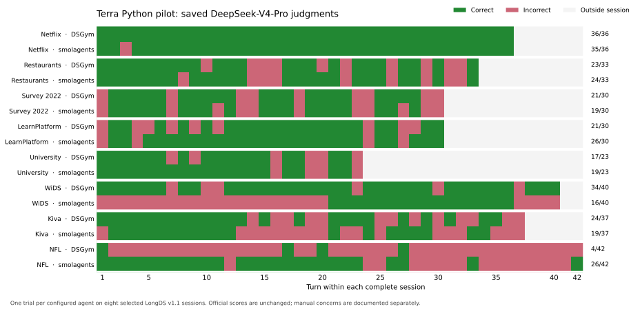

<!--
Licensed to the Apache Software Foundation (ASF) under one
or more contributor license agreements. See the NOTICE file
distributed with this work for additional information
regarding copyright ownership. The ASF licenses this file
to you under the Apache License, Version 2.0 (the
"License"); you may not use this file except in compliance
with the License. You may obtain a copy of the License at

  http://www.apache.org/licenses/LICENSE-2.0

Unless required by applicable law or agreed to in writing,
software distributed under the License is distributed on an
"AS IS" BASIS, WITHOUT WARRANTIES OR CONDITIONS OF ANY
KIND, either express or implied. See the License for the
specific language governing permissions and limitations
under the License.
-->

# Terra on long, stateful Python analysis sessions

Study date: 2026-09-30. Completed on `feat/state-registry`, base commit `96afcbd16`. Both agent arms use **gpt-5.6-terra**; the judge is **DeepSeek-V4-Pro**.

## Recommendation

First test a short policy that preserves full working results, checks population and metric scope before reuse, and ties numerical answers to executed results. Then test explicit result dependencies and a catalog generated from those execution records. The traces identify concrete failures those changes could address; this two-Python-system pilot does not establish a Dataflows benefit.

## Experiment

Eight complete sessions were selected before running either arm: Netflix task 3, NYC Restaurants task 2, Kaggle Survey 2022 task 2, LearnPlatform task 2, University Rankings task 3, WiDS task 1, Kiva task 1, and NFL task 1. Together they contain 271 turns per arm. The selection targets historical/current mixtures, temporary scenarios, revised populations, and multi-stage scores. All eight belong to the official Lite subset; this is a custom subset of Lite.

Both arms use `gpt-5.6-terra`, medium reasoning, 40 steps per turn, and an 8,192-token model output limit. DSGym uses the upstream persistent Jupyter agent. Smolagents 1.23.0 uses its persistent Python interpreter with the custom prompt enabled, a 5,000-character output limit, and the other branch's `final_answer(...)` prompt correction. Variables and conversation persist throughout each session. There is no reset, refresh, compaction, or experimental context budget between turns.

These are two configured systems: their prompts, tool protocols, and executor restrictions differ. DSGym requests temperature 0; the smolagents GPT-5 wrapper omits a non-default temperature. In particular, the smolagents custom protocol requests JSON output and the final-answer tool; DSGym keeps its upstream system prompt. The comparison does not isolate the executor or prompt as a causal factor.

The judge is `deepseek/deepseek-v4-pro` through OpenRouter, using the unchanged upstream judgment prompt, temperature 0, and an initial 4,000-token limit. Valid saved judgments are preserved, including judgments questioned by the manual audit. Missing verdicts caused by exhausted output limits receive a longer allowance under the same prompt; the recovery records preserve every attempt and its usage. The paper specifies DeepSeek-V4-Pro in §3.4 and averages turn accuracy within each task before averaging tasks. It distinguishes wrong state from later errors inherited from an earlier calculation; its DSGym baseline retains a Python kernel. [LongDS paper, v3](https://arxiv.org/html/2605.30434v3#S3.SS4)

Data is pinned to LongDS **v1.1**, Hugging Face revision `bf41bb28474fa9540d98922a6f5e6310ed014e51`. The dataset authors distinguish this audited release from the v1 data behind the original results. Our model, selected sessions, and custom smolagents configuration also differ, so these scores are not a reproduction of the paper's table. [Dataset release notes](https://huggingface.co/datasets/zjunlp/LongDS)

## Results

| Session | DSGym | Smolagents custom |
|---|---:|---:|
| Netflix | 36/36 (100.0%) | 35/36 (97.2%) |
| NYC Restaurants | 23/33 (69.7%) | 24/33 (72.7%) |
| Survey 2022 | 21/30 (70.0%) | 19/30 (63.3%) |
| LearnPlatform | 21/30 (70.0%) | 26/30 (86.7%) |
| University Rankings | 17/23 (73.9%) | 19/23 (82.6%) |
| WiDS | 34/40 (85.0%) | 16/40 (40.0%) |
| Kiva | 24/37 (64.9%) | 19/37 (51.4%) |
| NFL | 4/42 (9.5%) | 26/42 (61.9%) |
| **Task-macro accuracy** | **67.87%** | **69.48%** |
| Turn-weighted accuracy | 180/271 (66.42%) | 184/271 (67.90%) |

All **16 complete-session runs and 542 turn judgments** are present. Each task contributes equally to task-macro accuracy; this differs from pooling every turn. Smolagents LearnPlatform includes its empty first-turn failure.

The overall gap is small: smolagents has four more correct turns. Opposite task differences dominate it: +22 on NFL and -18 on WiDS. One trial on a selected subset cannot establish a general framework ranking.

The plot shows outcomes, not causal labels. Adjacent failures can inherit one earlier error, and a correct turn answer can leave incorrect working state.

### Returned model usage

| Quantity | DSGym | Smolagents custom |
|---|---:|---:|
| Model responses with usage | 811 | 637 |
| Input tokens, including cache reads | 32,449,327 | 28,891,555 |
| Cached input tokens | 31,785,750 | 28,083,145 |
| Cache-write tokens | 627,433 | 721,655 |
| Completion tokens | 505,256 | 349,456 |
| Reasoning tokens, already included in completion | 72,981 | 70,525 |

Saved judge usage reports **$2.5306** for these runs, including saved format retries. Agent charges cannot be recovered from the proxy's zero-rate cost metadata. Failed calls without usage and the excluded attempts/endpoint diagnostics are outside the returned-agent-token totals. Do not interpret the harness's Luna-rate dollar estimates as actual Terra spend.

Prompt sizes, code volume, caching, and executor protocols differ between arms. These totals describe the pilot; they do not isolate a framework efficiency advantage.

The manual evidence file documents **40 cases across 147 unique saved turn traces**. Cases include successes, failures, paired differences, and upstream/downstream chains. They are selected diagnostic audits, not an exhaustive error taxonomy.

## What the traces establish

### Persistent Python already handles substantial historical composition

Both systems handle Netflix's late combinations of current and historical score components, including a comparison across thirteen saved rankings. DSGym scores 36/36; smolagents scores 35/36. The latter's only failure is an early interpretation of “dominant component,” not a missing historical result. Stable variable names and full component tables are a serious baseline. At NFL turn 42, smolagents retrieves twelve saved player/team choices and gets all five leading conclusion-set distances right. One missed-player identity differs from the reference despite the judge assigning a pass; the manual evidence records that discrepancy without changing the score.

Survey provides a second control: smolagents preserves strict and broad adopter definitions, the changed industry denominator, and narrow versus expanded company-size views. Its late answers can use the requested versions correctly while still failing because the role-score formula was wrong earlier. In WiDS, both systems correctly update the social weights from equal shares to .20/.35/.10/.35 and then .45/.20/.35. Smolagents also correctly combines old and current county definitions and completes the final county panel. Its building panel inherits a wrong initial gas-use field instead.

### New answers sometimes bypass the available calculation

DSGym Restaurant turn 10 reports 55 problem rows without executing that calculation; the correct count is 59. Its next turn executes and recovers. LearnPlatform turn 1 loads raw rows but claims statistics from a join it never executed. At turns 7 and 11 it says execution is required and ends the turn instead of calling the available tool. Turn 28 executes a lookup but reports new, uncomputed composite scores.

“A Python call happened” is therefore too weak a check. A numerical claim needs the particular executed result that supports it. Direct answers remain useful when an existing result already answers the question.

### Having the right state does not ensure that the agent uses it

Restaurant turn 27 defines eligibility as positive voucher profit **and** the stricter quality condition. Both agents drop the quality condition in the turn-29 stress comparison and invent two stress-only failures. Smolagents has already joined the correct eligibility flag into its working table before ignoring it. More storage or more visible lineage alone would not prevent this mistake. The proposed intervention must test consumption of the established eligibility result.

Smolagents Restaurant turn 22 instead selects the older frequency-led customer definition even though the spend-led view is retained. This is a useful version-selection case, with a caveat: the public update wording is implicit, so the benchmark's hidden state labels cannot be treated as an online oracle.

### Reuse needs a definition check

Survey turn 13 replaces previously computed global experience anchors with role-conditioned calculations. Later score mixtures preserve those wrong anchors. University turn 20 includes missing publication values in the denominator. Survey turn 7 loses literal `None` opt-outs through pandas' default null parsing; an offline read with explicit null handling restores the reference counts exactly.

LearnPlatform shows the opposite danger: its turn-8 category winner is correct for a mean-weekly metric. Turn 27 asks for overall mean engagement, but both agents reuse that old winner. An instruction to reuse everything would make this failure more likely. The catalog needs to show the calculation's population, grouping level, denominator, and aggregation convention.

### A correct answer can leave the next working population undefined

At Kiva turn 12, smolagents correctly reports the strongest country-sector pairs removed by the new loan-theme-partner support requirement. It saves a broad table with a support flag and the removed top-five answer, but does not materialize the surviving population. Turn 13 joins poverty evidence to the old social table: 411 rows, versus the 17 supported rows that DSGym correctly retains. The next development comparison continues from that broad table. This is a direct state-management case: answering which rows were removed is different from committing the surviving population for later analysis.

Kiva also exposes premature use of a later population rule. Smolagents applies the complete-development and ten-MPI-region restriction at turn 18, although that restriction becomes current at turn 23. The full first-turn preamble defines future formulas, so the mere presence of a definition in context does not mean it is active. Turn 24 successfully recovers the requested relaxed population and identifies the three right returning recommendations.

### Component errors survive successful historical composition

Kiva's development profile diverges in both arms. Smolagents uses `100 - percentile` for low-valued indicators, which differs from ranking the negated values by `100 / nonmissing_count`. DSGym uses the intended direction, but its nullable `Float64` parsing path changes the agriculture and unemployment ranks in the installed pandas 2.2.3. An offline reproduction matches the recorded profiles: Sierra Leone is 79.940476 under the reference calculation, 80.593137 in DSGym, and 79.170868 in smolagents. This is a local reproduction of these exact paths, not a claim about all pandas versions.

Despite that error, smolagents correctly combines no-wait funding, inclusive partner scores, and current vulnerability at turn 29. At turn 35, median MPI flows through **both** uses of expanded vulnerability, and borrower caution is applied at the social layer. It identifies the correct CAPTN-out/PAC-in replacement. The absolute scores remain wrong because of the earlier development calculation. Counting every later zero as a fresh state failure would misdiagnose this chain.

NFL supplies another early definition error. DSGym observes that the source total pressure equals hit + hurry + sack and imposes that convention on the requested four-component event ledger, excluding beat. It also overwrites the source pressure column with its reconstruction. Later zero accounting gaps produce an inclusive zero mismatch cutoff, excluding all ten matched published-list players and retaining 35 players instead of 42. The first answer passes because its requested identity and ledger-size summary is correct, while the underlying pressure state is already wrong. At turn 23 the inherited flag removes all 35 remaining candidates, preventing subsequent score construction. DSGym finishes at 4/42. Smolagents initially also replaces the source pressure, but at turn 2 it notices the distinction, restores source total pressure from saved input rows, and computes the correct four-component ledger gaps. This repair happens before the downstream chain and receives no external hint. A lineage graph would reproduce DSGym's wrong definition unless the calculation were corrected.

### Fitting, ranking, and reporting can require different populations

Smolagents finishes NFL at 26/42. It correctly narrows the reliable population to 33 candidates at turn 23. The next request requires fitting speed caps on those candidates, applying them to all 86 players, ranking within each side across all players, and finally reporting current candidates. Instead, it fits, clips, and ranks only the 33-player copy. Both the full table and the explicit instruction are available. The mistake is a collapse of different population roles. At turn 26 it has no full-population current score to reuse; at turn 32 it selects the requested historical pressure and team definitions correctly, but the mixed scores inherit the wrong current speed values.

This limits a simple “current working table” design. Preserve the fitted caps, full scored population, and current cohort separately. A catalog should make those relationships visible, and an exported computation should name which one it consumes.

### Some apparent failures are about the answer or the reference

Both Restaurant agents recover historical attribution at turns 31–32, but the judge rejects terse labels where explicit business reasons were expected. Smolagents Survey turn 27 reports the two differences correctly; the saved judge reverses their labels and assigns zero. University has separate alias, population-scope, and answer-completeness concerns.

LearnPlatform's COVID mismatch is explained by two supplied source snapshots: DSGym chooses daily `States.csv`, while a separate `USA Covid Data.csv` contains the reference totals. That is an input-selection problem, not proof of state loss. These cases remain in the official score and are annotated separately.

DSGym WiDS turns 30 and 37 compute the requested historical comparison and marker shifts. Their detailed answers omit the closing answer tag. After parser feedback, the accepted retries drop required fields. Those zeros are protocol and answer-completeness failures, even though the calculations exist. Turn 23 has a separate strict last-decimal discrepancy; turns 7, 10, and 11 inherit geometry precision differences. The official 34/40 therefore does not imply six state-selection failures.

## Existing implementation changes the recommendation

The repository already has an analysis-state prompt advocating coarse processes, explicit inputs, parameters, assertions, shared corrections, and historical forks. Repeating that list is not a new algorithm. The earlier isolated six-session GPT-5.2 experiment scored 37.55% versus 40.15% for the entries baseline, with 34.96% higher accounting cost; it rarely used the proposed parameter/correction mechanisms. That study uses a different model, data release, and GPT-5.2 judge and must remain separate from this pilot.

Three concrete implementation observations matter:

- `answer_from` already names an executed output, but task-entry source attribution can fall back to matching answer numbers against cells. Retain the exact result reference through finalization instead.
- The registry's `supersede` operation changes metadata. Its prompt describes stronger downstream replacement behavior. Align the contract before using that operation to test correction propagation.
- The previous analysis-state study repeatedly inspected definitions missing from its selected task-start memory. A compact, useful inventory is more promising than another unrestricted inspection loop, but it still needs a matched comparison.

See the [earlier implementation study](analysis-state-implementation.md), [existing method prompt](../agent-service/src/agent/prompts.ts#L256), [answer-source heuristic](../agent-service/src/agent/native/task-entries.ts#L126), [recorded exact answer reference](../agent-service/src/agent/tools/native-batch-tools.ts#L1141), [supersede implementation](../agent-service/src/agent/native/definition-registry.ts#L132), and [its caller](../agent-service/src/agent/tools/native-batch-tools.ts#L978). No agent-service or engine changes were made in this pilot.

## Proposed next experiment

### Step 1: test a small policy on persistent Python

Both Python prompts already encourage incremental work and inspection. Consolidate that guidance into the following four operational rules instead of appending another long method section:

1. Before reusing a result, check its metric, aggregation, historical/current definition, and population at each stage: fitting, normalization, and reporting can use different row sets.
2. Preserve the full reusable result; produce a separate projection for a top-N report. After changing the population, save the survivors even when the question only asks about exclusions.
3. Treat an explicitly temporary scenario as a separate result; change the current choice only when the request calls for it.
4. Support new numerical claims with executed results and state every requested conclusion in the final answer.

This policy directly addresses observed failures. Test it with the same model, budgets, executor, and output format as its baseline. Avoid simultaneously changing retrieval, telemetry, state representation, and the engine.

### Step 2: test whether explicit result dependencies add value

Build the smallest Python experiment that exports coarse analytical results: a cleaned population, eligibility keys, a metric table, a fitted model, or a complete score table. Keep ordinary Python inside each computation. A small record should contain the producer turn, explicit input result IDs, executed code, output ID, and an output profile. A task record links the request, consumed results, produced results, and the answer result. A current-choice map names the selected result for each active component.

Use those records to render a compact catalog. Prioritize current components and the historical components referenced by the new request. Profiles can include row count, keys, columns, missingness, and the declared metric scope. Distinguish measured facts from an agent-written description; a description is not a verified contract.

The runtime must know the actual input boundary. Arbitrary Python globals or a model-written dependency list do not establish complete lineage. A constrained exported computation with explicit data inputs is one small way to test this; importing libraries and ordinary code within that computation can remain flexible. Do not instrument every pandas assignment or build a second planner for this experiment. Treat a turn as a request that can consume several results and produce several others; forcing one task to equal one operator would lose useful structure.

The critical test is whether the selected old/current result is **consumed**, including all eligibility conditions. Merely displaying its name is insufficient. A graph can reproduce a bad formula faithfully, so first-divergence audits remain necessary.

Concretely, use this turn loop:

1. **Resolve:** name the requested population, metric, and current or historical components using the public request and saved records. Future formulas in a preamble are available definitions, not automatically current choices.
2. **Execute:** pass those result IDs into a coarse computation. Retain the full working output and create the answer projection separately. At a population update, produce surviving keys or rows even when the answer asks only about losses.
3. **Finish:** record actual input IDs, output IDs, and `answer_from`. Update current choices only after successful execution of an intended persistent change. A temporary result leaves the current choices intact.

For the Kiva failure, the important boundary is `supported_social = intersect(social, specialized_partner_keys)`. The removed-pairs answer is a second output. The next poverty join must consume `supported_social`, rather than infer the active population from an answer about five removed rows. This requires a result reference and a small current-choice map, not a new hierarchy of task, catalog, and version objects.

Start with three records: immutable result records, per-turn input/output/answer records, and a current-choice map. Render the catalog from those same records. Existing operator history can supply the result IDs in Texera. Keep model-written scope notes visibly separate from runtime-measured row counts, keys, and missingness. Do not infer a dependency from an answer number appearing in a sampled cell.

Prefer a filtered eligible population or explicit cohort-key result when that is the boundary the next calculation needs. Passing a wide table containing an eligibility flag does not ensure the flag is applied. Even an explicit input edge only proves that a table was passed; it does not prove that the code used every required column or predicate. Check membership or component sums where the public definition supplies a concrete invariant. The model must still interpret the request correctly.

### Step 3: test correction propagation only after there is a correction

Once an upstream definition is explicitly corrected, replay its intended current consumers and preserve historical results for questions about the old analysis. Test this on the Survey-anchor, Restaurant-coverage, and NFL ranking-population chains. Give both systems the same correction at the same point and measure affected descendants, preserved historical results, and recomputation. Label this as a separate controlled repair test: it changes the interaction and must not replace unmodified LongDS accuracy. Lineage locates affected computations; it does not discover the correct formula by itself.

If the policy alone captures the benefit, stop there. If explicit dependencies improve accuracy, correct-result consumption, or the amount of recomputation, transfer that behavior into the existing native `process`, result, and answer-reference machinery. A separate Python prototype lets us test the algorithm before paying for Texera-specific integration.

### Concrete integration targets, after the Python test

| Place | Small change to test | Observed reason |
|---|---|---|
| System prompt | Consolidate the four rules and describe only operations the runtime performs | Existing prompts already urge inspection/reuse; the supersede wording currently overpromises |
| Task finalization and `task-entries.ts` | Carry the exact consumed, produced, and answer result IDs; retain a changed working population independently of the displayed answer | Kiva's correct removed-row report fails to establish the surviving state; numeric cell matching is not provenance |
| Catalog/context rendering | Show current populations and metrics, requested historical references, and the code of relevant shared definitions from the same execution records | Useful selection needs population and metric scope, not just an answer table or a version number |
| Coarse `process` execution | Make boundary inputs explicit and record the versions actually read | Restaurant has the right eligibility flag but does not use it; lineage display alone cannot enforce a predicate |
| Correction and scenario operations | Recompute intended current descendants after an explicit correction; preserve saved historical outputs and temporary results | Survey, WiDS, Kiva, and NFL expose long downstream effects from early errors |

Do not add a separate catalog database, automatic task planner, or another universal version API for this test. The current result history and operator inputs already provide much of the storage. The research contribution has to be better state use and reliable repair, demonstrated against a matched persistent-Python baseline.

### Evaluation gate

The eight inspected sessions are now development diagnostics. First compare the policy to its unchanged Python baseline within one executor; DSGym's persistent Jupyter path is a suitable starting point. Keep sampling, output limits, answer protocol, and all non-policy settings fixed. The present two-system comparison cannot identify the cause of a score difference.

Then test the explicit result boundary as a system change. To isolate the catalog's additional value, compare the same boundary and policy with the generated catalog hidden versus visible; otherwise a changed execution interface is confounded with the catalog. Correction replay remains its own controlled test.

Freeze additional held-out Lite sessions before running, and use paired repeated complete-session trials. An initial four-session, two-trial, two-arm comparison is 16 runs; expand only after reviewing the predefined accuracy and overhead criteria. Use task-macro accuracy, manual first-divergence cases, correct consumption of requested state, repair propagation, repeated reconstruction, and raw token use. Preserve official judgments and report manual disagreements separately. Claim a catalog benefit only if it improves over the same policy and boundary without that catalog. A smaller prompt is not necessarily cheaper when it causes new cache writes or extra inspection calls. These are proposed follow-up runs, not part of this completed pilot.

Terra is suitable as a strong research baseline: its successful long compositions prevent us from attributing every difficulty to context length or missing versions. This pilot does not establish its variance or relative value versus other models.

## Integrity and operational notes

- Every one of the 322 official input files was checked against the pinned remote manifest and content hash. University had no extra files. The other seven sessions use private copies containing only official inputs, mounted read-only in the Python executor. Agent execution cannot access references, benchmark task files, credentials, or the repository.
- An initial Netflix attempt saw leftover working files in the shared data directory. Both attempted arms were preserved separately and excluded, then started on clean inputs. A later smolagents Netflix attempt returned no first response; it was preserved and repeated through `/v1` after a bounded endpoint diagnostic. That diagnostic response was never executed or supplied to an agent. Other completed sessions were preserved.
- A harness-only fix separates library stdout from the smolagents executor's RPC channel. University ran before that fix and completed without this transport failure. Per-run protocol files preserve runtime hashes.
- Worker concurrency changed from two to three after endpoint recovery; the large LearnPlatform pair is serialized. Wall times are therefore not a controlled latency comparison.
- Agent usage comes from raw call logs, including cache reads and writes. Reasoning tokens are part of reported completion usage and are not added again. Requests failing before a usage response are absent from these token totals. Existing `cost_usd` fields apply Luna accounting rates, not actual Terra prices; do not use them as Terra spend. Judge charges can be summed from OpenRouter's saved usage.
- The smolagents Netflix diagnostic can warm its initial prompt cache. Do not present this single run as a controlled cache-cost comparison.
- Smolagents LearnPlatform turn 1 hit the configured model output limit and remains an empty-answer failure in the trial. Smolagents NFL first exhausted 8,192 reasoning tokens and then emitted malformed code responses, but recovered through normal feedback within turn 1. Neither agent budget was changed.
- Smolagents retains its import whitelist and interpreter operation cap. WiDS hits that cap during geometry parsing and then switches to a calculation that subtracts polygon holes. DSGym computes exterior area, but the strict four-decimal reference is itself sensitive to floating-point arithmetic on large coordinates. The saved offline Decimal check separates these issues from historical-state failures.
- Judge format recovery affected Kiva turn 28 in both arms and smolagents turn 33: those requests exhausted the initial 4,000-token allowance without a verdict. Missing verdicts alone were retried with 8,192 or 16,384 tokens under the same prompt and model. All valid earlier scores and all saved usage were preserved.
- Relevant harness tests passed: 11 Python tests covering execution isolation, persistent interpreter state, the final-answer prompt, stdout transport, and clean input snapshots. No engine changes were made.

## Artifacts

- [Frozen selection and protocol](../benchmark/longds/terra-state-selection-20260930.json).
- [Results, per-task usage, paired outcomes, manual cases, and trace hashes](longds-terra-python-pilot-2026-09-30.json).
- Raw runs: [DSGym](../benchmark/longds/system_scratch/LongDS_PythonState_20260930_dsgym_terra_t1/) and [smolagents custom](../benchmark/longds/system_scratch/LongDS_PythonState_20260930_smolagents-custom_terra_t1/). Each session has its saved answers, protocol, calls, traces, and judgments.
- [Input verification](../logs/longds-terra-20260930/official-input-verification.json), [initial provenance](../logs/longds-terra-20260930/campaign-provenance.json), [final provenance](../logs/longds-terra-20260930/final-provenance.json), [prompt provenance](../logs/longds-terra-20260930/smolagents-provenance.json), [transport repair](../logs/longds-terra-20260930/harness-transport-fix.json), [endpoint recovery](../logs/longds-terra-20260930/endpoint-recovery.json), and [judge format recovery](../logs/longds-terra-20260930/judge-recovery-summary.json).
- Offline checks: [Survey null parsing](../logs/longds-terra-20260930/survey-offline-checks.json), [University coverage/denominators](../logs/longds-terra-20260930/university-offline-checks.json), [LearnPlatform sources](../logs/longds-terra-20260930/learnplatform-source-check.json), [WiDS geometry](../logs/longds-terra-20260930/wids-geometry-check.json), and [Kiva development ranks](../logs/longds-terra-20260930/kiva-development-check.json).
- Harness changes: [runner](../benchmark/longds/run_official.py), [protocol](../benchmark/longds/official_protocol.py), [smolagents executor](../benchmark/longds/smolagents_executor.py), and [clean input snapshots](../benchmark/longds/input_snapshot.py). Tests: [executor](../benchmark/longds/test_smolagents_executor.py), [snapshots](../benchmark/longds/test_input_snapshot.py), [execution isolation](../benchmark/longds/test_execution_isolation.py).
- [Earlier trace review and existing-work assessment](longds-trace-review-2026-09-30.md). Its older runs are separate from this pilot.

Raw runs and control records are local, gitignored artifacts. The report JSON preserves the selected manual findings and evidence hashes for review.
