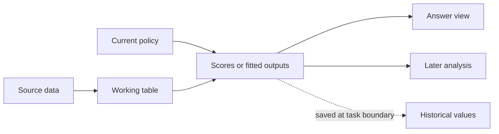

<!--
Licensed to the Apache Software Foundation (ASF) under one
or more contributor license agreements. See the NOTICE file
distributed with this work for additional information
regarding copyright ownership. The ASF licenses this file
to you under the Apache License, Version 2.0 (the
"License"); you may not use this file except in compliance
with the License. You may obtain a copy of the License at

  http://www.apache.org/licenses/LICENSE-2.0

Unless required by applicable law or agreed to in writing,
software distributed under the License is distributed on an
"AS IS" BASIS, WITHOUT WARRANTIES OR CONDITIONS OF ANY
KIND, either express or implied. See the License for the
specific language governing permissions and limitations
under the License.
-->

# LongDS trace review and research direction

September 30, 2026. Reviewed branch `feat/state-registry`, HEAD `96afcbd16`.

**Recommendation:** keep dataflow and test a smaller interface centered on the
tables an analysis needs to carry forward. Use the catalog to select exact
inputs, preserve changes, and propagate corrections. The next research question
is whether those capabilities improve state use with Terra. Further expansion
of the registry has little support in the evidence so far.

The traces expose two prerequisites for useful lineage: the required state must
actually be returned as a table, and the next task must select the intended
version and population. Several failures occur before dependency maintenance
can help. There are also concrete successes worth preserving: exact historical
comparisons and correction of a calculation together with its descendants.

This is a proposal based on an independent reading of 11 selected trace chains,
including successful and unsuccessful native/Python pairs, a budgeted run, the
latest prompt check, and older Terra runs. It is a purposive audit, not a census
of failure causes. The [evidence record](longds-trace-review-2026-09-30.json)
contains saved scores, artifact paths and hashes, step IDs, and observations
separate from proposed interventions. No agent or judge was run for this review.

## What the results establish

Recomputed from the saved September 27 evaluations, including all 68 sessions:

| Measure | Native `react-lean2` | DSGym with shared task text |
| --- | ---: | ---: |
| Correct turns | 732 / 2,225 | 723 / 2,225 |
| Turn accuracy | 32.90% | 32.49% |
| Mean session accuracy | 34.57% | 33.91% |
| Recorded model cost | $15.6091 | $9.1824 |

This one trial gives little reason to claim an accuracy advantage. The cost
premium is about 70%. These are model costs at the repository's accounting
rates, excluding judge and engine costs. The earlier $9.11 baseline figure
counted completed-answer spending; $9.1824 is the sum of all saved per-turn
costs, including failed turns.

The September 29 prompt checks also do not establish a broad improvement:
the two complete eight-session trials score **87/235 and 56/235**. A third
has **50/203**, with only seven sessions judged. It should stay separate from
the complete trials. The parameter-table instruction has no observed uptake
in these judged traces, but that is not itself a failure: BI task 2 successfully
revises a shared definition at turn 18 and binds earlier versions at turns 19
and 30 without a parameter table.

## What I found in the traces

The first seven cases use the matched September 27 runs. Turn numbers refer to
requests within a session. Pass/fail below is the saved answer judgment;
the explanation comes from the submitted programs and observations.

| Case | Trace evidence | Implication |
| --- | --- | --- |
| BI task 1, turns 10 to 19; native fails 19, Python passes | At 10, native computes replacement ages inside `age_outlier_analysis` but returns only `age_outlier_report`. At 19, it correlates `imputed_students`, whose ages were never replaced. Python updates `student_df` at 10 and uses it at 19. Both answers at 10 passed. | A correct earlier answer can conceal missing persistent state. Retrieval cannot recover a table that was never produced. |
| Restaurant task 3, turns 1 to 2; native fails 2, Python passes | `first_pressure_scan` contains ten rows; `first_pressure_leaders` contains five. Both names and sizes are visible. Turn 2 explicitly requests the fixed ten-row list, but native passes the five-row table to `review_fixed_pressure`. | The catalog contains the needed state but makes the answer view more prominent than its working population. |
| WiDS task 1, turns 27 to 29; native fails 29, Python passes | Turn 28 changes weights to .20/.35/.10/.35. Turn 29 removes race and redistributes its current share. Native uses the turn-27 report and .375/.375/.25; Python uses .45/.20/.35. Native reports cutoff .9907 instead of 1.1284. | Preserve the evolving policy independently from its report, and identify the active version before making a local change. |
| Netflix task 1, turns 2 to 3; native passes 3, Python fails | Native sorts the stored `split_market_slate` by score. Python reconstructs the earlier rank from a hardcoded list in the grouped answer's display order. Two rank-loss values are off by one. | Exact stored tables prevent presentation choices from becoming analytical state. Python could also reuse its existing table. |
| BI task 2, turn 19; native passes, Python fails | Native binds the earlier equal-weight composite and compares computed coefficients. Python types the old four-decimal coefficients into code, producing a shift of .0350 instead of .0351. | Historical values and `bind` have a demonstrated use. Removing them solely because usage is low would discard useful behavior. |
| LearnPlatform task 1, turns 2 to 3; native passes 3, Python fails | Python's `phase_weekly` is restricted to Virtual Classroom products and is reused for an all-products question. Native succeeds by loading the files again inside a zero-input function and rebuilding the calculation. | This native win does not demonstrate catalog reuse. Full populations and explicitly named subset views would help either arm. |
| University task 2, turn 5; native passes, Python fails | Native first gets an empty cohort, corrects the ratio interpretation inside `mahalanobis_all`, and recomputes distances and downstream cleaning, retaining 721 rows. Python corrects the screening values but keeps old `squared_mahalanobis_distance`, retaining 718. | The useful dataflow mechanism is applying a correction throughout its represented dependency chain. The original v1 ratio wording is ambiguous; the expected row count must not become an agent rule. |

The budgeted Water task 2, turn 38, adds a different warning. It scores 1 after
12 model calls, seven inspection calls, and two recall calls. In the final
function, `r2_top = default_top`: the requested R² ranking is never computed.
The answer labels happen to match. This is evidence against using retrieval
counts, state-tool usage, or answer agreement alone as proof of correct state
management. Preserve the official score and report the unsupported computation
separately.

These observations also qualify the analyzer's cascade counts. An incorrect
dependency answer is a useful screening signal. It does not prove that the
current calculation is locally correct, or that the earlier saved state is
wrong. BI shows the reverse problem: a dependency answer passed while its
required persistent update was missing.

## What the existing implementation already provides

Shared functions, historical values, parameter tables, `bind`, `fork`, and
dependency-based recomputation are implemented. The
[September 24 experiment](analysis-state-implementation.md) already tested much
of the obvious restructure. Its first pass reached 37.55% mean session accuracy
against 40.15% for the native entries control, at $1.837 versus $1.361. That
report identifies weak autonomous use of the mechanisms. Rebuilding the same
machinery under another name would not address the result.

The current prompt already asks for reusable populations, row-level fitted
outputs, separate summaries, corrections to shared definitions, and distinctions
between full populations and top-k displays. Another paragraph repeating those
instructions is unlikely to be sufficient. Two implementation details deserve
correction before relying on stronger claims about lineage:

1. **Task-to-answer attribution is partly heuristic.**
   `task-entries.ts:126` selects observed tables whose sampled numeric cells
   match any number in the answer. `buildTaskEntry` uses that result for `from`.
   This can select an incidental match and cannot identify prose-only sources.
   The tool already records an exact `answerFrom` when used. Carry that source
   and its revision into the task record; label the remaining attribution as
   inferred. It establishes which table supplied an answer, not whether the
   answer solved the task.
2. **Declared successors and actual edges are different facts.**
   `DefinitionRegistry.supersede` records a relationship. The batch handler
   does not rewire old consumers, and `explain` explicitly detects consumers
   that still read a superseded table. Yet the prompt says consumers follow the
   successor and the index describes ACTIVE as what current tables read.
   Correct that contract first. Show the declared default separately from the
   versions actually consumed. Use an explicit edit/bind when changing edges;
   automatic global rewiring could break intentionally historical branches.

The restaurant case also has a specific rendering explanation:
`definition-registry.ts:225` promotes tables that supplied answers or have
multiple consumers. A table with one consumer gets a shorter entry. The
ten-row working table therefore loses prominence to its five-row report.

## A concrete smaller algorithm

Treat each request as an edit to a small reusable analysis. Keep a coarse
operator boundary where there is a reusable population, fitted result, score
component, or independently changing policy. Ordinary pandas work can remain
inside that component. A separate node for every pandas statement adds little.

### Select the inputs

Use the existing reasoning field to state the population, the versions needed,
and whether the request changes the ongoing analysis or creates a local view.
This is part of the normal editing call, without a separate planner model.

The catalog should show related objects together, for example:

```text
Task 1 pressure analysis
  first_pressure_scan       10 rows  <- cleaned_orders
  first_pressure_leaders     5 rows  <- limit(first_pressure_scan, 5)
  answer source: first_pressure_leaders
```

The relationship and row counts are runtime facts. Calling an arbitrary custom
output a complete population is a semantic claim and needs the model's stated
intent. Built-in `limit`, projection, join, and aggregate operations can supply
their actual transformations directly.

For a request that combines old membership with current measurements, retrieve
the old keys and join them to current values. Selecting the correct two tables
is insufficient if the calculation then uses old value columns from the join.

### Save the working result before reporting

For BI turn 10, produce an updated student table and derive the outlier summary
from that table. For the restaurant case, keep ten rows and put the top-five
display downstream. For WiDS, keep the county components and the actual weight
choice, then calculate scores and the requested display.



Use a parameter table when a policy really evolves or needs alternative values.
BI's successful function revision shows that separate parameter tables are not
mandatory for every literal. Avoid retaining every local DataFrame: the retired
[kept-frames experiment](kept-frames.md) already explored that direction and
required replaying the parent to expose a local.

### Apply changes through the represented dependencies

For a persistent change, edit the existing component or its policy input. The
current graph recomputes its consumers and historical values remain addressable.
For a local scenario, use the existing `bind`/`fork` machinery and leave the
default unchanged. Reading an old result can use its saved values directly.

When observed values contradict a convention, inspect the implicated upstream
definition, correct it, and recompute its affected consumers. Recheck a small
number of meaningful boundaries such as population size, units, join coverage,
and the requested result. This requires evidence of a problem; a graph cannot
detect arbitrary wrong mathematics simply because it records dependencies.

### Record what was used and what changed

At task completion, preserve the exact answer source when available, changed
operator revisions, input edges, row counts, and historical references. Most of
these already exist. Group the answer view with the tables it reads, including
single-consumer working tables. Keep old entries immutable and keep the compact
global directory available so a working-set choice does not make older state
unreachable.

Under a context budget, retain the relevant function bodies with their input
schemas and versions. The Water retrieval loop and earlier signature-only
ablation argue against indiscriminately replacing code with names. After the
small catalog experiment, consider returning one bounded dependency slice for a
selected result if traces still show repeated upstream inspection. That is a
later optimization, not a prerequisite for this proposal.

## The first implementation experiment

Make one opt-in candidate with three changes:

| Change | Existing location | Intended effect |
| --- | --- | --- |
| Preserve exact `answerFrom` provenance; distinguish inferred attribution | `task-entries.ts`, `native-batch-tools.ts` | Reliable task-to-result links for selection and audit |
| Render answer views with their working inputs; show actual consumed versions separately from declared successors | `definition-registry.ts`, task-entry rendering | Address the restaurant selection failure and the misleading ACTIVE contract |
| Replace overlapping planning/state instructions with a short procedure and one full-table/report example | `prompts.ts` | Make the desired program shape easy to follow without further prompt growth |

An initial prompt replacement could be:

> Start from the population and analytical definitions required by this request.
> In your reasoning, name the existing tables or historical versions you will
> use and say which change, if any, becomes the ongoing default. Return a
> reusable working table when you clean data, change a population, define a
> score, or fit an analysis. Build the requested summary or top-k display from
> it. Keep full-precision values in working tables and round the answer view.
> Reuse existing functions and exact stored results. For an evolving policy,
> use a named parameter table or revise its existing component. Use bind or
> fork for a temporary alternative. When observed data contradict an earlier
> assumption, correct its shared definition and check the affected results.
> Before answering, check that the selected rows, versions, and fields match
> every part of the current request.

The BI example should show `updated_students = clean_age(students)` followed
by `age_report = summarize_age_update(students, updated_students)`, with only
the report used for `answer_from`. These names illustrate program structure;
they are not new built-in operators.

This candidate still depends on the model choosing useful component boundaries.
The missing BI update cannot be solved by a catalog renderer alone. If Terra
continues to return only a summary despite this interface, the next focused
test is a small explicit declaration of the working outputs required by the
task, validated at completion. Do not begin with a general semantic schema,
automatic local-variable capture, a new planning service, or another state
registry.

Engine repairs should be held constant across native arms. Address serialization
failures, function retention, duplicate definitions, package availability, and
measured timeouts before evaluating the interface. Preserve downstream numeric
meaning when fixing mixed/list output serialization; silently converting an
analytical column to text changes the problem. These repairs need regression
tests and stack smoke tests, independently of the algorithm comparison.

## What the paper changes about the experiment

I reread [LongDS v3](https://arxiv.org/html/2605.30434v3), including its state
semantics, error analysis, reset experiment, and evaluation details. Updates
change the default; counterfactuals are local; rollback answers use an earlier
anchor; composition combines states. Its cascade category requires a locally
correct step operating on earlier incorrect state. The reset study has mixed
effects and does not establish a universal reset policy. This supports testing
selective correction, while keeping our analyzer's dependency-based counts
distinct from the paper's manually validated taxonomy. The paper reports mean
session accuracy and uses DeepSeek-V4-Pro as judge; our saved GPT-5.2 judgments
support internal comparisons, not direct reproduction of its absolute scores.

The authors now recommend **v1.1-Lite: 24 sessions, 777 turns**, with clarified
scopes, output conventions, and inherited-state semantics. The paper's original
results use v1-Full. Our saved cases above use v1. Keep them as development
diagnostics; freeze v1.1 task hashes for new prospective comparisons and run all
arms on that same version. Existing raw datasets can be reused.
[Official dataset card](https://huggingface.co/datasets/zjunlp/LongDS).

## How to use Terra

**Use Terra for the next controlled comparison.** The justification is that a
baseline that reliably acts makes the state-management question easier to
study. It is not evidence that Terra will solve LongDS or favor dataflow.

The older three-session results illustrate both points:

| Session | Native catalog Terra trial 4 | DSGym Terra trial 3 |
| --- | ---: | ---: |
| GitHub task 1 | 15/15 | 15/15 |
| University task 2 | 2/21 | 3/21 |
| Policing task 1 | 9/36 | 10/36 |
| Total | 26/72 | 28/72 |

These historical runs use older interfaces and are not a comparison of today's
candidate. I read the University turn-5 code in both: each uses a quotient
scaled by 100 and returns 717. Terra has not eliminated interpretation errors.
The GitHub Python trace does actively inspect and compute. Across the three
Python sessions, six turns contain no Python cell; their saved answers reuse
prior evidence rather than refuse access. Absence of code alone should not
count as refusal or state failure.

**Fix accounting before setting a Terra spend limit.**
`official_table.py` explicitly documents Luna rates for every model, and the
native runner, Python runner, and session budget code hardcode those rates.
The old $0.4069 native and $0.3395 Python totals are therefore accounting
figures, not verified Terra charges. The gateway config does expose
`gpt-5.6-terra` with medium reasoning. Record its actual provider rate schedule
or provider-reported charges, plus uncached input, cached input, writes where
applicable, output, and unsuccessful calls. No Terra budget can be inferred
reliably from the present dollar fields.

### Experiment sequence

1. **Validate the mechanisms without model calls.** Add regression fixtures for
   exact answer provenance, a ten-row working table with a five-row display,
   declared successor versus unchanged consumer edges, correction propagation,
   and preservation of historical/default branches. Existing fork/bind tests
   should be reused. These tests validate semantics, not autonomous accuracy.
2. **Establish a current Terra baseline.** After engine and accounting fixes,
   run one paired smoke session, then a frozen eight-session pilot of current
   native and persistent DSGym. Select from v1.1-Lite using public questions,
   covering all six domains. The previous eight-session check has four surveys
   and covers only three domains, so it is a useful diagnostic set but a weak
   sole research sample. Freeze choices before observing Terra outcomes.
3. **Test the small candidate on the same sessions.** Keep model, reasoning,
   task text, data access, output limits, step budget, and judge fixed. Share
   general analytical guidance with the Python control; retain runtime-specific
   instructions where needed. Evaluate complete fresh sessions. Saved-prefix
   interventions on the cases above are useful mechanism tests, but must be
   labeled separately from end-to-end performance.
4. **Confirm only after a useful pilot signal.** Repeat all compared arms with
   three balanced fresh trials, then expand to the official Lite set if observed
   costs and gains justify it. Report every trial and spending on failures.
   Bootstrap by session rather than treating dependent turns as independent.
   Keep the earlier 1.25-times-Python model-cost target visible as a decision
   criterion, with rates corrected for Terra.

Use mean session accuracy as the primary score and also report correct turns,
calls, model/engine latency, and actual model cost. On a frozen sample, manually
audit whether required updates were saved, the correct versions/populations
were consumed, temporary changes preserved defaults, and corrections reached
their dependent results. Separate interpretation mistakes, infrastructure
failures, and unsupported computations that happen to pass the answer judge.
Gold dependencies and answers belong only in this offline audit; they must not
select the agent's working set or repair target.

## The decision after the pilot

Continue with dataflow if the candidate both improves answers and reduces the
specific state errors observed here at acceptable cost. A reduction in tool
calls alone is insufficient. A benefit confined to the selected development
cases needs prospective confirmation.

If Terra still makes the same choices despite correct, visible state, focus on
analytical reasoning and validation instead of adding retrieval tools. If the
same table discipline works as well in persistent Python and Amber execution
remains the dominant overhead, a lighter Python interface with named results
and exact saved versions is a reasonable next direction. A backend rewrite
should follow that measurement.

The clearest research claim to test is: **explicit dependencies and retained
versions help an agent apply a requested change to the right computation and
carry that change through later tasks.** The traces give concrete examples
where this helps, and equally concrete reasons why merely retaining a large
catalog does not establish it.
