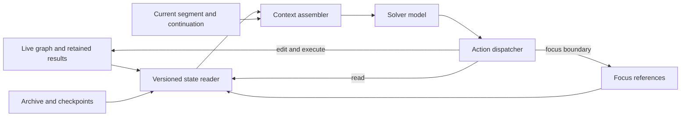

<!--
  ~ Licensed to the Apache Software Foundation (ASF) under one
  ~ or more contributor license agreements. See the NOTICE file
  ~ distributed with this work for additional information
  ~ regarding copyright ownership. The ASF licenses this file
  ~ to you under the Apache License, Version 2.0 (the
  ~ "License"); you may not use this file except in compliance
  ~ with the License. You may obtain a copy of the License at
  ~
  ~   http://www.apache.org/licenses/LICENSE-2.0
  ~
  ~ Unless required by applicable law or agreed to in writing,
  ~ software distributed under the License is distributed on an
  ~ "AS IS" BASIS, WITHOUT WARRANTIES OR CONDITIONS OF ANY
  ~ KIND, either express or implied. See the License for the
  ~ specific language governing permissions and limitations
  ~ under the License.
-->

# Dataflow working context design

Design proposal, 2026-10-12. The objective is substantially fewer total model
input tokens while preserving LongDS Lite task accuracy. The proposed mechanism
is a version-aware selection of dataflow state, combined with an explicit
boundary for retaining the current transcript. It uses the existing solver;
selection and solving happen in the same agent loop.

The durable workspace stores the graph, definitions, results, requests and
events. The model sees a compact directory, a selected working set, and the
work since its latest context boundary. `focus` changes that selection and
starts a new transcript segment. It never changes the computation graph.

This design specifies the complete contract. Syntax below is proposed unless
identified as existing. It does not claim an implemented focus mechanism or
measured accuracy parity. It replaces the design assumptions in
[the task expansion proposal](longds-task-expansion-proposal.md); that document
remains available as the earlier proposal.

## 1 Requirements and evidence

The Lite v1.1 task list contains 24 sessions and 777 user requests. The recorded
trace audit covers 32 runs over eight distinct sessions: one ledger run per
session and three hybrid K5 repetitions, totaling 1,084 requests. Static
reference-code analysis covered all 24 sessions; representative gold programs,
answers and traces were also read manually. These are different evidence scopes.

Among later requests, at most five earlier operators appeared as direct inputs
in 253/263 ledger requests and 732/789 hybrid requests. Their median count was
two in both arms. The mean ancestor counts were 7.63 and 6.52, with maxima of
22 and 29. These counts describe attempted solutions, including wrong ones;
they do not certify a sufficient context or justify a hard five-operator cap.

| Observed case | Requirement |
|---|---|
| NFL Q25 uses an accumulated player table in the reference, while the ledger attempt writes 6,131 Python characters rebuilding earlier analyses | Preserve reusable working tables and expose their actual rules |
| Netflix task4 Q31 needs three particular comparison/component states; the ledger attempt selects three different stages and answers incorrectly | Preserve semantic identity and version provenance, not just a small operator count |
| Kiva Q28 combines an older partner definition with the current population and scoring components | Allow independent references from different checkpoints |
| Kaggle Survey 2022 task2 Q30 combines narrow and broad adopter views with the current organization boundary and denominator | Selection cannot mean restoring one whole earlier task |
| March Madness Q31 uses Q25 and Q29 state while excluding the Q30 alternative | A later consumer or newer task does not establish adoption |
| NFL Q42 compares final conclusions with 12 earlier choices; the ledger accesses 17 earlier operators across the request | Allow repeated selection and durable intermediate comparison tables |
| NFL's 30-column protection table has important fields after column 24 | Never silently truncate the selected schema |

The dataflow property being used is that a materialized result can be consumed
without replaying the entire computation that produced it. Explaining or changing
that computation can still require inspecting its upstream rules. This is a
reason to make expansion available, not to expand every ancestor automatically.

Gold code informs these requirements and offline tests. It is never supplied to
the live selector or solver, and benchmark dependency annotations are not used
as a retrieval oracle.

## 2 State model

Separate four kinds of state:

| State | Owner and lifetime | Model visibility |
|---|---|---|
| Workspace | Graph, registered definitions and result artifacts; session lifetime | Selected state and compact directory |
| Archive | Original requests, answers, snapshots and complete tool events; session lifetime | Explicit reads, plus directory entries |
| Focus | References chosen by the model; inherited along the agent history branch until replaced | Detailed working set |
| Active segment | Model/tool exchanges since the current request began or the last successful focus; bounded | Current work transcript |

A selection is not a graph node. It is agent context state, like a view over the
workspace. Its authoritative representation is a recorded event in the agent's
history, so checkout and branching restore the appropriate selection. A cache of
the derived selection is permitted; a process-global mutable selection is not.

The active segment has a clear boundary. Earlier segments remain in the archive,
but their code, tables and prose do not continue to occupy the prompt. This
prevents a succession of focus calls from becoming an append-only expansion log.

Computed progress belongs in operators and their results. Examples include a
cohort ID table, an intermediate comparison table, and a one-row table holding
a computed scalar. Function parameters and registered constants represent rules.
A short continuation note represents the agent's plan and unresolved questions;
it is not a substitute for computed data.



## 3 Operator references and versions

Public references have two forms:

```text
scores       current scores in this agent's current graph
scores@5     scores at the checkpoint saved when request 5 completed
```

`@5` denotes a request checkpoint, not an edit counter. Several checkpoints may
resolve to the same unchanged state. Their public addresses remain valid even
when storage and rendering deduplicate that state. Request numbering remains
stable after checkout; it must not be recomputed from the length of a branch.

The internal resolver binds a reference to:

```typescript
interface ResolvedOperatorState {
  sessionId: string;
  operatorId: string;
  snapshotId: string;
  definitionRevision: string;
  namespaceRevision?: string;
  dependencyFingerprint: string;
  resultVersion?: string;
  executionStatus: "complete" | "not_run" | "stale" | "failed" | "deleted";
  observationCoverage: "none" | "sample" | "full";
  materializationAvailable: boolean;
}
```

These fields are conceptual contracts, to be adapted to existing types. A
definition revision alone is insufficient: upstream inputs, namespace bindings,
or executions may change without an apparent change in the local expression.

All parts of a displayed historical state come from the same checkpoint:
definition, namespace, input bindings, schema and result identity. The resolver
must never combine historical code with today's data or helpers.

A live reference is resolved against one consistent HEAD for each model call.
After a relevant edit, its result becomes stale or absent until execution
produces a matching result. The working view refreshes and labels that change.
Historical references remain fixed. A deleted live reference remains visibly
unavailable until replaced or deliberately removed from focus.

An old result and an old rule are different resources. `scores@5` supplies the
values computed then. Applying the old formula to today's population requires
an explicit new computation using that formula and the intended current inputs.
Focusing on historical code does not change the active function namespace.

Definition inspection is allowed when a matching historical result is missing.
A retained preview can still be displayed when its provenance matches the saved
state, with its coverage stated. A full-data read or use as a graph input requires
the complete matching artifact. Thus "executed successfully," "a sample remains"
and "the full result is available for computation" are separate facts. An absent
full artifact produces `HISTORICAL_RESULT_UNAVAILABLE` for operations requiring
it; it must not trigger execution against current files. Context eviction never
deletes or changes result artifacts.

At request completion, the checkpoint layer retains references to completed
materializations for the session lifetime. It shares identical artifacts across
checkpoints; it does not execute every operator or copy full tables into the
prompt. The artifact adapter needs retain, resolve, read and release semantics.
Session clear/end releases its references according to the existing lifecycle.
Retention quotas or backend loss must be explicit availability failures. The
same retention policy applies to control and treatment arms. Peak retained
storage and retention failures are recorded alongside model costs.

## 4 Focus action

One new context action has the following canonical payload:

```typescript
interface FocusAction {
  type: "focus";
  operator_refs: string[];
  continuation: string;
}
```

`operator_refs` is the complete replacement set. It may contain live and
historical references together. An empty set clears the expanded working set.
Duplicate public references are rejected. Selection order is not priority;
rendering uses a stable canonical order.

`continuation` is a short, model-authored statement of completed work, relevant
result references, unresolved issues and the next intended step. It replaces
the previous continuation note. It may be empty when there is no work to carry.
When a nonempty segment would be archived, a nonempty continuation is required.
This structural check does not claim that the note is correct or exhaustive.
The note has a configured token limit and is visibly labeled as unverified
agent working notes. Important facts must remain tied to computed artifacts.

For example:

```json
{
  "type": "focus",
  "operator_refs": ["scores", "scores@5", "eligibility@5"],
  "continuation": "Comparison rows are saved in rank_changes. Check whether the historical eligibility rule explains the remaining differences before attributing them to score weights."
}
```

In the registered statement interface, use one JSON-bearing statement rather
than introducing several modifiers or another mini-language:

```text
focus {"operator_refs":["scores","scores@5","eligibility@5"],"continuation":"Check the eligibility difference before interpreting rank_changes."}
```

The `python` field must be empty and focus must be the sole statement/action in
that call. This makes the boundary atomic and avoids ambiguity from the current
registered parser, which collects edits and applies them before read statements.
Work that depends on newly selected content always happens in a later model
invocation. There is no separate planner agent.

A successful focus:

1. Resolves and validates every requested reference against a consistent HEAD.
2. Builds the prospective working view and checks admission against the hard
   input limit, including the directory, current request and continuation.
3. Records the selection event, previous selection identity and resolution
   manifest without modifying the graph or executing Python.
4. Archives the previous segment and starts a new one with a short focus receipt.
5. Delivers the new working view to the next model call.

An invalid address, nonexistent historical operator, invalid continuation, or
oversized prospective mandatory context rejects the entire action. The old
selection and segment remain intact. A known operator without a completed
result is a valid focus target and displays its availability explicitly.

Repeating the same selection starts a fresh segment. It is therefore useful as
a context checkpoint, even though the selected references are unchanged. It
does not create a new operator version.

The recorded event contains the validated selection, continuation, prior focus
event ID, archived-through event ID, base snapshot ID, resolved manifest and
render-policy version. It also records the last completed exchange's status and
diagnostic references. Replaying these events along the selected history branch
reconstructs the context state. Arbitrary timing or a mutable in-memory message
list must not determine which history disappears.

## 5 What a selected operator exposes

Each operator packet contains:

- Public reference, resolved checkpoint and version identities, availability,
  originating request and relevant modification request references.
- Authored expression, parameters, description and local implementation.
- Registered helper/constant/import declarations reached by that implementation,
  resolved within the selected namespace; shared declarations appear once.
- Immediate input references with their origin, shape and availability.
- Complete known output schema, row count, result identity and coverage metadata.
- A bounded sample of a matching available result. Small complete results may
  be shown in full only within the sample budget and labeled as complete.

The default includes local implementation because the traces show that a name
or docstring alone may hide important cohort, ranking or denominator rules.
Implementation means authored Python and declarations, not generated execution,
profiling or serialization wrappers. A built-in's authored call and parameters
are shown; its shared contract comes from the tool reference rather than being
copied into every packet.
The helper closure is a declaration dependency closure, not an operator ancestor
closure. In the registered branch, `RegisteredBinding.references` already
provides a starting point for computing it. Definition-time defaults and
namespace versions must be preserved; listing today's binding with the same
name does not establish an old default's value.

The declaration reader must distinguish a function's defining cell from bindings
looked up when it runs. If existing metadata cannot establish a default or
closure binding, it returns the defining-cell references and an explicit
unresolved-dependency flag. It must not manufacture a value from a same-named
current constant. Improving that metadata is a reader prerequisite where needed.

An implementation whose dynamic namespace dependencies cannot be resolved must
say so. Its available declaration source remains readable; the renderer must
not describe the packet as containing every dependency. Source inspection never
runs imports, initialization code or arbitrary Python object representations.

An input boundary is a reference, not another expanded packet. To inspect an
upstream rule, the agent reads it temporarily or includes it in a later focus.
Consumers may be listed for navigation, but do not imply which branch the user
has adopted. Names and docstrings are agent-authored descriptions, not verified
semantic classifications.

Complete schemas come from schema metadata rather than sampled rows. If the
operator has not run and its schema is unknown, the packet says that. A stale
schema may be shown only as a separately labeled historical observation.
Focus does not execute an operator to discover its current schema.

## 6 Directory and request information

The directory has one compact entry per logical operator, including operators
that now exist only in retained checkpoints. It contains the ID, a short authored
purpose, current availability, and addresses or ranges for distinct saved states.
It contains no function bodies, table records, full schemas or full old answers.
State changes are deduplicated using dependency/result identity, not just local
code revision.

A compact request directory provides task numbers and short request excerpts.
Original request text, answers and event records remain available through the
common read service. Operator packets link to those records. Semantic selection
is based on public user requests and the agent's own artifacts, not gold metadata.

Directory display is budgeted and paginated. At the observed Lite graph sizes,
the ordinary target is a complete compact directory. When it does not fit,
the renderer reports counts and omitted pages explicitly. The read interface
must support directory paging and deterministic filtering over IDs, descriptions
and request text. It must not quietly expose only recent operators. Reading an
entry or page does not change the focus selection.

The directory is not constant size: its cost grows with the number of named
states until paging applies. That cost is included in every token measurement.
No free classifier or perfect retrieval assumption is part of this design.

System/developer instructions, explicitly retained session instructions and the
current user request remain intact. Earlier task-specific instructions are
recoverable through their original request records. The operator graph is not a
complete representation of arbitrary natural-language history. If the current
question relies on a prior convention that is unclear from selected definitions,
the agent must read its source request. Selection of those instructions is an
accuracy risk to evaluate, especially for inherited output conventions.

Use the same read service for focus and ordinary inspection. The registered
interface needs these proposed extensions, available in all comparison arms:

| Read | Semantics |
|---|---|
| `show operator scores@5` | Saved definition and provenance; no execution |
| `show result scores@5 sample` | Matching saved preview with coverage; no execution |
| `show result scores@5 full` | Full-data read within an explicit display/page budget; unavailable artifacts fail |
| `show schema scores@5` | Saved schema; no execution |
| `show {"target":"directory","query":"eligibility","cursor":null}` | Deterministic search or paging of the public directory |
| `show {"target":"task","task_id":5,"part":"request","cursor":null}` | Original request; other parts are `answer`, `operators` and `events` |
| `show {"target":"resource","handle":"returned-handle","cursor":null}` | A version-bound declaration, schema, record or event page linked by an earlier response |

Responses carry immutable resource handles, coverage and a next cursor where
necessary. Cursors bind to the same resource version, so successive pages cannot
mix an old definition with a new one. An empty directory query lists entries.
Index filtering does not use an LLM. An original answer read is the agent's saved
answer, never the benchmark gold answer.

Existing live `show result` and `show schema` retain their execute-if-needed
behavior. Historical variants use a separate read-only path. Focus calls that
path directly and therefore never inherits implicit execution from `show`.
Historical registered functions are accessed by the namespace-qualified resource
handles in their operator packets; a bare `show function name` remains a current
namespace read. This avoids another ambiguous historical function shorthand.

## 7 Prompt assembly and context boundaries

For current HEAD `H`, focus `F`, active request `Q`, and segment `S`, assemble:

```text
Stable system, tool contracts and retained session instructions
Current user request, verbatim
Working view resolved from (H, F)
Compact operator and request directory
Latest focus transition and continuation note for this request
Complete active segment exchanges within their explicit observation budgets
```

The stable prefix should remain byte-identical when its content is unchanged.
Ordering and formatting of directory entries and packets are deterministic.
The working view precedes the more frequently changing directory, so creating
an unrelated operator does not unnecessarily rewrite the prefix before selected
code. Unchanged selected state must render to identical bytes even when HEAD
advances: the complete resolution HEAD is kept in the audit manifest, while
display identity uses the actual definition, dependency and result versions.
Rebuilding a selection can reduce cache reuse; repeated calls with unchanged
content can still reuse their prefix. Cache behavior is measured separately
from total input tokens.

The focus receipt contains IDs, version identities, availability and size
information. Expanded operator packets appear once in the working-view block,
not again inside the receipt. Deduplication uses content plus version identity,
so different implementations sharing the same function name remain distinct.

After refocusing, the model sees exactly one previous-to-current focus
transition for the active request, together with the new continuation. Previous
focus bodies, previous continuation notes, and previous segment transcripts are
absent. The full event log preserves them for explicit inspection. If the
transition's address list is itself large, show its event reference and counts
with an explicit continuation page, rather than an unbounded list.

The transition also carries the prior segment's last outcome and exact
diagnostic references. Failed operators remain marked in the directory; selected
failed operators expose their diagnostics. This preserves the existence and
location of a failure without replaying all old tracebacks or trusting a note
that calls a failed execution successful.

Within a segment, explicitly requested reads, new edits, results and errors
remain visible. Consequently, the model can temporarily see details outside
its focus through an explicit read or its current work. This is deliberate:
focus controls persistent expansion; it is not an access-control boundary.
At the next focus or user request boundary, those temporary observations leave
the prompt unless their state is selected again.

Tool-call/result pairs must be retained or archived together. Compaction cannot
leave an orphan tool result or an incomplete call in the provider transcript.
Original events remain unchanged; the assembler creates a projection for each
model invocation and records the projection's manifest.

The blocks above specify logical content, not a requirement to duplicate it
across message roles. For example, a continuation may live in the retained
focus exchange or in the context block, but appears only once. Use existing
message builders to preserve provider-valid call/result framing. Record the
exact final messages in the trace so the token claim can be checked against
what was actually sent.

This segment boundary sharpens the earlier informal suggestion to keep a
"bounded recent history." There is one defined retention rule: keep the current
segment, and carry one explicit continuation across a focus boundary. There is
no hidden summarizer or growing chain of summaries.

## 8 Lifecycle

| Event | Graph and results | Focus and prompt |
|---|---|---|
| First user request | Empty or supplied initial workspace | Empty selection; current request and directory; build normally |
| Later user request | Continue the existing workspace | Inherit focus references; start a fresh segment; clear prior request's continuation and transition |
| Successful focus | Unchanged | Replace selection and continuation; archive prior segment |
| Failed focus | Unchanged | Preserve selection and segment; show error |
| Read or inspect | Unchanged, except any existing explicitly documented execute-and-show behavior | Observation in active segment; membership unchanged |
| Edit | Apply ordinary graph/namespace mutation and invalidation | Re-resolve affected live selections; fixed historical selections unchanged |
| Execute | Materialize requested graph with its normal upstream dependencies | Show current observations and availability changes |
| Answer | Save the completed request/checkpoint and existing provenance | Close segment; retain selected references for the next request |
| Live view grows beyond the hard input limit | Keep completed graph changes and results | Enter explicit context-pressure mode until a fitting selection is established |
| Checkout | Restore the chosen history branch | Derive focus and segment from that branch's events |
| Clear session | Existing clear behavior | Clear focus, continuation and segment state |

At a new request, the agent may immediately work using a suitable inherited
selection. Otherwise it focuses before relying on missing details. A mandatory
first-focus call is not the default. New operators are visible through active
work, but are not automatically appended to the persistent selection forever.

Focus membership does not limit computation. An edit can reference any valid
operator or supported saved result. Execution may traverse hidden ancestors.
Before modifying an unfamiliar rule or treating a selected report as a full
population, the agent should inspect its definition and scope. The runtime
validates addresses and data availability; it cannot certify semantic relevance.

A counterfactual uses separate graph names for the alternative. A user-requested
lasting rule change uses ordinary edits of the relevant active computation.
Focusing on either state does not declare that it replaces the other.

## 9 Budgets and oversized content

Budget the directory, working details, active segment and continuation separately.
The initial pilot should start with targets of 3,000, 6,000, 4,000 and 384 tokens
respectively. These are proposed tuning values, not results from the traces.
Freeze them before the comparative evaluation. System/tools/current request and
transport framing are additional input and are counted in reported totals.

The working-detail target is soft. Required definitions and known schemas are
complete. Samples are reduced first to respect the target; an oversized mandatory
packet is labeled with its cost and can exceed the target while the complete
prompt remains below the configured hard input limit. The runtime never removes
a selected reference, source fragment or schema field silently.

The hard limit is checked on the complete prospective prompt, with space reserved
for the next allowed model/tool exchange. If mandatory content cannot fit, focus
fails atomically and reports per-reference sizes. The model can select fewer
states, compute a smaller reusable intermediate, or inspect an oversized resource
in explicit pages. The common reader must support schema/source/record paging
with version-bound cursors; a page is labeled as partial and never masquerades
as a complete definition or table. A definition too large for any complete
working packet is investigated through pages rather than silently clipped.

Active-segment growth is also explicit. Once it reaches its target, the
controller enters `needs_focus` and asks the model to finish from sufficient
visible evidence or call focus with a continuation. Bounded recovery reads may
prepare that selection, but the action validator rejects further graph mutations
until the boundary is made. It preserves the final completed exchange so the
model can prepare the continuation. Output and observation budgets must reserve
room for this control response before a model call is admitted.

An execution can reveal a much wider schema or a changed live definition than
was known when focus was admitted. If the mandatory live view then exceeds the
hard limit, enter an explicit context-pressure state. Preserve the graph and
archive, and render a control prompt containing the current request, last
continuation, selected identities and per-item sizes, last exchange status, and
resource handles. State explicitly that working details are not loaded. Permit
bounded resource reads and focus, but no further graph mutations until a fitting
selection is established. A successful focus ends pressure mode. This exception
is recorded in the projection manifest and evaluated as a possible accuracy
failure; it is not silent clipping or a rollback of a successful computation.

A large result remains an artifact with a bounded observation and continuation
cursor. Large responses do not bypass admission by entering the prompt through
an error, a full-table retrieval, or a nested helper body. An indivisible user
request or required instruction set beyond the hard input limit is reported as
an input-limit failure; the system does not silently remove user instructions.

The token estimator and its safety margin are recorded in the run configuration.
Provider-reported usage is authoritative for evaluation. Count selection calls,
directory pages, failed actions, checkpoints and retries. A lower token total
caused by aborting tasks early is not a successful context reduction.

## 10 Failure and consistency rules

| Condition | Required behavior |
|---|---|
| Unknown operator or checkpoint | Reject focus atomically; provide discoverable alternatives without selecting one automatically |
| Known definition with no saved rows | Permit focus; mark unavailable; data reads/computation fail with the precise availability reason |
| Live upstream or helper changes | Invalidate affected data; render the new definition with no falsely current old result |
| Same function name in two historical namespaces | Keep namespace-qualified identities and render differing sources separately |
| Selected live operator deleted | Show a tombstone; no implicit substitution of an older version |
| HEAD changes during resolution | Revalidate before committing the focus event; reject if the prospective view no longer matches |
| Engine result evicted | Preserve definition/provenance; report unavailable historical data; never recompute it from today's sources |
| Wrong stage selected | Allow read/refocus; record the event for audit; no automatic claim that the newest state is correct |
| Continuation asserts an unsupported fact | Label it as model-authored; require computational evidence for the final answer under the normal answer contract |
| Checkout or process resume | Reconstruct from recorded events and immutable checkpoint identities |

Reproduction requires the same selected references, resolved manifests, settings,
archive boundary and retained artifacts. Focus is not an engine-cache eviction
policy. The system does not promise that retained sampled records alone can
reproduce a full historical table.

## 11 Worked request

Suppose a request asks how current scores differ from the state at request 5,
and whether the change comes from eligibility or scoring. The names below are
illustrative, not claims about operator IDs in an existing run.

1. The model sees the request, directory and inherited focus. It selects
   `scores` and `scores@5`, with a continuation describing the comparison.
2. The packets reveal that the scores use different eligibility states. The
   model refocuses on both score states plus `eligibility` and `eligibility@5`.
   The preceding focus's expanded body and segment are archived.
3. The model constructs an explicit comparison using full data inputs, not the
   displayed samples. If the question asks for the old formula on today's
   cohort, it creates that alternative computation explicitly.
4. It executes and reads the comparison. If a broader audit is needed, it saves
   comparison rows in an operator and refocuses on the next historical choice.
5. It eventually focuses on the completed comparison table, verifies the result,
   and answers through the unchanged text-answer protocol.

The durable graph carries completed computation across focus changes. The
continuation carries the unresolved objective. Saved references carry historical
identity. These are separate responsibilities.

For NFL Q42, the same pattern processes groups of historical alternatives into
a comparison table. It supports a small instantaneous working set without
requiring every alternative to fit simultaneously. It does not guarantee that
five states suffice for every intermediate computation.

## 12 Implementation boundaries

There are two distinct code lines in the current workspace:

| Capability | operator-history-lean | longds-answer |
|---|---|---|
| Tool dialect | JSON actions, including history-enabled `read` | Registered Python plus `set`, `execute`, `show` statements |
| Historical addresses | `ID@task`, resolver and saved-result input adapter exist | Current statement parser accepts plain IDs; compatibility work required |
| Saved-result computation | `saved-versions.ts` binds exact historical materializations | Snapshot inspection exists, but the same saved-result input adapter is absent |
| Context history | Task/state history machinery | Request catalog and current/recent transcript machinery |
| Focus and segment contract | Proposed | Proposed |

The inspected revisions were `973fd4628a4aafe38156330e57803dd2475632a6` and
`003a2a0f5962edf251a04f5d9efdc05ec1e09d6e`, respectively. The architecture must
not assume that retired settings or command schemas can be enabled unchanged in
the registered branch.

Use the registered `longds-answer` branch as the intended integration target for
this proposal, because it contains the proposal and current registered Python
workflow. Reuse the saved-version implementation's contracts and tests, adapting
them to that branch's types and execution interface. Merely adding a focus
renderer is insufficient to enable historical data as executable inputs.

Expose one new policy value, `multiRequest: "working"`, with a structured
`workingContext` budget configuration. Require native mode, DELTA and native
message layout, matching the existing catalog mode's prerequisites. The first
implementation fixes this policy at agent creation. It routes directly through
the working assembler even for the first request, and does not additionally
replay the old catalog, global thought history or a second compaction policy.
Incompatible renderer/tuner overrides are rejected during settings validation.
Existing modes retain their behavior. The focus action is exposed only in
working mode; the common version/read capabilities are available to controls.

The context controller has two derived states: `ready`, where normal actions
are allowed, and `needs_focus`, caused by a segment boundary requirement or
hard context pressure. In the latter, it permits focus, bounded recovery reads,
and a final response only when the normal evidence requirements are satisfied.
It rejects graph mutations before side effects. These gates are checked by
the dispatcher, not left only as advice in the prompt.

Implement in this order:

1. **State reader contract.** Resolve live and saved references, namespaces,
   result identities, task records and paged resources without executing code.
   Adapt exact saved artifacts as graph inputs. Verify engine support before
   choosing the adapter; any required engine work is a separate prerequisite.
   Distinguish this from copying a historical definition and recomputing it.
2. **Focus event and reducer.** Add the typed action, atomic validation, branch
   reconstruction, continuation and segment-start marker. One module owns its
   semantics; protocol adapters call it.
3. **Directory and working-view renderer.** Reuse observation formatting and
   result-version validation. Deduplicate namespace declarations and shared
   inputs by identity. Implement explicit paging and coverage labels.
4. **Context assembler.** Route a new opt-in working-context mode before the
   existing full-catalog path. Assemble the defined projection, enforce budgets
   and persist a manifest for each actual model call. Do not change an existing
   catalog mode to mean something different.
5. **Protocol and prompt.** Parse the sole focus statement, add readers for
   historical/task/directory pages, and teach the focus/compute/refocus cycle.
   Preserve text answers and the existing graph mutation semantics.
6. **Evaluation arm.** Expose the mechanism and budget settings in one recorded
   arm. Give the matched controls the same version and read capabilities.

Likely source locations in `longds-answer` are:

- `src/agent/native/turn-syntax.ts` and `src/agent/tools/dataflow-actions.ts` for protocol.
- `src/agent/tools/dataflow-action-runtime.ts` for action dispatch, with focus handled by
  an agent context controller rather than graph-edit code.
- `src/agent/workflow-snapshot-storage.ts`, `src/agent/native/result-versions.ts`,
  `src/agent/native/registered.ts` and a compatible saved-state resolver for identity.
- `src/agent/request-catalog.ts` for provenance and directory inputs.
- New `src/agent/context/working-context.ts` and associated rendering code for the pure
  reducer/projection, wired into `src/agent/util/context-utils.ts` and `src/agent/texera-agent.ts`.
- `src/types/agent.ts`, native prompt/reference generation and
  `benchmark/longds/arms.py` for configuration, documentation and evaluation.

Paths in this list are relative to `agent-service/` except the benchmark arm.
No frontend change is required for the initial experiment. The frontend can
later display the selection and manifests already recorded by the service.

## 13 Correctness and acceptance tests

Write focused regression tests before implementing each contract. The minimum
acceptance suite is:

| Test | Required outcome |
|---|---|
| Select current and historical versions of one ID | Different definitions/data remain correctly paired |
| Upstream changes with unchanged local expression | Live result invalidates; historical result remains fixed |
| Helper redefinition and definition-time defaults | Correct namespace identities; no substitution of today's binding |
| Historical sample available but full artifact absent | Read coverage is accurate; executable input is refused |
| Unknown reference among valid references | Entire focus rejected; previous segment/selection intact |
| Refocus after a large inspection | Unique old body text absent from the new prompt; archive retains it |
| Repeated focus, including identical selections | One transition/note in the prompt; no growing expansion history |
| Current read of an unselected operator | Visible in the segment; absent after boundary unless selected |
| Wide schema with important field after column 24 | Field remains visible or is explicitly paged; no silent omission |
| Shared helper used by several selected states | One rendering for identical bindings; differing bindings distinguished |
| An unrelated operator is added or edited | Unchanged working packets remain byte-identical |
| Edit creates an unselected operator | Its current observation is visible; it is not permanently auto-pinned |
| Segment or working budget exceeded | Defined control response or atomic rejection; no silent source deletion |
| Execution produces an unexpectedly huge live schema | Explicit pressure state; graph results preserved; recovery through bounded reads and focus |
| Failure followed by focus | Continuation and exact diagnostic references survive; no false success status |
| Checkout, off-branch saved read and reload | Stable checkpoint addresses and correct focus reconstruction |
| Mixed focus and graph edit in one call | Rejected before any mutation |
| Context projection produces provider messages | Complete call/result pairs and deterministic rendering |
| Working mode combined with a conflicting renderer | Configuration rejected; no accidental replay of the full historical context |

Add synthetic engine scenarios for mixed old/new inputs, an old rule on current
data, and missing historical materializations. Use small known tables rather
than benchmark answers in live solver prompts. Unit and integration tests
establish mechanics; they do not establish model accuracy.

## 14 Evaluation and decision criteria

Compare matched arms on the same frozen code revision, model configuration,
operator catalog, version/read capabilities, text-answer protocol, retrieval
views, call limits and execution environment:

| Arm | Context behavior | Purpose |
|---|---|---|
| Hybrid K5 control | Existing catalog plus recent transcript | Main accuracy/token reference |
| Compact directory plus ordinary reads | Earlier detail fetched into the current request's ordinary transcript | Separates retrieval from persistent selection and segment replacement |
| Working context | This focus and segment design | Main treatment |

Old recorded K5/ledger scores are historical context, not a matched causal
control for a new implementation. Re-run the controls with shared prerequisite
changes. Do not compare different answer mechanisms or models and attribute the
entire difference to focus.

Use the existing eight-session set for debugging and budget selection, then
freeze the design and run all 24 Lite sessions with at least three repetitions
per arm. All turns of a session run sequentially with the agent's own prior
state. Gold prefixes and gold-selected focus sets are diagnostic experiments
only and must not be reported as natural session results. Gold programs across
the Lite set have already informed this design; it is not an unseen benchmark.

The proposed acceptance target is at least 50% fewer total input tokens against
the matched K5 control, with an accuracy noninferiority margin of two percentage
points in session-macro accuracy. The margin is a proposed research decision,
to freeze before comparative runs; it is not an established property of the
mechanism. Use paired session-level uncertainty, retaining repetitions within
session clusters. A point estimate within two points is insufficient if the
confidence interval does not support the claim; report the result as inconclusive.

The decision rule is a one-sided 95% lower confidence bound on the paired
accuracy difference at or above -0.02, and a measured aggregate input ratio at
or below 0.50. Report an interval for that ratio as well. Every planned request
must be accounted for; missing or unattempted requests cannot disappear from
accuracy denominators or be presented as successful token savings. Unexpected
early termination blocks an acceptance claim until the matched completion and
retry protocol has been applied.

For `N` sessions, `R` repetitions and `T_s` requests per session:

```text
accuracy = mean over sessions s of
             mean over repetitions r of
               (correct requests in s,r / T_s)
```

Also report turn-weighted accuracy, but do not substitute it for session-macro
accuracy. Preserve existing judged labels when analyzing historical runs; use
the same judge protocol for all new arms. Apply identical infrastructure-retry
rules and report retry tokens. Do not cherry-pick successful task reruns.

Record:

- Total, fresh and cached input; output/reasoning; monetary cost and latency.
- Calls per request; focus calls, refocuses, directory reads and budget-triggered
  context boundaries; failed calls and incomplete requests.
- Prompt tokens by directory, working view, continuation and active segment.
- Selected public references and resolved manifests; source/result coverage;
  temporary reads; graph inputs actually used; invalidation and availability.
- Accuracy by session and request position, plus manually audited causes of
  wrong stage/cohort selection, missing rules, wrong transforms and reconstruction.
- Repeated Python generation and computations from copied historical literals,
  since graph edges alone undercount those dependencies.

Use paired session bootstrap intervals for the accuracy difference and input
ratio, with the procedure recorded before evaluation. Report both estimates and
intervals. If the design fails the target, distinguish selection failures,
continuation losses, artifact availability, extra-call overhead and ordinary
computation mistakes. Do not add arbitrary special cases for individual gold
tasks to make the aggregate pass.

## 15 Scope and tradeoffs

The main benefit is replacing repeated historical detail with a small set of
reusable states. The main accuracy risk is selecting the wrong state or failing
to recover a relevant earlier instruction. The main new runtime requirement is
correct identity across definitions, namespace bindings and materialized results.
The main cost risk is paying for selection/checkpoint calls and losing some
prefix-cache reuse. All four belong in the experiment.

This design introduces no automatic semantic selector, separate planning model,
learned summarizer, fixed operator-count cap, or automatic whole-task rollback.
It does not infer that a newer branch is the intended current analysis. Such
features would be separate experiments after this contract is evaluated.

The three durable pieces are sufficient to state the mechanism precisely:
the workspace preserves computation, references identify states, and focus
controls the prompt projection. The segment boundary and continuation make
eviction explicit rather than relying on the model to remember removed text.

## Evidence and source references

- [Lite task list](../benchmark/longds/DataMind/longds/dataset/task/longds_v1.1/task_list_lite.json).
- [NFL gold requests and programs](../benchmark/longds/DataMind/longds/dataset/task/longds_v1.1/sports/nfl_big_data_bowl_2023/task1/task.json), Q25 and Q42.
- [Netflix task4 gold](../benchmark/longds/DataMind/longds/dataset/task/longds_v1.1/business/netflix_movies_and_tv_shows/task4/task.json), Q25 and Q31.
- [Kiva gold](../benchmark/longds/DataMind/longds/dataset/task/longds_v1.1/social_good/data_science_for_good_kiva_crowdfunding/task1/task.json), Q28.
- [Survey 2022 task2 gold](../benchmark/longds/DataMind/longds/dataset/task/longds_v1.1/community/kaggle-survey-2022/task2/task.json), Q30.
- [March Madness gold](../benchmark/longds/DataMind/longds/dataset/task/longds_v1.1/sports/march_madness_analytics/task1/task.json), Q31.
- [Current context assembly](../agent-service/src/agent/util/context-utils.ts).
- [Current namespace dependency metadata](../agent-service/src/agent/native/registered.ts).
- [Current read semantics](../agent-service/src/agent/tools/registered-inspection.ts).
- Local audit artifacts: `/var/tmp/longds-working-context-study-20261012/{study.py,summary.json,gold.json,ledger.json,hybrid.json}` and `/var/tmp/longds-expansion-review-20261012/{review.json,source-payload.json}`. These are local analysis artifacts, not required runtime inputs.
- Saved-version implementation and tests: sibling worktree `operator-history-lean`, `agent-service/src/agent/saved-versions.ts`, `state-history.ts`, `task-history.ts`, and `tools/saved-version-actions.test.ts` at the revision recorded above.
