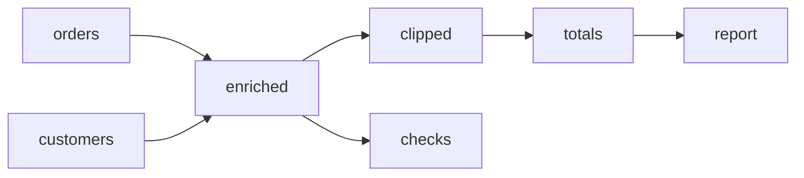

<!--
  Licensed to the Apache Software Foundation (ASF) under one
  or more contributor license agreements. See the NOTICE file
  distributed with this work for additional information
  regarding copyright ownership. The ASF licenses this file
  to you under the Apache License, Version 2.0 (the
  "License"); you may not use this file except in compliance
  with the License. You may obtain a copy of the License at

    http://www.apache.org/licenses/LICENSE-2.0

  Unless required by applicable law or agreed to in writing,
  software distributed under the License is distributed on an
  "AS IS" BASIS, WITHOUT WARRANTIES OR CONDITIONS OF ANY
  KIND, either express or implied. See the License for the
  specific language governing permissions and limitations
  under the License.
-->

# Native dataflow statements and registered Python functions

Design decision, 2026-10-08. Implementation and measured rollout remain pending.

Native mode will keep one `dataflow(reasoning, actions)` tool. An edit contains
two strings: `changes` for graph statements and `python` for an ordinary Python
module. Graph statements use `set id: operator(inputs=[...], key=value, ...)`
and `delete id`. Python functions are registered by name and selected through
`fn`; their named settings can be overridden in the operator statement.

This contract replaces the coupling between graph statements and indented
Python functions. It retains the existing operator catalog, explicit execution,
result retrieval, and versioned results. The prompt will contain a compact
contract, short catalog signatures, and one complete worked batch. Detailed
operator documentation and additional examples are available on demand.

This file records the proposed contract and exact prompt content. It does not
change the running service or reinterpret recorded benchmark attempts.
The [standalone proposed system prompt](native-registered-python-system-prompt.txt)
assembles the default data-statistics variant with its complete example, for
direct review. Flow guidance remains a conditional addition.

## 1. Decisions to freeze

| Area | Contract |
| --- | --- |
| Tool | One `dataflow` tool with a brief `reasoning` string and ordered `actions`. |
| Graph edits | `set id: operator(inputs=[...], ...)` creates or replaces a complete definition; `delete id` removes one operator. |
| Connections | Ordered `inputs` define incoming edges. There are no edge insertion or deletion commands. |
| Python | `edit.python` is a complete ordinary module. Graph statements contain no Python function bodies. |
| Function selection | `fn=name` selects a registered, named, top-level synchronous function. |
| Configuration | Direct literal keywords override function settings. `params={...}` handles names that collide with graph controls or are not identifiers. |
| Function lifetime | Registrations persist in the workflow/session. Each operator pins the exact module version, function entry, and supplied settings when it is set. |
| Edit transaction | Module registration and all graph statements in one edit commit together or roll back together. |
| Graph validity | Validate the final graph after the whole edit. Retained operators must have their required connections. |
| Execution | Only `execute` computes results. `retrieve` reads current materialized results. |
| Answer | Preserve the existing expression answer contracts. Teach retrieval and verification before answering. |
| Prompt | One syntax, one compact default example, generated signatures, and references selected on demand. |

Do not advertise the older assignment, `del`, create/update, explicit-edge,
indented-function, or typed-JSON operator syntax in a session using this
contract. Historical sessions keep their recorded protocol and revision.
Store a protocol identifier with new sessions and snapshots; this is an
internal compatibility boundary, not a revival of retired catalog settings.

## 2. Tool and action contract

The model-facing envelope remains JSON. Expression statements and Python are
string values within that envelope. They are separate parsers and namespaces.

The new edit shape is:

```json
{
  "type": "edit",
  "python": "def plus(table, *, opt1=1, opt2=2):\n    return table.assign(value=table['value'] + opt1 + opt2)\n",
  "changes": "set adjusted: process(inputs=[raw], fn=plus, opt1=10)"
}
```

`raw` is an existing operator in this illustration. Both strings are present
in the provider schema, and an unused string is `""`. This gives strict
providers one edit shape without duplicating schema branches. Reject an edit
when both strings are empty. A nonempty `python` with empty `changes` registers
functions without changing the graph; a nonempty `changes` with empty `python`
uses existing registrations and built-in operators.

No JSON schema or Vercel tool definition is generated for individual registered
functions. The static tool schema describes the action envelope; local
validation checks statements, operator contracts, and Python argument binding.
Provider tool definitions contribute to model input even though they are sent
separately from the system-message text. Track both components.

| Action | Behavior |
| --- | --- |
| `inspect`, `target="graph"` | Read graph definitions and current status. |
| `inspect`, `target="operator"` | Read one definition; `include_implementation` requests its pinned Python source. |
| `inspect`, `target="reference"` | Read selected operator contracts or an enabled example. No computation or workflow mutation. |
| `edit` | Validate and atomically register modules and apply graph statements. Never execute authored Python or compute tables. |
| `execute`, optional `operator_ids` | Compute selected operators and their ancestors; reuse valid cached results. Omitted IDs select the whole graph. |
| `retrieve`, `operator_id`, `view`, optional `columns` | Read a current result in an enabled view. Never execute. |
| `answer`, `content` | Finish with prose or an answer shape composed by the model. Must be the sole action in its call. |
| `answer`, `from` | Finish using the existing table projection and precision syntax. Must be the final action in its call. |

Actions run in order. An edit is atomic; an entire call containing several
edits and executions is not one transaction. Earlier successful edits remain
committed when a later action fails. A returned observation cannot change
arguments already submitted in that call; observation-dependent decisions
belong in the next call.

Keep the expression executor's existing exception for inspection and retrieval
of independent completed results after an execution failure. A requested failed
or blocked result receives its upstream cause and no table. Improve diagnostic
attribution so that this read failure is counted separately from its underlying
execution failure. All later writes, executions, and answers are skipped after
an action failure.

The preferred model behavior is one call containing a batch. As a separate
runtime cleanup, generalize the existing ordered-call adapter to accept multiple
returned calls deterministically rather than rejecting an entire response by
call count. Preserve call boundaries, transaction boundaries, skipped receipts,
and answer termination. Do not deduplicate calls implicitly. Qualify this
behavior before enabling it, and report it as a separate experiment treatment.

## 3. Graph statement grammar

```text
set <operator_id>: <operator_name>(inputs=[<operator_id>, ...], <key>=<value>, ...)
delete <operator_id>
```

Statements begin at the margin. A constructor may span lines inside its
parentheses. Comments and blank lines are allowed. IDs use the existing ASCII
identifier rules and cannot be Python keywords. A command is parsed as a graph
statement; it is never executed as Python.

`inputs` is required, including `inputs=[]` for sources. Its entries are bare
graph IDs. Their order identifies ports: a join's first input is left and its
second input is right. Repeated IDs are valid, including a self-join with two
ports fed by one source. A node cannot be its own upstream input.

Use keyword arguments for all remaining constructor parameters. Values use
Python literal spelling: `True`, `False`, and `None`. Column names are strings;
dtype names such as `float64` and catalog reducer/window calls remain catalog
expressions. Module constants and helpers do not evaluate graph parameters.

### 3.1 Complete replacement and connections

`set` creates a missing ID or replaces the existing operator's type, parameters,
function binding, and incoming connections. Omitted optional parameters reset
to documented defaults, including omitted function overrides. Existing outgoing
connections remain because their consumers define them. Restating an identical
resolved definition is a no-op.

An operator is written at most once in an edit. Reject repeated `set` or
`delete`, and a mixture of both for the same ID. Resolve forward references
against the final draft. Validate existence, input counts, parameters, function
binding, and cycles before committing any registry or graph mutation.

Deleting an operator removes its incident edges. If retained consumers still
need that source, reject the edit and identify the consumers. Rewire or delete
them in the same edit. There is no cascade deletion or inferred replacement.
This strengthens the current editable-draft behavior, which permits disconnected
consumers and rejects them only at execution. Keep old replay behavior intact.

For example, when `replacement` already exists:

```text
set totals: aggregate(inputs=[replacement], by=["region"], total=sum("amount"))
delete obsolete
```

This is valid when `totals` was the only consumer of `obsolete`. Intermediate
statement order does not matter; the final graph does.

### 3.2 Parameter names and the escape mapping

`inputs` and `params` are graph controls. For `filter`, `map`, and `process`,
`fn` and `doc` are also controls. Remaining direct keywords go to the built-in
operator or selected callback. The optional `params` mapping supplies additional
operator parameters after graph controls have been separated:

```text
set typed: cast(inputs=[raw], params={"Unit Price": float64, "inputs": str})
set counts: aggregate(inputs=[typed], params={"inputs": count()})
set custom: process(inputs=[typed], fn=compute, params={"fn": "setting-value"})
```

The first statement casts two columns. The second names its count output
`inputs`. The third forwards a Python setting named `fn` while keeping
`fn=compute` as the function selector.

Reject a parameter present both directly and in `params`. Mapping keys must
be constant strings. Callback setting values must be finite, faithfully
representable JSON-compatible literals; built-ins additionally accept their
documented dtype/reducer/window expressions. Never silently round unsafe
integers through JavaScript. Preserve exact supported values or report the
representation limit explicitly.

The escape resolves graph-control collisions. A built-in's own documented
option names still retain their catalog meaning: for example, aggregate `by`
selects grouping columns. Use a later `project` rename for an output that
collides with such a native option. No general expression evaluation, nested
operator calls, or Python `**` unpacking is needed in graph statements.

## 4. Python modules and function binding

### 4.1 Ordinary Python source

`python` accepts a complete module with imports, constants, helpers, classes,
and ordinary Python constructs. Selected callbacks are named, top-level
synchronous functions. Helpers may use lambdas and nested functions; graph
statements use named `fn` references so there is one callback registration path.

Each submission carries the imports and helpers its functions require. A new
module does not extend the runtime globals of older modules. A helper named
`sum` is an ordinary Python name inside that module; `sum("amount")` in an
aggregate statement remains the catalog reducer.

Parse with Python AST and compile without executing imports, decorators,
default expressions, annotations, or function bodies. Reject syntax errors,
duplicate exported function definitions, missing selected entries, and
asynchronous entries. Module initialization, callable checks, and actual
binding also run in the worker before invoking the selected function.

Python retains its normal scope rules. A function can reference a helper or
constant in its module. Table inputs arrive only as function arguments;
operator IDs do not become Python globals. Printed output is not a result
table; return diagnostics as table columns when they are needed.

### 4.2 Inputs and configuration

The call is exactly:

```python
selected_function(*ordered_input_values, **configuration_overrides)
```

For process, each input value is a DataFrame. Filter and map receive one row
mapping. A process with no graph inputs is a loader or another zero-input
computation, and it can still accept named settings.

Recommend required positional table arguments followed by keyword-only settings:

```python
def plus(table, *, opt1=1, opt2=2):
    ...

def compare(left, right, *, threshold=0.05):
    ...

def load(*, filename, sheet="Summary"):
    ...
```

Accept other normal Python signatures when the actual planned call binds,
including defaults, positional-only inputs, variadic inputs, and keyword-only
arguments supplied by settings. `def plus(table, opt1=1, opt2=2)` also accepts
one table and keyword overrides. Settings already occupied by positional
inputs normally cause a duplicate binding when supplied a second time. Follow
Python's actual binding rules: for `def f(table, /, **options)`, the keyword
`table="metadata"` legitimately enters `options` while the positional-only
`table` receives the input. Do not reject keys just by matching input names.

Build signature metadata from AST and check placeholder positional inputs plus
the supplied settings. Use a default-present sentinel rather than evaluating
default expressions. Runtime binding uses the callable after module
initialization, accounting for decorators and overwritten names. Do not infer
setting types by executing annotations or generate provider schemas from them.

Examples of precise edit errors:

```text
FUNCTION_NOT_FOUND: adjusted selects plus; available functions: normalize, keep.
FUNCTION_BINDING: plus got unknown setting optl; accepted settings: opt1, opt2.
FUNCTION_BINDING: plus parameter table is already supplied by input 0.
FUNCTION_BINDING: compare requires 2 positional inputs; this operator supplies 1.
GRAPH_INPUT: totals refers to missing operator parsed.
GRAPH_DELETE: orders is still required by totals at input 0; rewire or delete totals in this edit.
```

For `**kwargs`, unknown configuration keys are valid Python. Prefer explicit
named settings when typo detection is useful. Errors distinguish envelope,
statement, graph, module syntax, binding, module initialization, callback,
and table-output failures.

### 4.3 Output contracts and documentation

| Operator | Input | Output |
| --- | --- | --- |
| `filter` | One read-only row mapping; missing scalar values arrive as `None`. | `True` keeps the row; `False` or `None` drops it. Other values fail the contract. |
| `map` | One read-only row mapping. | One replacement dictionary per input row, with consistent keys and scalar values. `{**row, ...}` retains existing fields. |
| `process` | One DataFrame per graph input, in order. | One DataFrame with unique string column names, scalar cells, supported consistent column types, and finite numeric values or missing values. |

Preserve existing table and datetime policies for the initial syntax treatment.
Timezone-aware timestamps retain the engine's existing normalization. A civil
date or time without a justified timezone can be returned as explicit ISO text.
Changing automatic handling of naive datetimes is a separately recorded
runtime treatment, since the current JSON candidate and legacy expression arm
already differ on this behavior.

An optional operator `doc` overrides the selected function's docstring. Otherwise
use that docstring, then a generic operator description. Do not require an
extra prose string to make an otherwise valid callback executable. Function
registration and a docstring do not prove the transformation's correctness.

### 4.4 Registration versions and reproducibility

Store immutable modules by a hash of their authored source and protocol/runtime
identity. Registration publishes top-level function aliases to a module and
entry. Repeating identical source reuses its module record. Aliases persist
inside the workflow/session and are part of versioned state.

`set` resolves `fn=name` after that edit's registration and pins the entire
module, entry, and literal settings to the operator. Preserve imports, constants,
helpers, and default expressions together. Avoid dependency extraction by
matching function names in text.

Registering a replacement updates aliases for future `set` statements. Existing
operators and their cached results retain their pinned source. Explicitly
re-setting an operator adopts the current alias and invalidates that operator
and its descendants when semantics change. Registry-only registration does not
invalidate already pinned operators. Whole-module versioning is conservative:
a changed helper or unrelated definition changes the module version adopted by
newly bound operators.

Snapshots, checkout, persistence, import/export, and resume must preserve module
records and alias bindings. Restoring one historical operator restores its
pinned module without rewinding today's registry aliases. Clearing conversational
history while retaining a graph must also retain the definitions that graph uses.

Optional model-facing history uses the existing dedicated `fork` action to copy
a saved branch and its pinned bindings. Full checkout uses the existing session
API and restores graph plus registry together. Do not introduce the legacy
`at(...)` assignment syntax into the new `changes` grammar.

Shared source does not create shared mutable Python state. Execute each
operator's pinned module in its own worker execution namespace. Preserve parent
result immutability when passing DataFrames. Global variables are not durable
workflow state; pass tables through graph inputs.

## 5. Built-in operators

All fifteen existing catalog operators remain available. Their data semantics
and parameter names remain the source of truth; the new wrapper makes inputs
explicit and parameters keyword-based.

| Operator | Inputs | Common parameters and role |
| --- | --- | --- |
| `scan` | `[]` | `files`, `format`, `sheet`, `header`, `names`, `skip_lines`, `all_text`, `preview`. Read a source. |
| `project` | `[t]` | `keep`, `drop`, `rename`. Select and rename columns. |
| `cast` | `[t]` | `column=dtype`, `errors`; use `params` for unusual column names. Convert types. |
| `filter` | `[t]` | Registered `fn` and its settings. Select rows. |
| `map` | `[t]` | Registered `fn` and its settings. Replace each row. |
| `aggregate` | `[t]` | `by`, `output=reducer(...)`. Group and summarize. |
| `join` | `[left, right]` | `on`, `how`, `validate`, `nulls_equal`, `suffix`. Combine on explicit keys. |
| `union` | Two or more inputs | `schema="strict"` or `"align"`. Stack rows without deduplication. |
| `distinct` | `[t]` | `columns`, `keep`. Keep one whole row per key. |
| `sort` | `[t]` | `by`, `nulls`. Stable ordering. |
| `limit` | `[t]` | `n`, `offset`. Select a bounded ordered result. |
| `window` | `[t]` | `partition_by`, `order_by`, `output=window_function(...)`. Ordered calculations. |
| `unpivot` | `[t]` | `columns`, `name`, `value`. Wide to long. |
| `pivot` | `[t]` | `index`, `columns`, `values`. Long to wide. |
| `process` | Zero or more inputs | Registered `fn` and its settings. One operation outside the built-in vocabulary. |

Use built-ins for ordinary grouping, joining, ordering, and selection. A custom
process is appropriate for a specialized parser, statistical computation,
model fit, or another operation the catalog cannot express. Prefer row map or
filter for row-local transformations.

### 5.1 Join examples and checks

Preserving every left-side order while attaching a customer region:

```text
set enriched: join(inputs=[orders, customers], on="customer_id", how="left", validate="many_to_one")
```

Using different key names:

```text
set enriched: join(inputs=[orders, customers], on=[("customer_id", "id")], how="left", validate="many_to_one")
```

Selecting people by a composite membership key without multiplying rows:

```text
set eligible: join(inputs=[people, membership], on=["community", "name"], how="semi")
set missing: join(inputs=[people, membership], on=["community", "name"], how="anti")
```

The default join is inner with `validate="many_to_many"`; choose explicit
semantics where population or cardinality matters. Null keys do not match by
default. Inspect reported suffix renames when right-side columns collide.
Join output has no promised order; sort before top-k selection or ordered output.
Use a row-count, distinct-key, or unmatched-row check when a join's interpretation
remains uncertain. Do not build these checks for every simple join automatically.

### 5.2 Other built-in statements

```text
set cleaned: project(inputs=[raw], keep=["customer_id", "amount"], rename={"amount": "total"})
set numeric: cast(inputs=[cleaned], total=float64)
set grouped: aggregate(inputs=[numeric], by=["customer_id"], total=sum("total"), rows=count(), measured=count("total"))
set ranked: sort(inputs=[grouped], by=[("total", "desc"), "customer_id"])
set top: limit(inputs=[ranked], n=10)
set stacked: union(inputs=[january, february], schema="strict")
set previous: window(inputs=[daily], partition_by=["station"], order_by=["date"], previous=lag("value"), position=row_number())
```

`count()` counts rows, `count("column")` counts non-null measurements, and
`count_distinct("column")` counts distinct non-null values. These are different
questions. Numeric reducers require numeric columns. Catalog reducers remain
simple calls; put a conditional transformation in a named map/filter function
before aggregation.

Before publishing the generated index, reconcile advertised optional defaults
with normalizers. In the current catalog, `distinct(columns=None)` is advertised
but explicitly supplying `None` is rejected; omission already means all columns.
Add a regression and make explicit `None` match the advertised omission before
shipping this index. This is a compatibility fix, not a new data transformation.

## 6. Complete batched DAG example

This fictional request supplies the schemas of two small files: orders have
`customer_id` and numeric `amount`; customers have unique `customer_id` and
`region`. It asks to clip order amounts at the fifth and ninety-fifth
percentiles across all orders, then return totals and order counts by region
in alphabetical order, with amounts rounded to two decimals.

The known schemas and requested rule allow the complete computation to be
submitted together. The example uses a custom process for a global quantile
transformation and built-ins for the join, grouping, and ordering.



### 6.1 Register and construct the DAG in one edit

The Python module is:

```python
import pandas as pd

def winsorize(table, *, column="amount", q=0.05):
    """Clip a numeric column at the q and 1-q quantiles."""
    if not 0 <= q < 0.5:
        raise ValueError("q must be between 0 and 0.5")
    result = table.copy()
    values = pd.to_numeric(result[column], errors="raise")
    result[column] = values.clip(values.quantile(q), values.quantile(1 - q))
    return result
```

The statements are:

```text
set orders: scan(inputs=[], files="data/orders.csv")
set customers: scan(inputs=[], files="data/customers.csv")
set enriched: join(inputs=[orders, customers], on="customer_id", how="left", validate="many_to_one")
set clipped: process(inputs=[enriched], fn=winsorize, column="amount", q=0.05)
set totals: aggregate(inputs=[clipped], by=["region"], total=sum("amount"), n=count())
set report: sort(inputs=[totals], by=["region"])
set checks: aggregate(inputs=[enriched], rows=count(), customers=count_distinct("customer_id"), measured=count("amount"))
```

The actual tool arguments, including execution and retrieval, are valid JSON:

```json
{
  "reasoning": "Clip the requested amounts, total them by region, and check the joined population.",
  "actions": [
    {
      "type": "edit",
      "python": "import pandas as pd\n\ndef winsorize(table, *, column='amount', q=0.05):\n    \"\"\"Clip a numeric column at the q and 1-q quantiles.\"\"\"\n    if not 0 <= q < 0.5:\n        raise ValueError('q must be between 0 and 0.5')\n    result = table.copy()\n    values = pd.to_numeric(result[column], errors='raise')\n    result[column] = values.clip(values.quantile(q), values.quantile(1 - q))\n    return result\n",
      "changes": "set orders: scan(inputs=[], files='data/orders.csv')\nset customers: scan(inputs=[], files='data/customers.csv')\nset enriched: join(inputs=[orders, customers], on='customer_id', how='left', validate='many_to_one')\nset clipped: process(inputs=[enriched], fn=winsorize, column='amount', q=0.05)\nset totals: aggregate(inputs=[clipped], by=['region'], total=sum('amount'), n=count())\nset report: sort(inputs=[totals], by=['region'])\nset checks: aggregate(inputs=[enriched], rows=count(), customers=count_distinct('customer_id'), measured=count('amount'))"
    },
    { "type": "execute", "operator_ids": ["report", "checks"] },
    { "type": "retrieve", "operator_id": "report", "view": "full" },
    { "type": "retrieve", "operator_id": "checks", "view": "full" }
  ]
}
```

The batch is seven graph operations in one atomic edit, followed by one scoped
execute and two result reads. It does not require seven model turns or seven
provider tool calls. Shared ancestors are eligible for reuse during execution.
This is an illustrative batch, not a replay result from a benchmark task.

### 6.2 Verify the returned evidence and answer

For illustrative amounts `[100, 200, 300, 400]` with alternating east/west
regions, the quantiles are 115 and 385. The expected report and check values are:

| region | total | n |
| --- | ---: | ---: |
| east | 415 | 2 |
| west | 585 | 2 |

| rows | customers | measured |
| ---: | ---: | ---: |
| 4 | 4 | 4 |

Check that execution succeeded, both retrieved tables are current and complete,
the left join retained four orders, grouping uses the intended region, and the
transformation matches the requested global quantiles. Completeness describes
what was computed; it does not prove the population or formula was correct.
The target schemas and row counts in real runs come from their actual receipts.

After checking the observations, finish in a separate call:

```json
{
  "reasoning": "The complete report and population check support the requested totals.",
  "actions": [
    { "type": "answer", "from": "report[region,total:2,n]" }
  ]
}
```

Preserve the existing answer serializer: several rows of a multi-column table
are wrapped under the table ID, so this form produces `{"report": [...]}`.
Use `answer.content` for a different required envelope or explanatory prose.
`:2` is appropriate because the request specifies two decimals; use `:full`
to retain computed precision when the request does not ask for rounding.

## 7. Additional representative examples

These examples belong in the design and on-demand reference. The default prompt
includes the single complete example in section 6, rather than all examples.

### 7.1 Imports, constants, helpers, and settings

This parser assumes the already verified source table contains a `Reading`
column. It demonstrates the layouts rejected in the historical DeepSeek traces.

```python
import re
import pandas as pd

KWH = re.compile(r"([0-9]+(?:\.[0-9]+)?)\s*kwh", re.I)

def parse_kwh(value):
    match = KWH.search(str(value))
    return float(match.group(1)) if match else None

def parse_readings(table, *, column="Reading", scale=1.0):
    """Extract numeric kWh readings and apply the requested unit scale."""
    values = table[column].map(parse_kwh)
    return pd.DataFrame({"energy": values * scale})
```

Register that module once and use its defaults or overrides:

```text
set parsed: process(inputs=[raw], fn=parse_readings)
set mwh: process(inputs=[raw], fn=parse_readings, column="Reading", scale=0.001)
set summary: aggregate(inputs=[mwh], mean_energy=mean("energy"), measured=count("energy"), rows=count())
```

Execute `summary`, then retrieve it. If the source really uses `Usage text`
instead of `Reading`, an observed column error is repaired by inspecting the
actual schema and submitting a new edit with `python=""`:

```text
set mwh: process(inputs=[raw], fn=parse_readings, column="Usage text", scale=0.001)
```

Then execute `summary` and retrieve its new result. The unchanged function is
reused, the changed settings are recorded, and the prior summary is stale.
Since `set` replaces the whole definition, include every override to retain.
Changing only `column` while omitting `scale` resets scale to its default.

### 7.2 Row callbacks and composite eligibility

```python
ELIGIBLE = {"adult", "senior"}

def keep_group(row, *, column="category"):
    """Keep rows in the declared eligible categories."""
    return row[column] in ELIGIBLE

def add_unit_price(row, *, amount="amount", quantity="quantity"):
    """Add unit_price while preserving the existing row fields."""
    count = row[quantity]
    price = None if count in (None, 0) or row[amount] is None else row[amount] / count
    return {**row, "unit_price": price}
```

```text
set eligible: filter(inputs=[orders], fn=keep_group, column="category")
set priced: map(inputs=[eligible], fn=add_unit_price)
set included: join(inputs=[priced, membership], on=["community", "name"], how="semi")
set total: aggregate(inputs=[included], n=count(), entities=count_distinct("entity_id"))
```

The constant belongs to the Python module. A graph-level `ELIGIBLE = ...`
assignment is invalid. A semi join uses the full membership key and preserves
matching left rows once, avoiding name-only eligibility and multiplication.
Inspect or compute the row/entity counts needed by the actual question.

### 7.3 Zero and multiple table inputs

A custom loader can extract a non-tabular spreadsheet layout:

```python
import pandas as pd
from openpyxl import load_workbook

def load_summary(*, filename, sheet="Summary"):
    """Extract the labeled value from cells A2 and B2 of a verified sheet."""
    book = load_workbook(filename, read_only=True, data_only=True)
    try:
        page = book[sheet]
        return pd.DataFrame({"metric": [str(page["A2"].value)], "value": [page["B2"].value]})
    finally:
        book.close()
```

```text
set summary: process(inputs=[], fn=load_summary, filename="data/summary.xlsx", sheet="Summary")
```

Use the built-in scan for ordinary rectangular worksheets. Verify sheet names,
cell meanings, and cached formula values before relying on this loader.

Two independent populations can feed one statistical operator:

```python
import pandas as pd
from scipy.stats import ttest_ind

def compare(left, right, *, column="value", alternative="two-sided"):
    """Run Welch's t-test on two specified independent populations."""
    a = pd.to_numeric(left[column], errors="raise").dropna()
    b = pd.to_numeric(right[column], errors="raise").dropna()
    result = ttest_ind(a, b, equal_var=False, alternative=alternative)
    return pd.DataFrame({"t": [float(result.statistic)], "p": [float(result.pvalue)],
                         "n_left": [len(a)], "n_right": [len(b)]})
```

```text
set comparison: process(inputs=[treatment, control], fn=compare, column="response", alternative="greater")
```

Each example requires its imported package in the worker environment. The test
and direction must be justified by the request. Row alignment is irrelevant to
this independent-population test; use a keyed built-in join when correspondence
between observations matters. Execute and retrieve the result before answering.

### 7.4 Uncertain sources require an observation boundary

When a file's header or sheet layout is unknown, batch a preview execution and
retrieval first. Decide on parsing in the next call:

```json
{
  "reasoning": "Inspect the raw worksheet layout before choosing a reader configuration.",
  "actions": [
    { "type": "edit", "python": "", "changes": "set preview: scan(inputs=[], files='data/readings.xlsx', sheet='Usage', preview=8)" },
    { "type": "execute", "operator_ids": ["preview"] },
    { "type": "retrieve", "operator_id": "preview", "view": "full" }
  ]
}
```

`sheet="Usage"` is justified only when supplied by the request or source metadata.
A complete preview contains all preview rows, not all source rows. After
observing the layout, set a full scan with justified `header`, `skip_lines`, and
column options, omitting `preview`. Do not guess a different worksheet merely
because the displayed first sheet does not contain the desired values.

## 8. Exact proposed default system prompt

The production renderer assembles the following core text, the example call
from section 6.1, and its separate verified-answer call from section 6.2.
The examples retain the request's short schema description so that direct
computation is justified. The common catalog index is generated from the same
operator metadata used by validation; the text below specifies its target form.

This concrete rendering assumes a single task, DELTA context, no optional
history tools or flow evidence, and enabled `sample_stats` and `full` views.
Render actual enabled views, context mode, and features from session settings.
Never advertise unavailable actions or views. No numeric retrieval caps are
hardcoded in this prompt. Append the data-statistics paragraph in section 8.3
for this rendering, and the flow paragraph only when flow exposure is enabled.

```text
You answer data-analysis requests by building, executing, and checking a directed graph of table-producing operators. Match the requested population, unit of analysis, eligibility, keys, formula, units, ordering, precision, and answer format. Use supplied schemas directly; resolve uncertain files, sheets, headers, or columns with a focused observation.

Use dataflow(reasoning, actions), with one brief objective and an ordered JSON action list. Batch operations whose arguments are known in one call. A decision that needs a returned observation belongs in the next call. Earlier observations describe their own graph versions; later edits may make their results stale.

Actions:
inspect reads graph/operator state or selected reference documentation; it never executes.
edit takes python and changes strings; use an empty string when either is unused. It registers Python and edits the graph atomically, without executing.
execute computes operator_ids and their ancestors, reusing valid cached results; omit IDs to run the whole graph.
retrieve reads one current result using an enabled view and optional columns; it never executes.
answer finishes the task. After checking results, use content for prose or a requested envelope, or from for a table projection. A content answer is its call's sole action; a from answer is the final action.

Graph statements in changes:
set id: operator(inputs=[upstream_ids], key=value, ...)
delete id
Each statement starts at the margin; calls may span lines inside parentheses. Use bare operator IDs in ordered inputs, including [] for sources. For join, input 0 is left and input 1 is right. A set creates or replaces the entire definition and its incoming edges; omitted options reset to defaults and consumers remain. Use one statement per ID. References resolve after the entire edit. No nested operator calls, self-inputs, or cycles. Deletion removes incident edges; rewire or delete affected consumers in the same edit. Invalid edits apply nothing.

Use Python literals in parameters, quoted column names, and unquoted dtype names. params={...} supplies parameters with unusual names or names colliding with graph controls; a parameter cannot be supplied twice. Built-ins retain their documented parameter contracts.

Python belongs in python as a complete ordinary module: imports, constants, helpers, and named synchronous functions. fn=name selects a registered function. For process/filter/map, inputs, params, fn, and doc control the operator; other literal keywords are function settings. Inputs bind positionally and settings by keyword, with Python defaults for omitted settings. Prefer keyword-only settings after *. Each set pins the selected source version; later registration affects future sets. Resend Python only when defining or changing a module. Each operator has its own execution namespace. A function docstring supplies its description; doc is an optional override.

filter calls fn(row, **settings): True keeps a row; False or None drops it. Missing row values are None.
map calls fn(row, **settings) and returns the entire replacement row dictionary; {**row, ...} retains fields. Return consistent keys and scalar cells.
process calls fn(*input_dataframes, **settings) and returns one DataFrame; [] supports loaders. Return unique string columns, scalar cells, consistent supported column types, and finite numbers or missing values. Use justified timezones for timestamps and explicit ISO text for civil dates without a timezone. Return useful diagnostics as columns. Prefer built-ins for ordinary joins, grouping, selection, and ordering.

Operator index; optional keyword arguments may be omitted:
scan(inputs=[], files=..., format="auto", sheet=None, header=True, names=None, skip_lines=0, all_text=False, preview=None)
project(inputs=[t], keep=None, drop=None, rename=None)
cast(inputs=[t], column=dtype, ..., errors="raise")
filter(inputs=[t], fn=name, ...settings)
map(inputs=[t], fn=name, ...settings)
aggregate(inputs=[t], by=[], output=reducer(...), ...)
join(inputs=[left,right], on=None, how="inner", validate="many_to_many", nulls_equal=False, suffix="_right")
union(inputs=[a,b,...], schema="strict")
distinct(inputs=[t], columns=None, keep="first")
sort(inputs=[t], by=[...], nulls="last")
limit(inputs=[t], n=..., offset=0)
window(inputs=[t], partition_by=[], order_by=[...], output=window_function(...), ...)
unpivot(inputs=[t], columns=[...], name="variable", value="value")
pivot(inputs=[t], index=[...], columns="...", values="...")
process(inputs=[...], fn=name, ...settings)
Reducers: count(), count("col"), count_distinct, sum, mean, min, max, median, stddev, first. count() counts rows; count(col) counts non-null values. Other reducers take a column name. Window functions: lag, lead, row_number(), rank(), dense_rank(). Dtypes: str, int64, float64, bool, datetime.

Choose join keys and cardinality that preserve the intended population. Inner joins can drop rows; nonunique keys can multiply them. Composite keys may be necessary. semi/anti select matching/unmatched left rows once. Null keys do not match by default. Sort before top-k or ordered output. Resolve numeric text before numeric reductions.

Inspect target="reference", topic="operators", operator_names=[...] for needed options and detailed semantics. Reuse reference material already in context. Built-in names are constructors inside edit changes, not action types.

Read results with sample_stats or full. sample_stats shows a bounded sample and available data statistics; full is bounded too. Check coverage and clipping. A sample is a subset, not the full population or a random sample. A scan preview is only a source preview; reload without preview for computation. Compute counts, searches, rankings, and summaries over the intended data in the graph, then retrieve the small result. Successful execution and complete display do not prove the selected population or formula is correct.

If execution fails, repair its reported cause and re-execute the affected ancestry before retrieving that target. Independent completed results can still be read. Preserve calculations at full precision and round only final presentation as requested. After focused checks resolve material uncertainty, finish. For tabular answers, from="report[region,total:2,n]" selects columns and rounds total to two decimals; :full retains computed precision. Use content when the required answer shape differs from the table serializer.
```

### 8.1 Feature paragraphs

Keep optional features as small generated additions rather than a second prompt:

| Feature | Addition |
| --- | --- |
| LATEST context | Replace the context-version sentence with a statement that current definitions/results are shown and older execution receipts may be collapsed. |
| `sample_stats` enabled | Add that this view includes available data statistics with their stated coverage; samples/statistics describe the computed selection. |
| Flow evidence enabled | Describe its scope/coverage and the distinction between measured metadata and the correctness of custom selection. |
| History enabled | Add the enabled task inspection/fork rules and pinned function-version behavior; full session checkout restores graph and registry together. |
| Alternative record layout | Explain the actual table/record notation briefly only when needed to interpret records. |

Do not copy implementation details, full telemetry definitions, optional-tool
documentation, or provider-specific strictness behavior into the common core.
The operator reference contains all reader enums and rare options. The core
shows common scan parameters without suggesting unsupported `format` strings.

### 8.2 Initial prompt budget and references

Target at most 9,000 UTF-8 bytes for the core plus the one worked example and
answer example, excluding the license comment. Allow up to 1,400 additional
bytes for both conditional evidence paragraphs together. This is a design
gate, not a measured token claim. Count the actual provider tool payload separately and
require combined setup tokens to be no higher than the recorded expression
control with matching evidence settings on each evaluated model. Record any
required exception before running. Serialize tool examples compactly from their
fixtures; the readable JSON formatting in this document is not a required
prompt cost.

The assembled review prompt is 8,977 UTF-8 bytes with data guidance, and 9,583
with the flow paragraph also appended. These counts include the example prose
and compact JSON. They are not provider token counts and exclude the separate
tool payload. The combined setup-token gate remains an implementation/pilot
measurement.

Detailed examples use the existing reference action; extend its example names
only where needed. Use a closed selection such as `single`, `python`, `repair`,
and enabled `statistics`/`history`. Every reference example is generated from
structured fixture data and adapted to the enabled views. Do not return the
whole catalog for a one-operator lookup.

### 8.3 Using data statistics and flow statistics when available

Data evidence and flow evidence answer different questions. Data evidence
describes values in a profiled output table. Flow evidence describes the
operation and measured input/output relationships that produced it. Use either
when available; enable the two short paragraphs independently.

Derive data guidance from the actual view enum, not just the legacy
`dataEvidence` boolean. In the current implementation,
`availableRetrievalViews()` defaults to `sample_stats` and `full`, and choosing
`sample_stats` requests data evidence. Explicit `retrievalViews` can remove it.
Flow exposure independently follows `flowEvidence`, including operation lines
on execute receipts and selected producing ancestors on retrieval. An enabled
view or channel does not guarantee a valid profile or every possible fact.

| Available exposure | Model behavior | Prompt addition |
| --- | --- | --- |
| Neither | Use schemas and records; compute a focused check only when needed. | Core only; advertise the actual non-statistics views. |
| Data only | Use `sample_stats` for relevant types, missingness, value sets, and ranges; inspect coverage before relying on a fact. | Data paragraph. |
| Flow only | Use operation counters to assess matching, retention, conversion, and denominators. Retrieve records in an enabled view. | Flow paragraph. |
| Both | Use data profiles for value quality and flow counters for transformation effects. Avoid recomputing facts those measurements already establish. | Both paragraphs. |

Flow-only can contain numerical statistics such as join matches or reducer
denominators. Data-only can use DAG-aware relevance to choose column profiles.
The two arms differ in exposed evidence families, not in whether all numerical
information or graph knowledge exists.

Append this exact paragraph when `sample_stats` is available:

```text
Data statistics: sample_stats adds available column profiles independently of displayed rows. Check full/partial row and column coverage. Use types, null counts, distinct values, and ranges to settle relevant questions; a prefix profile describes only its covered rows. all lists values within that profile; top is not exhaustive. Omitted facts are unknown. Column profiles do not establish row associations or order, and rounded summaries are not exact answers. Compute required exact quantities in the graph. Complete small records may suppress redundant profiles. Reuse evidence that already resolves the check.
```

Append this exact paragraph when flow evidence is enabled:

```text
Flow statistics: available lines describe source parsing, conversions, filter retention, join matching/duplication, grouping denominators, and other operation effects. Distinguish contract statements from measured counts and read their scope. Investigate unexpected changes relevant to the request; intended exclusions may be correct. Examples are bounded, and absent lines mean unknown. Producing-ancestor evidence can be trimmed or stop at process; custom internals are opaque. Return or compute focused diagnostics when needed. Counts and successful execution do not certify the population or formula.
```

Both together remain under the additional 1,400-byte budget. They replace the
longer data/flow fragments; do not append both old and new explanations.

The observation renderer keeps three separate budgets: records/schema, data
evidence, and flow evidence. Statistics do not displace rows. A complete small
table can suppress redundant data profiles. Raw-line previews have no meaningful
column profiles until parsed. Missing, invalid, budget-omitted, and redundant
facts have distinct reasons. Reuse version-bound evidence; a cached result
without proven producing inputs must not inherit today's flow relationship.

Collection policy remains separate from exposure. `nativeProfileCollection`
and `nativeProfileScope` are compiled into operators and must be fixed before
workflow construction. Prefix/full profile coverage, collection overhead, and
bounded distinct dictionaries are recorded, not guessed from the view name.
Changing views reads retained results and evidence without executing or making
another provider call.

#### A focused statistics example

Suppose the request asks for mean order amount by region, and the model needs
to verify measurement completeness and customer matching. After a successful
scoped execute, when `sample_stats` is available:

```json
{
  "reasoning": "Check amount coverage and customer matching before calculating the regional means.",
  "actions": [
    { "type": "retrieve", "operator_id": "enriched", "view": "sample_stats", "columns": ["customer_id", "region", "amount"] }
  ]
}
```

Consider these illustrative measured facts, rather than a literal runtime
receipt format:

| Available fact | Valid conclusion and next step |
| --- | --- |
| Full amount profile over 1,000 rows: 50 nulls and numeric non-null values. | There are 950 measured amounts in this table. Follow the request's missing-value policy; compute the mean exactly in the graph. |
| Partial amount profile over 200 of 1,000 rows: 10 nulls. | Ten profiled values are null. Full-table missingness remains unknown; compute a full count if it affects the answer. |
| Full single-column customer-key distinct count equals its non-null count. | That key is unique among the covered non-null rows; composite-key uniqueness still requires the composite relation. |
| Left join: 990 of 1,000 left rows matched, 10 unmatched, output 1,000. | Left rows were preserved but 10 have no lookup match. Decide how those rows belong in the requested region analysis. |
| Join multiplicity or output count exceeds the intended grain. | Inspect the key definitions or enforce the appropriate cardinality. Do not automatically deduplicate. |
| Flow aggregate denominator is 950 while input rows are 1,000. | The reducer used non-null measurements. A row count and a measurement count answer different questions. |

When full profiles and flow counters already settle the relevant checks, the
next call can compute and retrieve the answer without an extra diagnostic
branch:

```json
{
  "reasoning": "Compute the requested regional means over valid amounts, retaining denominator counts.",
  "actions": [
    { "type": "edit", "python": "", "changes": "set means: aggregate(inputs=[enriched], by=['region'], average=mean('amount'), rows=count(), measured=count('amount'))" },
    { "type": "execute", "operator_ids": ["means"] },
    { "type": "retrieve", "operator_id": "means", "view": "full" }
  ]
}
```

This computation is appropriate after the request's handling of unmatched
regions and missing amounts has been established. A data-only arm can establish
value quality but still needs a focused computation if join provenance is
unresolved. A flow-only arm can establish operational matching/denominators
but may need records or a computation for unknown value quality. With neither,
use targeted aggregates, casts, or anti joins to resolve the needed checks.

The profiler does not supply exact quantiles, correlations, histograms, or
within-row associations. In the winsorization example, calculate the fifth and
ninety-fifth quantiles from the input DataFrame; a reported range is not a
substitute. The generic process boundary can report input/output shape, output
profiles, and the function description, but cannot prove what the custom code
selected or changed internally. If those internals need verification, return a
small diagnostic result in a separately justified process or compare focused
before/after quantities; do not create one diagnostic row per input by default.

Add coverage/version tests for all four exposure combinations: enabled view
with unavailable profiles, partial profile plus full measured flow counters,
complete records suppressing data profiles, independent evidence budgets,
stale producing versions, omitted witnesses, and opaque custom stages. Hold
collection and exposure fixed in the primary syntax/prompt comparison. Evaluate
the four evidence policies separately after qualification so that statistics
benefits are not attributed to syntax changes.

## 9. What trace evidence says to keep and trim

Counts below retain their original units and cohorts. Categories overlap;
do not add them into a single failure total. The original campaign and fresh
36-attempt format pilot are separate experiments.

| Decision | Content | Evidence and consequence |
| --- | --- | --- |
| Replace | Indented functions, imports inside functions, repeated Python beneath every operator. | Original campaign: 18 of DeepSeek's 23 failed edit actions received the house-indentation error, across 30 native attempts. Seventeen attached imports before a function; one placed a function before its operator. All 18 extracted modules pass compile-only parsing when separated. This establishes layout coverage, not 18 recovered answers. |
| Replace | Exact positional-arity bans on defaults and variadic arguments. | Three original Sonnet tool receipts hit signature restrictions. Check actual call binding; do not forbid ordinary signatures through prompt prose. |
| Remove | Required extra `doc` prose and repeated implementation summaries. | Derive documentation from the function docstring. Built-ins have different keyword semantics: aggregate `doc="..."` is interpreted as an invalid reducer output, not callback metadata. |
| Keep compact | Legal actions and the distinction between constructors and actions. | Original Qwen traces contained 48 unsupported `scan` action entries concentrated in two biomedical attempts. A constructor belongs in `changes`. |
| Keep compact | Explicit inputs, separate statements, and no nested operator calls. | DeepSeek's other failed edits included nested constructors, an unsupported reducer expression, a graph constant, and genuine syntax errors. Registration does not repair these graph statements automatically. |
| Keep with an example | Batch known operations; defer observation-dependent choices. | Batching was already instructed. A fresh Qwen task still used eight standalone set/read pairs. A complete batch demonstrates the boundary better than repeated slogans. |
| Keep | Repair execution before retrieving the failed target. | Of 26 original missing/unrun-result receipts, 24 followed failed execution in the same batch. These are usually consequences of upstream errors, not evidence that execute was forgotten. |
| Keep | Verify population, entity grain, composite keys, join cardinality, and formulas. | Selected original environment traces differed between name-only and community-plus-name eligibility, including 267 versus 268 counts. Successful execution did not resolve these semantic differences. |
| Keep | Source/header/sheet discovery and preview coverage. | Reader-option errors and worksheet guesses occurred in both campaigns. A complete preview cannot establish the full population or justify another worksheet's existence. |
| Keep compact | Valid table outputs, actual column names, and result completeness. | Callback, mixed-value, and duplicate/nonstring-column failures survive removal of parser restrictions. |
| Separate treatment | Automatic handling of naive datetimes. | Original DeepSeek had six affected execute failures; the candidate JSON runtime already uses a different calendar policy. Record date handling separately from syntax. |
| Move to references | Full catalog prose, rare reader modes, every join variant, and renderer internals. | Retain common signatures and critical defaults. Return detailed contracts only when requested. |
| Enforce in code | Precise schema/binding diagnostics and ordered response execution. | The fresh pilot had 19 schema-invalid calls among 243 captured returned calls and no captured JSON-syntax failures. Wrong union-branch diagnostics caused repair loops. |

The historical multiple-call evidence is also specific: Qwen had 49 responses
containing two calls each; DeepSeek had one response containing 35 calls.
These are not 133 separate multi-call model responses. The fresh format pilot
contained no multi-call response, so it does not qualify a new ordered-call path.

Registered Python targets repeated source and parser repair. It does not by
itself remove repeated system/tool setup, reduce model turns, or guarantee
better accuracy. Keep function source out of routine success receipts and avoid
expanding it once per operator in assembled context.

## 10. Refactor plan and implementation boundaries

Implement the contract in stages with one shared graph planner and runtime.
Do not translate registered modules back through the old graph program parser.

| Stage | Files and responsibility | Required gate |
| --- | --- | --- |
| 1. Protocol and parsing | `types/agent.ts`, `server.ts`, protocol selection in `texera-agent.ts`, `tools/dataflow-actions.ts`, `native/python/graph_parser.py`, `native/program.ts`, `native/codegen.ts`. Wire the protocol identity and edit strings; parse set/delete and explicit inputs; handle params before catalog normalization. Update API/client metadata types where exposed. | New grammar and envelope fixtures, duplicate/unknown/arity/cycle checks, and no mutations on failure. |
| 2. Module registration and binding | Extend `native/python/function_parser.py`; add a pure registry module and AST signature metadata. Update `native/catalog.ts` to resolve entries and settings. | Imports/constants/helpers preserved, no authored execution in preflight, correct default/keyword/variadic binding, precise errors. |
| 3. Atomic state and snapshots | `tools/graph-edits.ts`, `types/workflow.ts`, `workflow-state.ts`, `workflow-snapshot-storage.ts`, and restore/import paths in `texera-agent.ts`. Store versioned module records/aliases and pinned operator bindings. | Graph and registry rollback together; checkout/import/resume/replay and registry-only snapshots work; old snapshots stay readable. |
| 4. Execution and cache identity | `native/python/runtime.py`, `native/codegen.ts`, `native/result-versions.ts`. Invoke with kwargs, check actual runtime callable, and hash module/entry/settings into operator semantics. | Real worker execution without provider calls; changed settings invalidate descendants and preserve independent cache. |
| 5. Context and observations | Native context/snapshot rendering, `native/action-observations.ts`, `util/context-utils.ts`. Deduplicate authored modules by version and expose function signatures/bindings briefly. | Shared source appears once per assembled request, old/current versions stay distinct, errors keep original source locations. |
| 6. Prompt and references | `prompts.ts`, active `prompts/native-mode-single.md` and feature fragments, `scripts/render-native-reference.ts`, `native-mode/`, and active expression documentation. | Every fixture is accepted by the new parser; enabled-view examples match schema; generated references pass drift checks and setup-size gates. |
| 7. Metrics and harness | `benchmark/dsbench/native_integrity.ts`, metrics/run modules, experiment manifest and retrieval harness. Record protocol and UDF attribution using existing transport/resource ledgers. | Complete or explicitly unknown metrics, comparable boundaries, frozen source/config/runtime manifests. |

Use `rg` to locate actual workflow-state and context paths during implementation;
the table names responsibilities rather than authorizing a separate state store.

### 10.1 Current components to reuse

The local candidate `agent-service/src/agent/native/python/function_parser.py`
already parses and compiles source without executing it. This file is not part
of the documentation commit. Extend it to return
the module exports and signature metadata; keep it independent of graph grammar.
The existing [atomic graph planner](../agent-service/src/agent/tools/graph-edits.ts)
already resolves final graph references and detects cycles. Stage registry
changes beside its draft and commit both only after validation and cancellation/
current-head checks. The [revision hashing](../agent-service/src/agent/native/codegen.ts)
and result-version machinery already support source-dependent invalidation.

The current `functionSlot`/`functionClosure` path extracts definitions and can
discard ordinary module state. Replace it for the new protocol. Explicit inputs
must also bypass the old table-versus-function-name heuristic.

The runtime's current callable check only handles positional inputs and
rejects required keyword-only arguments even when supplied configuration could
satisfy them. The callback invoker currently forwards positional arguments only.
Both must change; accepting module syntax alone is insufficient.

Workflow serialization currently reconstructs known fields and has no registry.
Carry the registry through `get/set`, snapshots, checkout, imports, and saved
trace replay. Freeze registry-only snapshots even when the graph has no native
operators. Clearing history while retaining current operators must not discard
their registrations. These are state correctness requirements, not prompt rules.

### 10.2 Prompt ownership and cleanup

Keep one catalog metadata source for constructor names, arity, common signatures,
full contracts, and defaults. Generate the index and on-demand reference from
that source. Keep one action contract for schema and action descriptions.
Maintain example fixtures as structured data and serialize their tool arguments
with real newlines; avoid manually maintained copies of escaped Python.

Replace obsolete syntax throughout active single-task and history examples,
tool descriptions, rendering scripts, and documentation at rollout. Regenerate
`native-mode` using the existing reference script; never hand-edit its output.
Remove contradictory import/signature/doc requirements in the new protocol's
path. Keep historical implementation branches isolated only where required for
recorded runs and replay; do not present several syntax families to one model.

Runtime internals, generated engine Python, full registry payloads, and telemetry
schemas stay out of ordinary model observations. Privately persisted workflows
and traces retain complete source and provenance. Default context shows module
versions/signatures, operator references, settings, and available results. When
source is included, group it once by module version across operators and history.

### 10.3 Meaningful regression and integration cases

Write failing tests before implementation for:

1. The 18 historical rejected Python layouts, plus constants, helper order,
   multiline strings/comments, and a graph-level constant rejected with a fix.
2. Defaults, keyword-only settings, required settings supplied explicitly,
   positional-only inputs, zero/two inputs, varargs, duplicate binding, and
   unknown keys with and without `**kwargs`, including a legal positional-only
   input name also appearing inside `**kwargs`.
3. `params` collisions for a column/output called `inputs` and a setting called
   `fn`; reject duplicate direct/escaped parameters and unsafe literal values.
4. Registration-only followed by next-turn reuse; a failed graph, Python compile,
   cancellation, or head change leaves registry and graph unchanged.
5. Function v1 used by two operators; registration v2 leaves both unchanged;
   explicitly setting one adopts v2 and invalidates only its affected branch.
6. Checkout/import/export/resume preserve exact aliases and pinned sources;
   restoring one old operator does not replace today's global alias bindings.
7. Forward references, repeated source ports, valid rewiring/deletion, and
   rejection of a deletion that leaves consumers disconnected.
8. Preflight does not execute a module that raises or performs a side effect;
   execute reports initialization, binding, callback, and output errors distinctly.
9. One module reused by multiple operators and turns appears once per context
   request; include two source versions when both are actually needed.
10. One owned-stack integration with no LLM: register, set, execute, retrieve,
    retrieve cached data, change settings, re-execute, restore, and clean up.
11. All four data/flow exposure combinations produce matching prompt/view
    contracts; incomplete and unavailable profiles never become full-table
    claims, and process internals remain opaque.

Run focused tests, the required Bun tests/typecheck, and native reference drift
checks after implementation. Exercise all advertised examples through the real
parser, planner, and worker. A zero-provider integration gate comes before any
paid model pilot. This documentation change itself only needs example and link
validation.

## 11. Experimental plan and complete metrics

Keep the syntax stable during evaluation. Attribute outcomes to separate
treatments rather than repeatedly changing the grammar after each small pilot.

### 11.1 Staged comparisons

| Arm | Purpose |
| --- | --- |
| A. Frozen expression control | Its recorded grammar, prompt, runtime policies, and source revision. |
| B. Registered statements with complete migrated guidance | Qualify the new protocol while retaining equivalent analysis guidance. |
| C. Registered statements with section 8 compact prompt | Measure prompt trimming against B with the same parser/runtime/visibility. |
| D. Frozen JSON candidate, where useful | Contextual comparison with its recorded read/answer/calendar semantics; do not treat this as a syntax-only ablation. |
| Script and smolagents controls | Matched model/data/runtime-resource boundaries for the external accuracy/cost goal. |

A versus B is a bundled protocol, registration, binding, state, and context
migration, including the stricter deletion invariant. It is not a syntax-only
ablation. B versus C isolates prompt trimming with those mechanics held fixed.

First replay parser and graph fixtures offline. Then use a small, preregistered
matched pilot covering a built-in DAG, custom import/helper UDF, settings reuse,
zero/multiple inputs, joins with composite eligibility, unknown parsing, and
focused failure recovery. Include KramaBench and DSBench; use separate LongDS
tasks for multi-turn registration/version qualification.

Pair models, tasks, data, budgets, available views, evidence, prompt-cache
policy, provider strictness/parallel flags, timeouts, concurrency, and dependency
versions. Record declarations separately from actual observed enforcement. Use the exact recorded
routes for Sonnet, Qwen, DeepSeek, and any added model. Fix grading and pass
thresholds before execution; report binary passes, official scores, completed
runs, and unknowns separately. Use diagnostic tasks for mechanism coverage and
a fixed holdout for generalization. Preserve first attempts and preregister any
recovery rounds symmetrically. Full KramaBench campaign comparisons include the
same two recovery rounds before freezing each arm.

Report per-model totals and paired differences, including both-pass cost pairs
and accuracy flips. Do not extrapolate six-task results into a universal model
preference. Keep date-policy, answer-policy, and ordered-multicall experiments
separate from the B-versus-C prompt comparison.

### 11.2 Token and cost ledger

Every attempted provider request needs durable timing, status, route/model,
raw usage, normalized usage, and its cache-aware cost calculation:

- Total input, cache-read input, cache-write input where reported, and uncached
  input under the provider's documented accounting convention.
- Total output and reasoning output, noting whether reasoning is included in
  reported output; do not add overlapping categories.
- Cached output if a provider exposes it. Otherwise use `null` with an explicit
  unsupported/unreported reason, rather than manufacturing a cached-output zero.
- Provider-reported cost and a pricing-versioned estimate, with known subtotal
  and full totals only with complete coverage: estimates need all billable
  classes and applicable prices; provider totals need a reported charge for
  every attempted request. Complete token usage alone cannot establish either.

Do not subtract cache-write categories blindly across providers. A timed-out
request can still incur unknown provider usage; retain that unknown rather than
declaring a cheap completed run. Cached input remains input even when discounted.

Inventory system text, actual provider tool definitions, initial task, current
observations, earlier authored Python, new authored Python, and conversation
history per request. Character/UTF-8 byte attribution is exact; token attribution
requires the applicable tokenizer or provider usage and must be labeled as an
estimate when unavailable. Record model turns, returned calls, valid actions,
edit statements, `executeWorkflowAndPersist` helper invocations, cache hits,
registrations, binding reuse, and error stages as different units. Count backend
submissions/partitions or engine-history executions separately where observed;
a helper invocation is not proof of one independently counted backend execution.

### 11.3 Memory and timing comparison

Keep the harness's existing resource collector and record its measurement
method and scope. The primary local computation comparison includes the worker
and required execution services for dataflow, and the corresponding interpreter/
sandbox for script and smolagents. Record task-driver and gateway resources
separately. Report broad system totals only when the same components are in
scope for every arm. Remote provider CPU/memory is not observable local compute.

| Metric | Required meaning |
| --- | --- |
| CPU time | Report user CPU, system CPU, and collected total independently, with process-tree/cgroup scope and units. Cgroup v1 scheduler-runtime totals and tick-estimated user/system counters need not sum. CPU time is distinct from wall time. |
| Memory | Absolute kernel/cgroup charged peak in bytes, baseline bytes, and sampling/method metadata. Do not label charged memory RSS. Report peak RSS separately if collected. |
| Wall time | Monotonic task start/end, plus setup, solve, artifact capture, and cleanup phases. Include model wait in solve; record local execution intervals separately. |
| Execution scope | Required warm services, fresh worker boundaries, concurrency, cold/warm/cache policy, and shared-service treatment. |
| Completeness | Coverage status and reason for each unavailable measurement; aggregate known subtotals without presenting them as complete totals. |

Collect every run's full metrics while keeping the model's ordinary tool
observations compact. Full raw traces and ledgers are stored as artifacts,
not replayed into the prompt at each step.

### 11.4 Acceptance gates

The rollout requires passing parser/runtime/state qualification and a
non-regressing paired accuracy result under the preregistered criterion. The
compact prompt must satisfy its setup-size gate and reduce measured cost or
input exposure without trading away correctness. Report uncertainty when the
pilot is too small to establish that result; expand the fixed evaluation rather
than changing syntax to fit individual tasks.

The longer-term target remains accuracy above the script/smolagents comparator
at comparable token cost. Publish full denominators and resource boundaries so
that a token reduction, cache discount, missing usage, or excluded warm service
cannot be mistaken for that outcome.

## 12. Evidence and current implementation references

Active sources reviewed for this design:

- [Current expression contract](native-expression-mode.md).
- Local single-task template `agent-service/src/agent/prompts/native-mode-single.md`
  and analysis principles `agent-service/src/agent/prompts/single-task-principles.md`.
  Their implementation commits are outside the documentation review branch.
- [Tool schema and action handling](../agent-service/src/agent/tools/dataflow-actions.ts).
- [Operator catalog](../agent-service/src/agent/native/catalog.ts),
  and [Python runtime](../agent-service/src/agent/native/python/runtime.py).
- [Reference renderer](../agent-service/scripts/render-native-reference.ts).
- [Active retrieval selection](../agent-service/src/agent/native/retrieval.ts),
  [evidence renderer](../agent-service/src/agent/native/evidence.ts), and
  [flow lineage](../agent-service/src/agent/native/evidence-lineage.ts).

Local, uncommitted candidate artifacts also reviewed are
`agent-service/src/agent/native/python/function_parser.py`,
`benchmark/retrieval/results/20261008-native-json-format-pilot-v3.json`, and
`benchmark/retrieval/results/20261008-native-json-format-pilot-v3-summary.csv`.
These are outside the documentation commit. Links to tracked implementation
files show their committed versions; the design also records relevant behavior
of the local candidate.

Original retained trace evidence is rooted at
`/var/tmp/texera-single-task-final/campaign-matrix-v1/attempts/`.
Supporting audits under `/var/tmp/texera-single-task-final/` are
`private-format-contract-claims-audit-v2.json`,
`private-native-format-pilot-trace-summary-v3.json`,
`private-ds-input-replay-audit-v3.json`, and `model-behavior-audit-v1.json`.
These local audits are supporting artifacts, not replacements for official
benchmark grading or portable repository references.

Representative trace anchors include DeepSeek DS00000032 question 1's repeated
`import re` rejection beneath process, DS00000006 question 25's module-level
pandas import rejection, wildfire-hard-16 BobFlow step 4's preceding `chi2test`
definition, and Sonnet astronomy-hard-10's zero-input `load(*args)` rejection.
Their layout/signature mechanisms motivate registration and actual binding;
their downstream answers still require execution and semantic verification.

Documentation validation on 2026-10-08 parsed all six JSON examples, compiled
all seven Python blocks and embedded edit modules, checked illustrative graph
headers through AST translation, and resolved the relative links. A local
synthetic pandas calculation verified the example's regional totals of 415
and 585, population counts, argument binding, and unchanged parent data. The
standalone prompt matches the specified core, data paragraph, and example
fixtures. The new service parser and worker contract are still implementation
gates; these checks do not claim engine qualification or a measured model win.
